# Modern Quality Engineering

## The Comprehensive Guide to Quality Assurance in the 2026 Software Development Life Cycle

### Scope and audience

This manual treats quality engineering as an evidence-producing control system spanning requirements, architecture, code, build, deployment, operation, and governance. It is written for senior quality engineers, staff and principal engineers, test architects, SRE and platform partners, security and accessibility specialists, engineering managers, auditors, and graduate students.

### Evidence conventions

- **Normative** identifies a requirement in a cited standard or regulation.
- **Empirical** identifies an observed result in a cited study and is bounded by that study's design and population.
- **Consensus** identifies a vendor-neutral specification or broadly reviewed practitioner framework.
- **Engineering inference** identifies a reasoned synthesis in this manual; it is not attributed to a source as a discovered fact.

Source editions and publication years are explicit. Draft standards are labeled as drafts. A tool name illustrates an architecture and is not an endorsement.

### Research and editorial method

The domain was partitioned into nineteen non-overlapping research subjects by assurance object and lifecycle control point. Exactly one context-isolated GPT-5.6 Luna researcher at X-High inference investigated each subject. All researchers received the same source hierarchy and evidence criteria: peer-reviewed ACM/IEEE literature, formal ISO/IEC/IEEE and NIST publications, and university/SEI research first; consensus specifications and official architecture documentation second; marketing and unverified commentary excluded. Appendix D preserves the dispatch protocol and every subject boundary.

The chapter text is an editorial synthesis, not a concatenation of researcher prose. Claims are normalized into one vocabulary, cross-track dependencies are made explicit, and formulas state assumptions. Appendix E retains every research source and every verified short excerpt so readers can audit how primary evidence was interpreted. Publication year means the source's actual year, not “current as of 2026.” A cited standard establishes only what falls within that standard's scope and edition. Legal, regulatory, safety, and sector applicability require competent contextual review; this manual supplies engineering evidence architecture, not legal advice or certification.

### How to use this manual

Begin with Chapter 1 to define context, quality attributes, risks, and evidence claims. Select technique chapters by the uncertainty each can reduce, then use Chapters 17–19 to assign decisions, economics, data controls, independence, and capability. Appendix A supplies a reference control loop and cross-track interface matrix; Appendix B consolidates formulas and statistical selection rules; Appendix C supports capability assessment. Treat each maturity level as a diagnostic description, not a score or procurement checklist.

## Contents

### Part I — Foundations and testing theory

1. Quality theory, models, standards, and assurance evidence
2. Specification-based test design and behavioral modeling
3. Combinatorial, model-based, search-based, mutation, and adequacy methods

### Part II — Shift-left architecture and static verification

4. Static program analysis and formal verification
5. Executable specifications, contract tests, properties, and developer feedback

### Part III — Continuous testing and delivery pipelines

6. Hermetic test infrastructure and ephemeral environments
7. Test selection, prioritization, parallelism, and suite trust

### Part IV — Non-functional engineering

8. Performance, scalability, and capacity assurance
9. Reliability, resilience, chaos, and recovery assurance
10. Security assurance across the SDLC
11. Accessibility, usability, compatibility, and internationalization
12. Data quality, integrity, persistence, and migration assurance

### Part V — Shift-right and production quality

13. Observability-driven testing and field diagnosability
14. Progressive delivery, synthetic monitoring, traffic shadowing, and RUM

### Part VI — AI-native and autonomous quality systems

15. Evaluation and assurance of ML, LLM, and nondeterministic systems
16. Agentic-system testing and autonomous quality engineering

### Part VII — Departmental governance and economics

17. Risk, defects, quality metrics, reliability measures, and Cost of Quality
18. Test-data management, privacy, regulation, and audit evidence
19. QA operating model, leadership, capability maturity, and workforce

### Appendices

A. Enterprise control architecture and reference pipelines
B. Formula and statistical-method reference
C. Consolidated maturity matrix
D. Taxonomy and subagent dispatch record
E. Bibliography and quotation index

<!-- RESEARCH_MODULES_BEGIN -->

# Part I — Foundations and Testing Theory

## 1. Quality Theory, Models, Standards, and Assurance Evidence

### 1.1 Quality is a contextual claim

Software quality is the degree to which a product, service, process, or system satisfies stated and implied stakeholder needs under specified conditions. It is neither an intrinsic scalar nor a synonym for passing tests. The working distinctions are:

- **Quality attribute:** a stakeholder concern such as reliability, security, or maintainability.
- **Quality requirement:** an attribute made measurable for a defined context and population.
- **Quality assurance (QA):** planned governance and independent activity intended to create justified confidence in process and outcomes.
- **Quality control:** product-focused checking and disposition.
- **Verification:** evidence that an activity's output conforms to its specified input requirements.
- **Validation:** evidence that the product satisfies intended use and user needs.
- **Testing:** one verification/validation mechanism that examines a test item against an oracle.

IEEE 1012-2024 covers analysis, review, inspection, assessment, and testing across system, software, hardware, interfaces, documentation, maintenance, and reuse; reducing V&V to automated execution is therefore conceptually and normatively too narrow [FND01-7]. Passing tests support bounded claims under the tested conditions. They do not establish defect absence.

### 1.2 The 2026 product-quality model

ISO/IEC 25010:2023 defines nine product-quality characteristics [FND01-1]:

| Characteristic | Assurance question | Example measurable requirement |
|---|---|---|
| Functional suitability | Does the product provide correct, complete, appropriate functions? | Critical business rules produce independently calculated results for the accepted domain. |
| Performance efficiency | Are time and resource behavior acceptable under stated load? | p99 latency ≤ 400 ms at 2,000 requests/s under workload profile W. |
| Compatibility | Can the product coexist and exchange information correctly? | Version N and N−1 consumers preserve defined contract behavior. |
| Interaction capability | Can intended users learn, operate, and avoid errors? | Representative users complete task T within criterion C with declared accommodations. |
| Reliability | Does service remain correct and recover under faults and time? | Monthly availability ≥ 99.95%; recovery point and time objectives verified. |
| Security | Are confidentiality, integrity, authenticity, accountability, and resistance protected? | Unauthorized actor cannot read or modify protected record classes under threat model H. |
| Maintainability | Can change be diagnosed, analyzed, modified, and verified safely? | Change class X meets review, dependency, test-impact, and rollback evidence criteria. |
| Flexibility | Can the product adapt, scale, install, replace, and vary where intended? | Deployment topology changes preserve invariants across supported environment matrix E. |
| Safety | Is unreasonable risk of injury or harm controlled? | Hazard controls have verified requirements, independence, and residual-risk acceptance. |

The model supplies a shared taxonomy, not priorities, universal weights, or a complete metric catalogue. For every selected characteristic, specify the operating context, affected stakeholders, measurement unit, workload or population, threshold/target, method, uncertainty, acceptance rule, and owner. Keep the generic ISO term alongside a domain interpretation. A metric is evidence about a property, not the property itself.

Quality attributes interact. Encryption may increase latency; redundancy may increase complexity; aggressive caching may weaken freshness; accessibility adjustments may expose hidden interaction defects. Hard constraints for catastrophic security or safety outcomes must not be averaged away in a composite score.

### 1.3 Standards as a complementary system

The standards answer different questions:

| Reference | 2026 role | Editorial caution |
|---|---|---|
| ISO/IEC/IEEE 12207:2026 | Lifecycle process framework from acquisition through disposal [FND01-5] | Prescribes no lifecycle model or technique; engineering judgment remains necessary. |
| ISO/IEC 25010:2023 | Product-quality taxonomy [FND01-1] | Generic characteristics require domain operationalization. |
| ISO/IEC/IEEE 29119-1:2022 | Test concepts and common vocabulary [FND01-2] | Part 1 is informative; do not imply process conformance from vocabulary use. |
| ISO/IEC/IEEE 29119-2:2021 | Organizational, management, and dynamic test processes [FND01-3] | Tailor proportionately and record the agreed rationale. |
| ISO/IEC/IEEE 29119-3:2021 | Test-documentation structures [FND01-4] | A completed template is not evidence that the method or oracle was valid. |
| ISO/IEC/IEEE 15289:2019 | Lifecycle information-item purpose and content [FND01-8] | Organize evidence without forcing document-heavy media. |
| IEEE 730-2026 | SQA initiation, planning, control, and execution [FND01-6] | Published 21 August 2026 and harmonized to 12207:2017; map deltas to 12207:2026 explicitly. |
| IEEE 1012-2024 | V&V processes and integrity levels [FND01-7] | The designation is 2024; the active standard was published in 2025. |
| ISO/IEC/IEEE 15026-1:2025 and -2:2022 | Assurance vocabulary and minimum assurance-case structure [FND01-9; FND01-10] | Structure alone does not establish the truth of a claim. |
| NISTIR 8397 and NIST SP 800-218 | Minimum developer verification and secure-development guidance [FND01-11; FND01-12] | Guidance is neither a complete quality model nor automatic conformity evidence. |

ISO/IEC/IEEE 29119 permits tailored conformance when tailoring and rationale are documented. The defensible pattern is to preserve required information and reasoning while adapting artifacts to risk and delivery cadence. Imposing every template on low-risk work and discarding normative processes without a rationale are opposite forms of the same standards failure.

### 1.4 Risk and assurance cases

Quality risk allocates scarce assurance effort. A simple expected-loss model is

\[
RE_i=P(F_i\mid c)\times I_i,
\]

where \(P(F_i\mid c)\) is a context-dependent failure probability and \(I_i\) is consequence. For rare catastrophic events, uncertain probabilities and non-linear harm make this product an ordering aid, not a complete decision rule. Add uncertainty, detectability, reversibility, legal duty, and correlated failure when material.

An assurance case makes the release rationale inspectable:

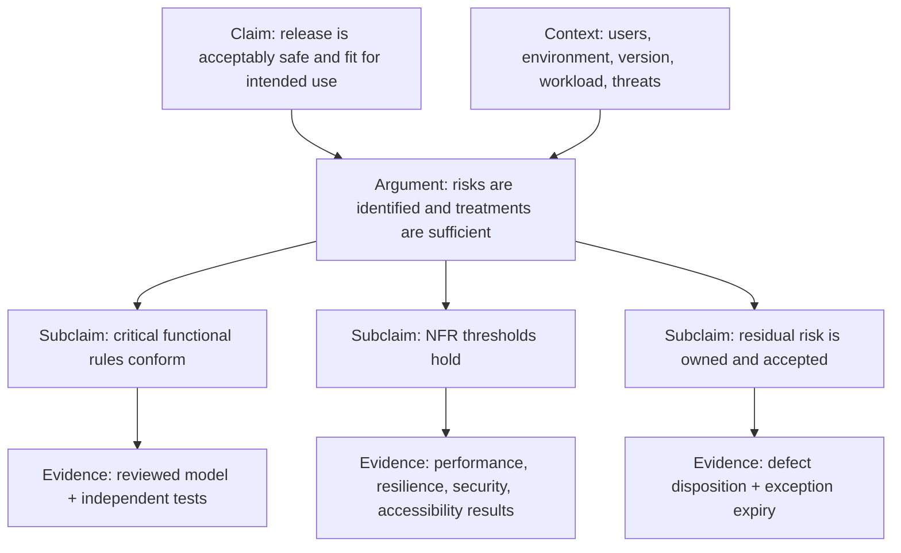

Judge evidence by relevance, method/oracle validity, completeness against claim scope, independence, reproducibility, provenance, freshness, and uncertainty. Minimum records include claim and requirement versions, risk rationale, item/build/environment identity, method and oracle, tool and version, data/fixture identifier, executor and reviewer, actual and expected results, anomaly and defect links, limitations, and disposition.

### 1.5 Quality-and-evidence architecture

Implement five linked contracts:

1. **Context contract:** stakeholders, intended use, supported environment, hazards, obligations, suppliers, and system boundary.
2. **Quality contract:** selected ISO attributes translated into measurable requirements and acceptance rules.
3. **Risk contract:** consequence, likelihood/uncertainty, integrity level, treatment, owner, residual-risk tolerance, and review trigger.
4. **Evidence contract:** trace identifiers and complete, reproducible, tamper-evident records where stakes warrant it.
5. **Decision contract:** release criteria over claims, evidence quality, defects, exceptions, compensating controls, expiry, and re-verification—not merely “all tests green.”

Use a goal–question–measure chain. State the decision, ask what uncertainty must be reduced, then select measures whose construct validity is defensible. Prefer stratified distributions and trends over fleet-wide averages. A queryable evidence graph should traverse requirement → risk → treatment → artifact → result → defect → residual-risk decision.

### 1.6 Antipatterns and maturity

The recurrent systemic failures are standards cargo cult, test-only QA, coverage-as-confidence, arbitrary composite scores, unmeasurable attribute labels, stale evidence without provenance, disconnected trace stores, conflicted independence, undocumented tailoring, mixed standard editions, metric gaming, static risk registers, siloed attributes, product-only metrics that ignore use context, and automation treated as authority.

At **foundational** maturity, the organization defines intended use, a tailored quality profile, measurable criteria, owned risks, basic 29119 processes, configuration identity, and independent review for consequential work. At **advanced** maturity, goal–question–measure logic, lifecycle QA/V&V controls, assurance cases, trace graphs, provenance, supplier boundaries, and attribute interactions are integrated. At **expert 2026** maturity, claims, assumptions, uncertainty, evidence, exceptions, and residual risk are machine-readable and independently challengeable; edition migrations are explicit; product-family profiles adapt continuously to incidents, field evidence, and context change.

## 2. Specification-Based Test Design and Behavioral Modeling

### 2.1 From prose to a test model

Specification-based testing samples externally observable behavior. Its decisive artifact is not the test script but the **test model**: a reviewable representation of input domains, environmental assumptions, permitted outputs, state, and verdict rules. ISO/IEC/IEEE 29119-4:2021 standardizes a family of test-design techniques, but conformance to a technique never proves that the source specification is complete or correct [FND02-1]. A coverage percentage therefore means “covered with respect to this model and denominator,” not “percent correct.”

For a model-induced set of feasible test requirements \(R\) and the requirements exercised by suite \(T\), model coverage is

\[
C_M(T)=\frac{|\{r\in R: T\text{ exercises }r\}|}{|R|}.
\]

The evidence is interpretable only if the model revision, feasibility rules, coverage criterion, exclusions, and oracle are versioned with the result. Requirements and test models should have separate authors or an independent review because a single misunderstanding can otherwise make implementation and oracle agree on the same defect.

### 2.2 Equivalence partitions and boundaries

**Equivalence partitioning (EP)** divides a domain into classes expected to receive equivalent treatment. The disciplined derivation procedure is:

1. Identify each input, output, state, and environmental factor relevant to the requirement.
2. Derive valid and invalid classes from type, format, range, semantics, authorization, and presence/absence rules.
3. Check that classes are disjoint and collectively cover the declared domain.
4. Select representatives and record why equivalence is expected.
5. Attach an expected output, expected post-state, and requirement identifier.

The category-partition method turns this reasoning into parameters, choices, constraints, and generated frames [FND02-3]. Its core assumption is defeasible: one representative is adequate only if behavior is homogeneous within the class. Parsers, conversions, locale rules, and internal representation limits often create hidden sub-partitions.

**Boundary-value analysis (BVA)** targets predicates where behavior changes. For every ordered range, count, length, time, quota, or version, test immediately below, at, and immediately above the boundary when those values are representable. Include semantic boundaries—empty versus absent, daylight-saving transitions, rounding thresholds, encoding length, integer overflow, retry limits—not just numeric minima and maxima. The oracle must specify whether the product rejects, rounds, clamps, defers, or maps a value to a particular error. Controlled studies have found context-dependent differences among EP, BVA, structural testing, and random testing; they do not establish a universal ranking [FND02-7; FND02-8].

### 2.3 Rules, classifications, and scenarios

A **decision table** maps normalized conditions to actions. Each column is a rule and ordinarily induces at least one test. A dash means genuine irrelevance, not missing analysis. Before test generation, prove or review:

- rule completeness over the stated domain;
- mutual exclusivity when deterministic behavior is required;
- feasibility constraints;
- action and side-effect completeness; and
- priority semantics where several rules may match.

A **cause–effect graph** expresses the same logic as Boolean relations and constraints before normalization into a table. It is useful when causal rules are dispersed across prose; the table is usually better for review and execution. Automated consistency work shows that formalized requirements can expose contradictions and omissions before code is run [FND02-4], while generation research shows why constraint preservation matters when minimizing suites [FND02-11].

A **classification tree** organizes semantic dimensions and their choices hierarchically. Select one choice per required classification, then apply explicit feasibility constraints in the combination table. Visual completeness is not semantic completeness: overlapping choices or a missing classification can produce a polished but invalid test model.

**Use-case and scenario tests** follow actor goals through a main flow, alternatives, refusals, exceptions, and recovery. A scenario should assert durable business effects and postconditions, not merely the last visible screen. Scenario methods are particularly valuable for reviewing distributed requirements and stakeholder intent [FND02-9]. Their blind spot is path explosion; risk and model coverage must govern which feasible paths are retained.

### 2.4 State-transition models

A state model is \(M=(S,E,G,A,O,s_0)\): states \(S\), events \(E\), guards \(G\), actions \(A\), observations \(O\), and initial state \(s_0\). A transition is a relation

\[
(s,e,g)\rightarrow(s',a,o).
\]

State identity must be externally observable or supported by a documented proxy. Generate progressively stronger obligations: all states, all legal transitions, invalid transitions, transition pairs, bounded \(n\)-transition paths, guard boundaries, and round trips. All-state coverage is weaker than all-transition coverage; neither rules out longer sequence faults. Unreachable obligations must be classified as infeasible with a reason, not silently removed from the denominator. Model checking can generate requirement-derived paths and counterexamples [FND02-5], but the concrete adapter still has to preserve the abstract preconditions and observations.

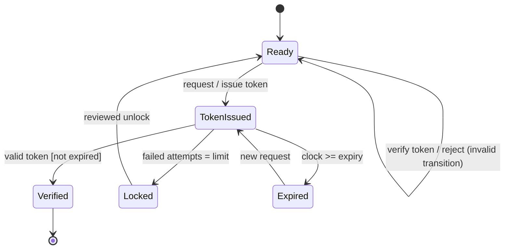

The final self-loop is deliberately tested: invalid transitions have observable security and integrity requirements even though they do not advance a happy-path state machine.

### 2.5 Oracles and evidence packages

Design the oracle with the model. Store preconditions, stimulus, permitted outputs, expected state, forbidden side effects, timing/order assumptions, tolerance, and verdict rule. For nondeterministic behavior, assert a relation or membership in an allowed set. For negative tests, assert rejection **and** absence of unauthorized state change. Prefer independently derived calculations, state invariants, contractual rules, and reviewed reference implementations over copying production algorithms.

An auditable evidence package contains:

| Artifact | Minimum content |
|---|---|
| Test basis | Requirement and model revision; assumptions; unresolved ambiguity |
| Coverage ledger | Obligation identifier, criterion, feasibility, selected test, exclusion rationale |
| Executable case | Setup, stimulus, observations, oracle, cleanup, deterministic controls |
| Result | Build/environment identity, actual observations, verdict, diagnostic links |
| Review record | Author, reviewer, change impact, residual-risk decision |

### 2.6 Failure patterns and maturity

Recurring failures include partitions that hide heterogeneous behavior; numeric-only boundaries; incomplete or overlapping rules; main-path-only scenarios; all-state coverage presented as sequence coverage; unobservable states; implementation-derived oracles; stale traces after requirement changes; nondeterminism absent from verdict rules; and contaminated setup shared among stateful tests.

At **foundational** maturity, teams maintain requirement traceability, explicit classes and boundaries, rule tables, lifecycle states, and declared oracles. At **advanced** maturity, these are versioned machine-readable models checked for completeness, disjointness, determinism, feasibility, and reachability. At **expert 2026** maturity, APIs, events, workflows, and regulated systems share a model-centered evidence layer. AI may propose partitions or extract scenarios, but accountable engineers approve semantics, feasibility, observability, and oracle independence before the output becomes assurance evidence.

## 3. Advanced Generation and Adequacy Methods

### 3.1 Obligation systems, not score systems

Advanced generation methods define different obligation spaces. Combinatorial testing covers parameter interactions; model-based testing (MBT) covers abstract behaviors; search-based software testing (SBST) optimizes reachability; mutation analysis measures whether tests distinguish plausible faults; and structural coverage records exercised implementation elements. Their percentages are not interchangeable. An enterprise strategy combines them only after naming each method's mechanism and blind spots.

### 3.2 Combinatorial interaction testing

For \(k\) factors with domains \(D_1,\ldots,D_k\), a mixed-level covering array of strength \(t\) is a set of valid rows such that every permitted assignment to every \(t\)-factor subset occurs in at least one row. Without constraints and with uniform domain size \(v\), the raw number of \(t\)-tuples is

\[
N_t=v^t {k\choose t}=v^t\frac{k!}{t!(k-t)!}.
\]

NIST's ACTS research and guidance show how covering arrays compress this obligation space, but the effectiveness claim depends on the interaction profile of real faults and on the quality of the input model [FND03-1]. Pairwise coverage is therefore not a default proof threshold. Use variable strength, weights, and seeds when hazard analysis identifies higher-order or business-critical interactions.

A generator contract must include domains, constraint formula \(\Phi\), required strength, variable-strength groups, weights, exclusions, seed rows, budget, and output schema. Validate \(\Phi\) independently. Count only tuples that can extend to a legal full configuration. An IPOG-family procedure incrementally adds parameters, horizontally extends existing rows to maximize newly covered tuples, and vertically adds rows for residual obligations [FND03-3]. Constraint-aware implementations cache solver outcomes and perform a final validity and coverage audit. When a complete array is too costly, measure an existing suite and add tests for high-risk uncovered tuples rather than reporting “pairwise” from generator settings alone [FND03-4].

### 3.3 Model-based generation

Version the behavioral model separately from generated tests. The model declares states, events, guards, data constraints, outputs, invariants, timing assumptions, and environment contracts. Test purposes may require a transition, a guard boundary, an error state, an output distinction, or a temporal property. Generate abstract traces using bounded breadth/depth search, shortest paths, model-checker witnesses, or online exploration. Solve path constraints for concrete data, then pass the trace through an adapter that maps abstract actions and observations to the system interface.

Keep three evidence layers separate:

1. **Model validity:** does the model represent the intended requirement?
2. **Model coverage:** which declared obligations did generated traces cover?
3. **Implementation conformance:** did concrete observations satisfy the model relation?

Industrial studies report both benefits and substantial modeling/adaptation cost [FND03-8; FND03-9]. Generated cases amplify the model; they do not repair an incorrect abstraction.

### 3.4 Search-based software testing

SBST treats test generation as optimization. For a target branch, a common minimization fitness is

\[
f(x)=\operatorname{approachLevel}(x)+\nu(\operatorname{branchDistance}(x)),
\]

where \(\nu(d)=d/(d+1)\) normalizes a nonnegative distance. A practical evolutionary loop creates legal candidates, executes them in a controlled environment, evaluates one or several goals, selects, mutates, optionally crosses over at validity-preserving boundaries, archives newly covered goals, and periodically minimizes replayable witnesses. Repeat independent seeds and report the distribution of coverage, failures, time, and suite size; one stochastic run is not reliable evidence.

SBST works when candidate encoding preserves enough validity and fitness provides a useful gradient. Object protocols, opaque predicates, cryptographic checks, and discontinuous environment behavior can flatten the search. Combine domain seeds, constructor/use templates, constraint solvers, or targeted models rather than spending a larger blind budget. EvoSuite illustrates whole-suite evolutionary generation for object-oriented software [FND03-11]; its outputs still require stable setup and meaningful assertions.

### 3.5 Mutation analysis

Mutation creates syntactic variants intended to represent small plausible faults. Given mutant set \(M\), killed mutants \(K\), and mutants adjudicated equivalent \(E\), the adjusted mutation score is

\[
MS=\frac{|K|}{|M|-|E|}.
\]

The denominator must also disclose invalid, timed-out, not-applicable, and unknown mutants. Strong mutation requires an externally observable difference; weak mutation detects an infected internal state near the mutation point. A kill matrix—mutants by tests—supports test ordering, subsumption analysis, and targeted improvement. The coupling effect provides a rationale for small mutations but is an empirical assumption, not a theorem that all complex faults are represented [FND03-12]. Equivalent-mutant identification remains undecidable in general and costly in practice [FND03-15].

Use selective operators, changed-region focus, sampling, parallelism, and early-kill ordering to manage expense. Calibrate sampling locally and report uncertainty. A survivor becomes a test obligation only after triage determines whether it is non-equivalent, observable, and inside the intended contract.

### 3.6 Structural and data-flow adequacy

Statement, branch/decision, condition, MC/DC, path, and definition–use coverage are obligation ledgers over a particular source/object revision. MC/DC requires evidence that each atomic condition can independently affect the decision outcome under the declared unique-cause or masking interpretation. Compiler transformation, short-circuit semantics, infeasible conditions, generated code, and instrumentation can change the denominator. Safety contexts may require reconciliation between source- and object-level evidence.

Coverage measures execution, not assertion sensitivity. Empirical work comparing mutation, statement, and branch coverage illustrates that their relationships depend on study controls and fault populations [FND03-18]. Treat a coverage gap as a question—uncovered, infeasible, unobservable, tool failure, or intentionally excluded—not automatically as a test to add.

### 3.7 Selection architecture

| Dominant risk | Primary method | Required companion evidence |
|---|---|---|
| Configuration interaction | Constrained/weighted covering array | Constraint audit; tuple coverage; domain oracle |
| Ordered protocol or lifecycle | MBT or sequence covering | Model validation; adapter trace; invalid transitions |
| Hard implementation reachability | SBST or solver hybrid | Repeated-seed statistics; minimized replay; oracle |
| Weak assertion/test sensitivity | Mutation analysis | Operator manifest; equivalent-mutant triage; kill matrix |
| Safety traceability | Structural coverage/MC/DC | Feasibility rationale; source/object mapping; requirement tests |
| Missing exact oracle | Metamorphic/model relation | Relation validity; differential independence; allowed nondeterminism |

The expert evidence package retains every generator version and seed, model and constraint revision, generated row/trace, adapter/oracle version, obligation denominator, exclusion, stochastic distribution, failure reproduction, and decision record. The decisive maturity transition is from maximizing isolated percentages to managing explicit, reviewable obligation systems.

# Part II — Shift-Left Architecture and Static Verification

## 4. Static Program Analysis and Formal Verification

### 4.1 The semantics boundary

Static verification reasons from source or an intermediate representation without executing the target program. Every claim is relative to a boundary: language version, libraries, compiler and IR, memory/concurrency model, generated code, native interfaces, configuration, and environment assumptions. An analyzer that silently ignores reflection, callbacks, FFI, unsafe code, or framework lifecycle edges is not “clean”; it has an unreported unknown region.

A defensible analysis pipeline preserves exact source identity through lowering:

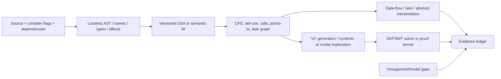

Stable source maps, symbol identities, IR/model revisions, and unknown regions are part of evidence—not implementation trivia.

### 4.2 Types, effects, and data flow

A typing/effect judgment can be written \(\Gamma\vdash e:\tau\;!\;\varepsilon\), where context \(\Gamma\) assigns types, \(\tau\) is the result type, and \(\varepsilon\) records effects such as mutation, I/O, blocking, exceptions, or unsafe capability. Progress and preservation establish a form of type soundness for the defined semantics. They exclude classes of invalid states; they do not prove arbitrary domain correctness.

Forward data-flow analysis over control-flow graph \(G=(N,E)\) computes facts with transfer function \(F_n\):

\[
IN[n]=\bigsqcup_{p\in pred(n)}OUT[p],\qquad OUT[n]=F_n(IN[n]).
\]

A worklist iterates to a fixpoint. SSA makes definition–use links explicit. Interprocedural analysis adds call edges, summaries, and context; alias/points-to analysis approximates memory identity. IFDS/IDE formulations give polynomial algorithms for finite distributive fact domains [SL01-3], but richer heaps, concurrency, path relations, and non-linear arithmetic trade precision against time and memory.

Taint analysis is policy-specific data flow: sources introduce labels, transfer models propagate them, sanitizers discharge them under stated preconditions, and sinks require forbidden labels to be absent. Source, sink, sanitizer, callback/lifecycle, trust-boundary, and library models must be versioned. FlowDroid's empirical results illustrate how context, flow, field, object, and lifecycle sensitivity affect precision [SL01-8]; those results do not transfer universally to another framework or corpus.

### 4.3 Abstract interpretation

Abstract interpretation maps a collecting concrete semantics into an abstract domain, typically through abstraction \(\alpha\) and concretization \(\gamma\) [SL01-2]. A sound over-approximation contains all modeled concrete behaviors. If abstract state \(a\) entails invariant \(P\), then \(P\) holds for every concrete state in \(\gamma(a)\). Failure to prove \(P\) is usually a warning or unknown—not a concrete counterexample.

Infinite-height domains use widening \(\nabla\) to force convergence and may use narrowing to recover precision. Intervals scale but lose correlations; relational numeric, shape, ownership, or symbolic domains prove stronger properties at higher cost. State the domain, transfer semantics, widening points, concurrency/environment model, and unsupported constructs with every absence claim.

### 4.4 Deductive verification and separation logic

Hoare logic expresses partial correctness as

\[
\{P\}\;C\;\{Q\},
\]

meaning that if precondition \(P\) holds and command \(C\) terminates, postcondition \(Q\) holds [SL01-1]. A weakest-precondition transformer \(wp(C,Q)\) computes the least state predicate sufficient for \(Q\). Loops need invariants; procedures need contracts. Separation logic adds ownership and separating conjunction, supporting modular heap reasoning and frame rules [SL01-15].

A verification-condition generator lowers annotated code to logical obligations, labels every formula with source/specification identity, and emits an interchange form such as SMT-LIB. Archive solver logic, version, resource limits, seeds, script, model, unsat core or proof, and result. A specification can be vacuous or wrong; proving it does not validate stakeholder intent.

### 4.5 Model checking, symbolic execution, and CEGAR

Model checking evaluates temporal or reachability properties over a finite or abstract transition system. State explosion is controlled through partial-order and symmetry reduction, slicing, bounded methods, and data/predicate abstraction. Counterexample-guided abstraction refinement (CEGAR) follows a disciplined loop [SL01-4]:

1. Check a coarse abstraction.
2. If it satisfies the property, accept only if abstraction soundness supports that conclusion.
3. If it yields a trace, validate feasibility in the concrete model.
4. Report feasible traces; refine from spurious traces; retain unresolved traces as unknown.

Symbolic execution maintains symbolic state \(\sigma\) and path condition \(PC\), forking at branches and querying a solver. A satisfiable model produces an input witness; unsatisfiability rules out that path under the encoding. Path explosion, aliasing, non-linear arithmetic, external effects, and memory models bound the claim [SL01-7]. Concolic systems such as DART combine concrete execution with symbolic constraints [SL01-6]; their artifacts are executable witnesses, not exhaustive static proofs.

### 4.6 Solver and proof semantics

SAT operates over Boolean formulas; SMT adds theories such as integers, reals, bit-vectors, arrays, strings, datatypes, and uninterpreted functions. DPLL(T) coordinates Boolean search with theory solvers [SL01-9]. Treat result states precisely:

| Result | Defensible interpretation |
|---|---|
| `sat` + validated model | Candidate or concrete witness for the encoded obligation |
| `unsat` + trusted proof/check | No model exists for that exact formula and semantics |
| `unknown` / timeout / unsupported | Inconclusive; not a pass |
| Abstract invariant proven by a sound analysis | Property holds within the stated modeled envelope |
| Heuristic warning or inferred convention | Triage lead; neither theorem nor necessarily a defect |

Proof assistants reduce acceptance to a small kernel, but the trusted computing base still includes axioms, formal semantics, extraction/runtime, compiler boundaries, and external code. CompCert demonstrates semantic-preservation proofs across intermediate languages [SL01-10]; it also shows why source proofs do not automatically survive an unverified compilation/linking chain.

### 4.7 Enterprise implementation

Stage cost and evidence depth:

```yaml
static_verification:
  editor: [parse, name_resolve, type_effect, deterministic_lints]
  pull_request:
    - incremental_cfg_dataflow
    - changed-surface_taint
    - targeted_contract_and_model_checks
  scheduled:
    - whole_program_abstract_interpretation
    - bounded_model_checking
    - proof_obligation_replay
  evidence_policy:
    violated_proof: fail_closed
    feasible_witness: risk_based_gate
    heuristic_warning: triage
    timeout_or_model_gap: unresolved_visible
```

Finding records require stable ID, source/IR location, rule/model revision, evidence class, assumptions, solver outcome, trace/proof object, severity rationale, first/last seen revisions, and disposition. Deduplicate semantically, cluster correlated paths, validate traces and solver models, and make suppressions scoped, reviewed, and expiring. High-impact absence claims should use independent proof checking or solver replay.

### 4.8 Failure modes and maturity

The major failures are AST pattern matching presented as semantic verification; soundness claims with silent unsupported regions; under-approximating witness finders presented as absence proofs; warning floods that destroy trust; abstract traces reported without feasibility checks; timeout treated as success; opaque distributed runs without replay artifacts; benchmark scores generalized beyond their population; coarse framework/lifecycle models; weak or vacuous specifications; source proofs disconnected from deployed binaries; concolic paths relabeled as proofs; and permanent blanket suppression.

At **foundational** maturity, compiler-backed parsing/types, simple flow checks, documented unsupported constructs, stable triage, and fast feedback establish reliable boundaries. At **advanced** maturity, versioned SSA/IR, incremental summaries, context-aware taint, documented abstract domains, targeted CEGAR/VC/SMT, and replayable evidence support higher-risk code. At **expert 2026** maturity, a semantics-first portfolio combines sound invariants, contextual taint, model checking, symbolic/concolic witnesses, proof replay, and machine-checked obligations; an explicit trusted-computing-base and unknown ledger prevent stronger claims than the evidence permits.

## 5. Executable Specifications, Contracts, Properties, and Developer Feedback

### 5.1 Executability and the limits of schemas

An executable specification is a machine-checkable description whose predicates can be applied to an implementation. It can express structure (types, required fields, ranges, encodings), interaction examples, pre/postconditions, invariants, algebraic laws, and protocol transitions. Executability improves feedback, but it does not imply semantic completeness. A schema can validate a message while saying nothing about authorization, idempotency, ordering, timing, side effects, recovery, or business meaning.

OpenAPI 3.1 aligns its Schema Object with JSON Schema 2020-12 [SL02-10; SL02-12]. AsyncAPI 3.0 provides a corresponding description structure for message-driven operations [SL02-11]. These are consensus interface languages. Pin dialect and validator versions, control reference resolution, and test representative parser/serializer combinations because tooling can interpret edge cases differently.

Separate four assurance layers:

| Layer | Principal question | Typical artifact |
|---|---|---|
| Structural | Can messages be parsed and do values satisfy declared constraints? | OpenAPI/AsyncAPI + JSON Schema validation |
| Interaction | Does this provider preserve exchanges on which represented consumers depend? | Consumer/provider contract |
| Semantic | Do results and side effects preserve business invariants? | Properties, reference models, decision/state rules |
| Workflow | Does a representative distributed journey complete under its operating assumptions? | Selected integration/end-to-end scenario |

A green lower layer cannot be promoted to a higher-layer claim.

### 5.2 Provider and consumer contracts

A **provider contract** declares what an interface offers. A **consumer-driven contract (CDC)** records the subset of interactions a named consumer uses. A **behavioral contract** adds semantic relations not expressible in a shape schema. In a CDC flow, the consumer exercises a mock, publishes an immutable interaction artifact, and the provider later replays that artifact in a controlled fixture.

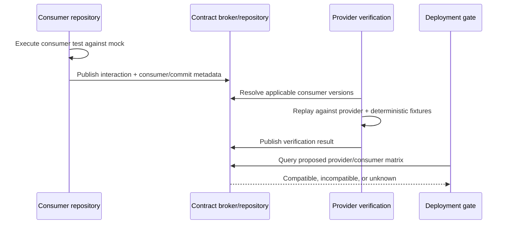

Unknown consumers remain unknown; a provider must not claim universal compatibility from contracts that no consumer published. Public or anonymous APIs need provider-owned conformance cases, generated client examples, historical-client tests, and deprecation telemetry. Third-party systems that cannot participate need an explicit adapter boundary, recorded fixtures, and small live probes.

Compatibility is multidimensional. A structurally additive field can still break behavior by tightening a range, changing retryability, reordering events, altering defaulting, or making an optional value semantically required. Conversely, a tolerant consumer may accept a change that a strict schema diff rejects. Semantic Versioning conveys compatibility intent; it does not infer semantics or prove implementation behavior [SL02-13]. Use schema diffs to classify additions, narrowing, removals, and annotation changes, then require an accountable compatibility decision.

### 5.3 Property-based and metamorphic testing

Property-based testing evaluates an executable predicate over generated inputs. Useful properties include:

- invariant preservation;
- algebraic identity, associativity, or commutativity where valid;
- idempotence;
- encode/decode round trips;
- model or differential agreement;
- bounded outputs and valid error relations; and
- state-machine preconditions, transitions, and postconditions.

QuickCheck established the generator–property–shrinker architecture [SL02-1]. A metamorphic relation compares related executions when an exact oracle is unavailable—for example, a permutation may preserve a result multiset. It is a partial oracle, and empirical work shows that usefulness depends on the relation's strength and validity [SL02-2; SL02-3].

If a defect-triggering region has independent per-sample probability \(p\), the chance that \(n\) samples miss it is

\[
P(\text{miss})=(1-p)^n.
\]

Real generators are rarely independent and uniform, and \(p\) is generally unknown. The formula explains why “1,000 tests” is meaningless without the domain and distribution. Review valid/invalid partitions, boundary weights, recursion/depth limits, assumption-discard rate, unique states, feature distribution, and reproducibility. Coverage-guided PBT can adapt the input distribution toward new program behavior [SL02-4], but coverage remains a steering signal rather than an oracle.

### 5.4 Shrinking and replay

Shrinking searches for a simpler counterexample that retains the failure. Structural shrinking reduces numbers, collections, trees, or command sequences; domain-aware shrinking also preserves validity and state preconditions. Blindly deleting fields can replace the original semantic failure with an irrelevant invalid-input failure.

The evidence artifact must retain the original case, minimal case, seed or replay token, generator/property/shrinker revisions, environment, dependency versions, and failure classification. Promote a stable minimal counterexample to a named regression example. This forms a productive loop: examples seed generators; properties generalize examples; minimized failures become durable examples.

### 5.5 A three-speed developer loop

| Loop | Target latency | Contents | Failure output |
|---|---:|---|---|
| IDE/on-save | Seconds | Changed-file examples; schema lint; small deterministic property budget | Source-located mismatch or minimal counterexample |
| Pre-commit | Tens of seconds | Interface diff; affected contracts; bounded offline properties | Compatibility class, represented consumers, replay command |
| Local integration | Minutes, explicit | Provider verification; stateful/message properties; selected workflows | Versioned evidence bundle and diagnostics |

Expose the same commands through IDE, command line, hooks, and CI. “Fast locally” must not mean a different validator or fixture. Expensive or nondeterministic checks can be deferred, but the local result must say what has not run. TDD's red–green–refactor loop supplies named examples; BDD/ATDD supplies a small, stable communication layer; contracts guard represented interfaces; properties explore behavior families. Do not compile all four into thousands of fragile UI steps.

A contract-aware pre-commit gate can be expressed tool-neutrally:

```yaml
quality_gate:
  inputs: [interface_spec, changed_files, consumer_matrix]
  stages:
    - schema_meta_validate: {dialect: "json-schema-2020-12"}
    - compatibility_diff: {classify: [additive, narrowing, removal, semantic]}
    - affected_contracts: {unknown_consumer_policy: "explicit-risk"}
    - properties: {seed: "derived-from-commit", budget_seconds: 20, max_discard_rate: 0.20}
  evidence:
    retain: [spec_revision, validator_version, represented_consumers, seed, minimal_counterexample]
```

The configuration is an architectural example, not syntax for a particular product.

### 5.6 Failure modes and maturity

Common failures are schema-as-semantics; a contract population mistaken for all consumers; consumer contracts that overspecify provider internals; provider verification against unrealistic fixtures; unpinned dialects; compatibility based only on version numbers; properties copied from implementation; biased generators with high discard rates; vacuous relations; nondeterministic seeds without replay; shrinkers that violate preconditions; slow hooks routinely bypassed; and fast local suites whose commands differ from CI.

At **foundational** maturity, interfaces are versioned, schemas validate both directions, critical interactions have provider verification, properties retain seeds, and developer commands are reproducible. At **advanced** maturity, a compatibility matrix gates deployments, generator health and domain coverage are reviewed, shrinking is domain-aware, and affected contracts/properties drive the three-speed loop. At **expert 2026** maturity, structural, interaction, semantic, and workflow evidence remain explicitly separated; public and event-driven interfaces have population-aware compatibility policies; and AI-proposed properties or contracts cannot become evidence until humans validate the domain, relation, and consumer representation.

# Part III — Continuous Testing and Delivery Pipelines

## 6. Hermetic Test Infrastructure and Ephemeral Environments

### 6.1 Hermeticity, determinism, and reproducibility

A hermetic build or test is a function of an explicit input closure: source, transitive dependency digests, toolchain, base image or VM, configuration, fixtures, test code, and declared external parameters. **Hermeticity** constrains ambient inputs. **Determinism** concerns repeated execution behavior. **Reproducibility** means an independent execution from the same declared inputs yields byte-identical artifacts or results equivalent under a documented relation. These properties improve cache correctness and diagnosis; none proves that source, tools, or oracle are trustworthy.

Research on reproducible builds identifies timestamps, paths, filesystem order, randomness, and parallel completion as recurring entropy sources [CT01-1]. Commercial experience shows why semantic equivalence rules may be necessary for signatures and third-party artifacts, but each exception must remain reviewable [CT01-2].

### 6.2 Control plane and disposable execution plane

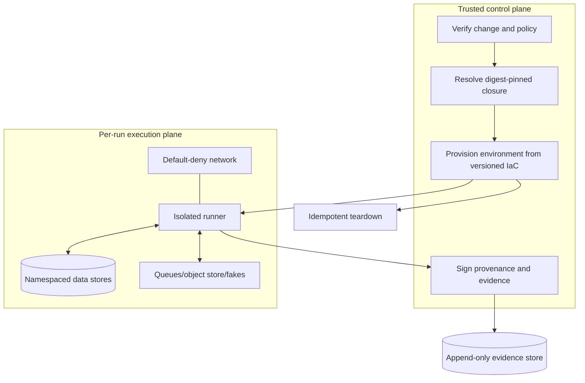

The control plane authenticates source, resolves content-addressed dependencies, chooses a signed runner, and issues short-lived identity. The execution plane receives read-only source and declared inputs plus bounded scratch space. Default-deny egress blocks live registries, cloud metadata, internet responses, and accidental credential use. Necessary external input is prefetched through a controlled mirror or recorded with endpoint, policy, identity, and digest. “Network restricted” is not the same as offline-hermetic.

### 6.3 Select isolation by threat and fidelity

| Isolation | Advantages | Limits | Appropriate use |
|---|---|---|---|
| Process sandbox/rootless container | Fast startup; high density; portable packaging | Shared host kernel and runtime trust | Trusted unit/component/integration tests |
| MicroVM/light VM | Stronger kernel boundary; narrow device model | Boot, memory, image, orchestration cost | Untrusted inputs, tenant separation, privileged tests |
| Full VM | OS/kernel/device fidelity and strong boundary | Slow, expensive, harder fleet management | Cross-OS, driver, kernel, regulated fidelity |

Container portability does not imply kernel equivalence or complete isolation. Apply read-only roots, dropped capabilities, seccomp/AppArmor equivalents, user namespaces, no host socket, bounded CPU/memory/PID/storage, and per-run network namespaces, consistent with NIST container risk guidance [CT01-8].

### 6.4 Eliminate hidden entropy

Inject or record clocks, UTC/timezone, `SOURCE_DATE_EPOCH`-style timestamps, locale, encoding, collation, PRNG seed, identifier generation, CPU count, scheduling assumptions, and ordering. Sort maps, directory listings, and serialized collections. Verify controls by rebuilding under deliberate variations in time, hostname, locale, path, filesystem order, CPU count, and image/kernel revision. Classify mismatches as uncontrolled input, nondeterminism, intentional equivalence, or possible compromise. Deterministic syscall interposition can help reproduce exceptional failures but may impose substantial overhead [CT01-3].

### 6.5 Service virtualization and fixtures

Mocks and fakes are behavioral contracts, not substitutes for integration. Use mocks for unit isolation, versioned fakes/emulators for deterministic component tests, and a bounded real-service conformance lane. Explicitly support latency, timeout, retry, malformed response, and dependency-down scenarios. Every virtual response should link to a contract and fixture version. Empirical work reports the familiar tradeoff: mocking improves focus while drift and coupling reduce realism [CT01-6].

Separate immutable source fixtures, per-run derived state, and retained evidence. Namespaces—database schema, bucket prefix, queue, service account, test tenant—are run-specific. Builders and migrations are idempotent and deterministic. Cleanup runs in a `finally` path and an asynchronous reconciler handles leaks. Evidence becomes durable before destructive TTL cleanup.

### 6.6 Infrastructure-as-code verification

IaC is executable software. Verify layers in increasing fidelity:

1. Formatting and static syntax/schema/type checks.
2. Security and organizational policy checks.
3. Provider/module lock and provenance validation.
4. Unit/property tests with explicit generators and resource oracles.
5. Plan/diff review.
6. Apply in a disposable account/namespace/cluster.
7. Assert resulting identity, network, encryption, data, and least-privilege state.
8. Detect drift and record teardown.

Research on automated IaC testing supports generated configurations and mocks while also exposing the need for real apply-state oracles [CT01-5]. A passing declaration check does not prove the deployed state.

### 6.7 Reference pipeline

```yaml
pipeline:
  source: {verify_signature: true, revision: "$IMMUTABLE_COMMIT"}
  closure:
    lockfiles: required
    images: digest_only
    packages: internal_content_addressed_mirror
  execution:
    profile: rootless_container
    filesystem: {root: read_only, scratch: per_run}
    network: {default: deny, allow: []}
    clock: source_derived
    locale: C.UTF-8
    random_seed: recorded
    resources: {cpu: "2", memory: "4Gi", pids: 256}
  topology:
    namespace: "run-${RUN_ID}"
    fixtures: immutable_versioned
    ttl_after_evidence: "30m"
  evidence:
    bind_to: artifact_digest
    retain: [source, dependency_closure, runner, iaC, fixtures, command, results, logs, traces, sbom, provenance, teardown]
  promotion: immutable_digest_only
```

SLSA and OCI provide provenance and artifact-association mechanisms [CT01-10; CT01-11]. A signed attestation can truthfully describe compromised source or a faulty oracle, so verify content and policy rather than treating provenance as functional proof. NIST's CI/CD supply-chain guidance supplies a useful actor/artifact/gate model [CT01-9].

### 6.8 Operating controls and maturity

Measure reproducibility rate, authenticated cache-hit correctness, environment create/teardown time, orphan rate, network-denial violations, fixture contamination, evidence completeness, and time to reproduce a failed run. Recurring failures are ambient host dependencies, mutable references, live network calls, credential leakage, incomplete cache keys, persistent runners, privileged containers, resource exhaustion, clock/order entropy, mock drift, declaration-only IaC testing, evidence deleted during cleanup, unreviewed infrastructure drift, promotion by mutable tags, and provenance presented as correctness proof.

At **foundational** maturity, definitions and dependencies are versioned, runners are clean, images are immutable, egress is restricted, entropy controls are recorded, fixtures namespaced, resources bounded, and evidence exported. At **advanced** maturity, every job receives a declarative ephemeral environment, isolation profiles are risk-based, caches authenticated, adversarial rebuilds routine, IaC applied and asserted, and attestations bound to digests. At **expert 2026** maturity, the platform itself is continuously tested for escape, contamination, cache poisoning, time skew, network bypass, drift, fixture leakage, and evidence loss; high-consequence artifacts use independent rebuilding or attestable builders, with a documented trusted boundary and residual risk.

## 7. Test Selection, Prioritization, Parallelism, and Suite Trust

### 7.1 Three different optimization problems

Regression-test selection (RTS) chooses tests relevant to a change. Prioritization orders candidates to optimize early information or fault detection. Minimization removes tests redundant with respect to a declared criterion. A selector is **safe** only relative to its program/dependency model and assumptions: no test whose behavior may change is omitted. The seminal safe-RTS work and later empirical studies show both the formal goal and context-dependent cost/precision tradeoffs [CT02-1; CT02-2].

Use an explicit policy lattice:

1. Retest all for release, integrity, or safety gates.
2. Conservative static closure for normal change validation.
3. Dynamic/hybrid impact for high-throughput CI, bounded by dependency freshness and full-suite audits.
4. Heuristic selection only as a probabilistic optimization with abstention and retest-all fallback.

Static control/data/build reachability generally over-selects. Dynamic observations can be more precise for executed behavior but miss reflection, generated code, configuration, resources, network state, and unobserved paths. Coverage means “executed,” not “only possible dependency.”

### 7.2 Change and dependency model

Represent a revision as changes to source symbols, generated artifacts, interfaces/contracts, schemas, build metadata, dependency locks, tests, and runtime resources. Maintain a test-by-entity matrix \(M_{te}\), static dependency graph, dynamic dependency observations, and history. Select mandatory tests plus every test whose dependency set intersects the changed closure. Unknown or stale dependencies expand selection; they do not reduce it.

The auditable service has five stores:

- change facts by commit/build;
- dependency evidence with model version and freshness;
- attempt-level execution history;
- test metadata, ownership, criticality, resources, and isolation contract; and
- selector, retry, quarantine, override, and omission audit records.

Canonical test identity must survive parameterization and renames, with a lineage map. Otherwise history fragments and flake estimates become misleading.

### 7.3 Prioritization and time budgets

History, duration, severity, novelty, affected coverage, and diversity can rank tests; none is a safety proof. A transparent baseline is

\[
score(t)=\frac{w_rR_t+w_f\hat p_t+w_sS_t+w_nN_t+w_dD_t}{\max(d_t,\epsilon)},
\]

where \(R\) is change/risk relevance, \(\hat p\) calibrated failure probability, \(S\) severity, \(N\) novelty, \(D\) diversity/information gain, and \(d\) expected duration. Mandatory tests bypass scores. Calibrate on temporally separated data, monitor drift, and add aging so low-history tests are not starved. Recent large-suite evidence found a simple short-and-recently-failing baseline competitive in its dataset; this is a local empirical result, not a universal algorithm [CT02-9].

For \(n\) ordered tests and \(m\) detected faults, with \(TF_i\) the first position detecting fault \(i\), average percentage of fault detection is

\[
APFD=1-\frac{\sum_{i=1}^{m}TF_i}{nm}+\frac{1}{2n}.
\]

APFDc incorporates variable test and fault costs. Both require an observed fault baseline and should be reported with selection loss, overhead, and confidence—not alone.

### 7.4 Parallel execution topology

Parallel scheduling minimizes makespan and time-to-first-signal subject to precedence, exclusivity, and CPU/RAM/GPU/network/database constraints. Round-robin is reproducible but straggles; duration-weighted largest-processing-time (LPT) bin packing is a strong baseline; pull queues/work stealing adapt but need idempotent result writes and stable identity. Research on parallel prioritization shows why serial rankings do not directly optimize multiple workers [CT02-8].

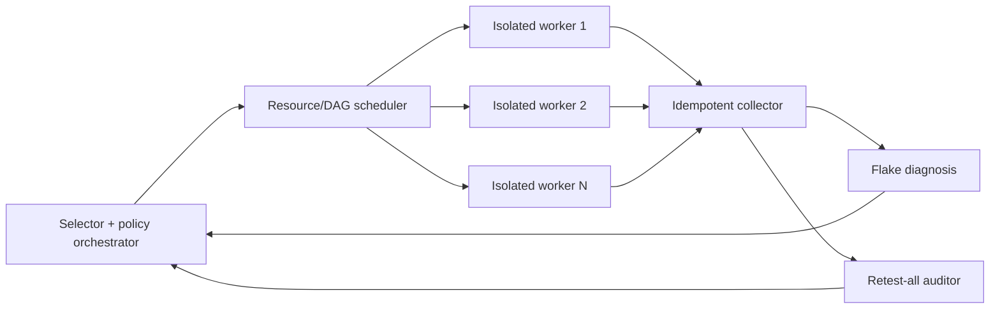

Each runnable unit carries estimated duration, resource vector, mutex claims, and precedence edges. Use leases, heartbeats, bounded diagnostic retries, deterministic tie-breaking, shard seed/order retention, and duplicate/missing-test reconciliation. Shared mutable state creates order dependence; independence must be established or represented as conflicts. Framework sharding contracts illustrate implementation constraints but do not prove the suite is parallel-safe [CT02-20; CT02-21; CT02-22].

### 7.5 Flakiness as a distribution

For fixed revision, test identity, inputs, runner, and relevant configuration, a test is flaky when repeated executions contradict. Classify non-order-dependent, order-dependent victim/polluter, resource/timing/concurrency, external-service, and infrastructure mechanisms because repair differs. A pass and fail in the same fixed context establish observed nondeterminism. No contradiction does not establish stability.

If failure probability is \(q\) and reruns are independent, the miss probability after \(n\) reruns is \((1-q)^n\). Low-rate flakes therefore require large budgets or targeted perturbations. The independence assumption is often false. Use passive contradictory outcomes plus active same-order reruns, order permutation/reversal, controlled clocks/randomness/scheduling, resource telemetry, changed-code coverage, and log differencing. Foundational and longitudinal studies document varied root causes and detection difficulty [CT02-10; CT02-13; CT02-15].

Retries preserve the first outcome, cause, and every attempt. “Pass after retry” is flaky-suspected, not silent green. Quarantine is temporary routing with owner, reason, expiry, lost-coverage debt, and continued isolated/full-suite execution. Repair mechanisms: reset state, remove order coupling, replace sleeps with condition synchronization, control time/randomness where legitimate, use unique resources, clean subprocesses, virtualize unstable externals, and fix product races.

### 7.6 Trust measures

Publish denominators, windows, configuration identity, confidence intervals, and adjudication policy for:

- first-pass signal precision;
- retry-masking rate;
- flake-event burden and test-level prevalence;
- selection recall against retest-all failures;
- selected-suite coverage retention;
- APFD/APFDc;
- shard imbalance \(\max d_{shard}/\operatorname{mean}d_{shard}\); and
- quarantine age and repair rate.

A composite dashboard score may summarize; it must never hide component metrics or unmeasured risk.

### 7.7 Reference policy and maturity

```yaml
test_intelligence:
  selector:
    mandatory: [changed_tests, contracts, security_critical, recent_failures, stale_dependencies]
    modes: [safe_static, hybrid_dynamic, retest_all]
    abstain_on: [model_disagreement, reflection_gap, stale_coverage, low_confidence]
    audit_full_suite: nightly
  prioritizer: {deterministic: true, fairness_aging: true, calibrated_temporally: true}
  scheduler: {baseline: LPT, dynamic_pull: true, resource_mutexes: true}
  retries: {diagnostic_only: true, preserve_first_failure: true}
  quarantine: {owner_required: true, expiry_required: true, continues_in_baseline: true}
```

At **foundational** maturity, stable identities, attempt-level history, clear retry semantics, temporary quarantine, simple deterministic sharding, and full-suite baselines establish trust. At **advanced** maturity, conservative change closure, fresh hybrid dependencies, cost/risk prioritization, resource-aware scheduling, flake mechanism diagnosis, and quantitative safety audits operate together. At **expert 2026** maturity, selection first runs in shadow mode, then expands with explainable inclusion, abstention, calibrated drift monitoring, explicit omission risk, trust SLOs, and a non-skippable baseline; AI rankings remain advisory until validated on temporally separated evidence.

# Part IV — Non-Functional Engineering

## 8. Performance, Scalability, and Capacity Assurance

### 8.1 Define the boundary and workload

Performance is measured behavior as workload, data, configuration, and resources vary. Define latency \(R\) from arrival to completion; throughput \(X\) as valid completions per time; offered arrival rate \(\lambda\); work in flight \(L\); utilization \(U\); saturation; and error/timeout rate at the same boundary. ISO/IEC 25010:2023 distinguishes time behavior, resource utilization, and capacity; one does not substitute for another [NFR01-1]. ISO/IEC 25023 supplies measures but deliberately does not set universal grades [NFR01-2].

A versioned operational profile specifies endpoint/journey mix, state transitions, payload and data-size distributions, cache/database state, think time, arrival process, concurrency, priority, retries, burstiness, and downstream fan-out. Trace replay retains real correlations but ages and misses unseen paths. Stochastic/state models improve exploration but must preserve data dependencies and invariants. Validate generated load against held-out traces using mix and size quantiles, interarrival distribution, autocorrelation, session lengths, cache behavior, fan-out, and path coverage [NFR01-7].

### 8.2 Queueing and capacity laws

Little's Law for a stable population is

\[
L=\lambda R.
\]

The boundary and flow accounting must match. At 400 requests/s and 0.25 s average residence, about 100 requests are in flight. For resource \(k\) with \(m_k\) parallel servers and demand \(D_k\), a first approximation is

\[
U_k\approx\frac{\lambda D_k}{m_k},\qquad X_{max}\approx\min_k\frac{m_k}{D_k}.
\]

For a closed population \(N\) with think time \(Z\), \(X=N/(R+Z)\). An M/M/1 approximation yields \(R=1/(\mu-\lambda)\) and shows nonlinear latency as \(\rho=\lambda/\mu\to1\). Real systems include non-exponential variability, finite buffers, priorities, batching, retries, fan-out, and correlated demand; the laws generate hypotheses and sanity checks, not universal predictions [NFR01-15].

### 8.3 Open and closed generators

A closed generator sends a new request after completion plus think time; when the system slows, offered load falls. An open generator schedules arrivals independently, exposing backlog, missed sends, timeouts, and coordinated omission. Partly open models combine exogenous arrival with sessions. Select the control loop from real arrival semantics; open and closed systems can produce materially different tail behavior under the same nominal load [NFR01-14]. Measure intended arrival time, actual send, completion, cancellation, and drop.

**Coordinated omission** occurs when stalls prevent the generator from creating arrivals that should have queued, excluding the worst waiting time from the sample. Use deadline-aware/open scheduling, offered-versus-achieved accounting, and tail-safe histograms. A p99.9 estimate needs enough observations in the relevant class and an uncertainty interval; a percentile label without sample count and histogram resolution is not evidence.

### 8.4 Experiment portfolio

| Experiment | Controlled change | Principal question |
|---|---|---|
| Baseline/benchmark | Pinned system and workload | What is the reproducible reference distribution? |
| Load | Low, typical, peak profile | Are stated SLOs met under anticipated demand? |
| Stress | Above peak or reduced headroom | Is degradation bounded and observable? |
| Spike | Rapid step in arrival/concurrency | Can queues and autoscaling absorb burst safely? |
| Breakpoint/capacity | Increasing offered load/data | What first violates latency, error, queue, or resource criteria? |
| Volume | Stored/input data size and skew | Does data growth change demand or plans? |
| Scalability | Instances/cores/workers/partitions | What throughput, tail, and efficiency curve results? |
| Endurance/soak | Representative load over time | Do memory, queue, GC, descriptors, connections, or credits drift? |

Every run has safety ceilings, abort/stop rules, reset, warmup/cold-start labels, and an oracle combining throughput, tails, errors, queue age/depth, and resources. Tail amplification in fan-out means one slow child can dominate the parent [NFR01-5]; propagate deadlines and bound retry/concurrency multiplication.

### 8.5 Valid experiments and telemetry

Pin build, runtime, OS/image, hardware, topology, quotas, flags, data seed, cache state, and dependencies. Monitor the load generator's CPU, network, scheduler, timer lag, and send-rate error so the harness is not the bottleneck. Randomize or block run order, repeat independent processes/hosts, declare warmup and precision rules, and report cold and steady state separately. Managed-runtime research demonstrates why independent runs and confidence intervals matter [NFR01-6].

Observe client edge through dependencies: RED (rate, errors, duration), USE (utilization, saturation, errors), queue depth/age, concurrency, retries, fan-out, CPU/run queue/throttling, memory/GC, I/O, network, locks, pools, database/cache, scheduler, and autoscaler events. Histograms are necessary for duration, queue age, payload size, and service demand [NFR01-16]. Keep dimensions decision-relevant and low-cardinality; retain exemplars or tail traces without biasing aggregate histograms.

### 8.6 Acceptance and capacity planning

```yaml
performance_contract:
  scenario: peak_checkout_v4
  workload: {model: open, offered_rps: 2000, mix_revision: "2026-Q3"}
  acceptance:
    valid_throughput_rps: {min: 1980}
    latency_ms: {p95_max: 220, p99_max: 400}
    error_timeout_rate: {max: 0.001}
    queue_age_ms: {p99_max: 100}
    critical_resource_headroom: {min: 0.25}
  evidence:
    repetitions: 5
    report: [offered_and_achieved_load, samples, intervals, histogram_error, environment_manifest, bottleneck]
```

Capacity is the largest offered workload meeting the complete acceptance conjunction for a scenario. Record the first failing constraint and reserve headroom for burst, forecast error, failover variation, growth, and control-loop delay. Compare like-for-like runs using absolute and relative change, practical effect threshold, uncertainty interval, and false-positive/negative risk. Statistical non-significance is not proof of equality. Performance-regression prioritization can reduce cost but cannot remove acceptance-critical paths [NFR01-8; NFR01-13].

### 8.7 Failure modes and maturity

Failures include closed-only rate testing, coordinated omission, mean-only acceptance, tail claims with inadequate samples, saturated generators, stale/unrealistic workload mix, hidden warmup, noisy environments, unbounded queues, CPU as sole proxy, linear extrapolation, one-run gates, soak tests without drift analysis, telemetry that perturbs or erases tails, and standards treated as thresholds.

At **foundational** maturity, requirements name workload and boundary, reproducible load/stress/soak runs collect core metrics, warmup is separated, and Little's Law checks plausibility. At **advanced** maturity, calibrated stateful profiles, chosen open/closed semantics, production-shaped environments, synchronized histograms/traces, replicated tail intervals, breakpoint curves, and conjunction-based acceptance identify bottlenecks. At **expert 2026** maturity, performance is a lifecycle quality contract with coordinated-omission detection, demand tables, uncertainty-aware capacity forecasts, validated nonlinear curves, adaptive sample sizing, and explicit inconclusive outcomes for heterogeneous cloud/serverless/accelerator behavior that has not been locally measured.

## 9. Reliability, Resilience, Chaos, and Recovery Assurance

### 9.1 Dependability semantics

Reliability is conditional:

\[
R(t\mid u,e,c)=P(T>t\mid\text{use profile }u,\text{ environment }e,\text{ configuration }c),
\]

where \(T\) is time to an unacceptable service failure. State mission, exposure, failure definition, and observation window. A **fault** is a hypothesized cause, an **error** an incorrect internal state, and a **failure** delivered service outside specification; detection, containment, masking, and recovery can break the fault → error → failure chain [NFR02-1]. Availability includes declared acceptable degraded states; maintainability concerns restoration time; resilience is the dynamic capacity to anticipate, withstand, recover, and adapt [NFR02-10].

Use a capability trajectory \(q(t)\) to record pre-event service, minimum delivered capability, degradation duration, recovery time, and post-recovery correctness. “Endpoint responds” is not equivalent to preserved writes, ordering, freshness, authorization, or business invariants.

### 9.2 Reliability and availability mathematics

For lifetime distribution \(F(t)\),

\[
R(t)=1-F(t),\qquad h(t)=\frac{f(t)}{R(t)},\qquad MTTF=\int_0^\infty R(t)\,dt.
\]

For a stationary exponential two-state repairable model,

\[
A=\frac{\mu}{\lambda+\mu}=\frac{MTTF}{MTTF+MTTR}.
\]

Multi-state continuous-time Markov chains solve \(p'(t)=p(t)Q\); availability sums probabilities of states whose delivered capability is acceptable. Reliability blocks give \(R_{series}=\prod_iR_i\) and \(R_{parallel}=1-\prod_i(1-R_i)\) only under independence and common mission assumptions. Shared zone, image, provider, identity, control plane, deployment process, operator, or schema creates common cause and invalidates naive parallel-nines arithmetic.

Reliability growth models learning rather than proof. Duane's cumulative failure rate can be modeled \(C(t)=at^{-\alpha}\). Crow/AMSAA uses \(M(t)=\lambda t^\beta\), with \(\beta<1\) suggesting improvement and \(\beta>1\) deterioration. Goel–Okumoto uses \(M(t)=a(1-e^{-bt})\). Fit with declared exposure, failure classification, correction policy, uncertainty intervals, residual checks, and sensitivity. Architecture, workload, debugging policy, censoring, and duplicate reporting changes can invalidate extrapolation [NFR02-3; NFR02-4].

### 9.3 Resilience mechanisms

Layer detection, containment, recovery, and adaptation across process, service, queue, tenant, cell, zone, region, and provider boundaries. Mechanisms include bounded deadlines and retry budgets with jitter; circuit breakers; bulkheads; finite queues and backpressure; load shedding; idempotency and deduplication; transactional outbox/inbox; leases and fencing; quorum; safe read-only or bounded-staleness modes; and split-brain prevention. Every fallback states correctness and freshness bounds. Diversity can reduce common-mode risk while increasing deployment, reconciliation, test, and operator complexity.

### 9.4 Chaos as a controlled experiment

A defensible experiment pre-registers a hypothesis such as: “loss of one zone preserves ≥99.9% valid requests, loses no acknowledged writes, and restores full capability within the measured RTO.” It includes baseline, fault treatment, comparison when feasible, target identity, narrow blast radius, automatic abort thresholds, independent kill switch, rollback, owner, and semantic post-check.

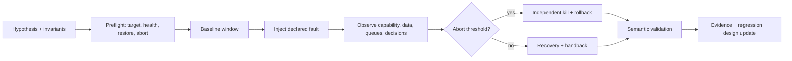

Start with reversible dependency/process faults in isolation; expand one failure domain at a time. Incident-informed classes include process/node/zone loss, dependency error, delay/loss/partition, duplication/reordering, stale discovery, clock skew, storage read-only/unavailable, quota exhaustion, and restore failure. Avoid destructive corruption until an independently approved isolated design proves cleanup. Surveys and foundational chaos work support scenario-based fault injection but do not establish that chaos programs alone cause organizational reliability [NFR02-5; NFR02-6].

### 9.5 Recovery correctness

RTO is maximum tolerable unavailability before unacceptable impact; RPO is the recoverable point/data-loss bound; maximum tolerable disruption must leave time for validation, backlog processing, and business resumption [NFR02-8]. Measure from a defined disruption trigger to validated capability, separating detection, decision, promotion, dependency reconfiguration, service restoration, semantic validation, backlog drain, and handback.

A restore passes only after checksums/content identity, schema compatibility, meaningful counts, referential/domain invariants, ordering, idempotent replay, duplicate-side-effect detection, authorization, representative workflows, and return-to-normal. Backups need independent failure domains, retention/version metadata, integrity, and regular restore sampling. NIST's current backup guidance emphasizes creation, testing, and recovery-exercise review [NFR02-11]. Active-active requires conflict semantics and fencing; active-passive must prove authority, stale-primary fencing, dependency readiness, and handback.

### 9.6 Evidence and failure modes

The packet links requirement, use profile, fault model, architecture boundary, experiment revision, raw measurement, human decision, restore artifact, semantic validation, observed RTO/RPO, model uncertainty, residual common causes, and corrective regression. Tabletop exercises assess decisions and coordination; timed technical tests establish measurable operability [NFR02-9]. ISO 22301 additionally makes return to normal part of continuity [NFR02-12].

Recurring failures are availability-only success, paper RTO/RPO, hidden common cause, retry amplification, split brain, untested backups, neglected recovery code, easy-but-unrepresentative faults, oversized blast radius, confounded experiments, scripted game-day theater, growth extrapolation across change, MTBF misuse, diversity illusion, gray-failure blindness, degraded-mode drift, premature readiness, and missing human/supplier decision paths.

At **foundational** maturity, critical capabilities define failure, degraded modes, RTO/RPO/MTD, dependencies, common causes, and restore invariants; recovery handlers and actual artifacts are tested in isolation. At **advanced** maturity, operational profiles, uncertainty-aware growth models, common-cause analysis, layered containment, timed failover/restore distributions, controlled injection, and risk-based game days feed regressions. At **expert 2026** maturity, an evidence graph links requirements through incidents and corrections; multi-region/provider/control-plane/event/agent dependencies are exercised; experiment admission/abort is policy-controlled but high-consequence handback retains human authority; no model or chaos program is treated as universal proof.
## 10. Security Assurance Across the SDLC

### 10.1 Claim-, threat-, and evidence-driven security

Security assurance asks whether declared claims hold for a specific system, threat model, deployment, and supply chain. Begin with assets, trust boundaries, attacker capabilities, abuse goals, impact, and assumptions; derive requirements and controls; verify them through complementary methods; adversarially validate; triage residual vulnerabilities; and feed incidents back into the model. NIST SSDF supplies a risk-based practice vocabulary, not a universal proof calculus [NFR03-1].

An executable abuse case records attacker goal, assets, entry point, preconditions, prohibited outcome, expected control behavior, detection/response, and oracle. It can drive negative acceptance tests, API/state sequences, fuzz targets, and red/purple-team scenarios [NFR03-8]. Every high-risk abuse case should link to at least one preventive control, negative/adversarial test, detection expectation, and owner.

### 10.2 Complementary analysis layers

| Method | Evidence strength | Principal blind spots |
|---|---|---|
| SAST | Broad source/IR rules, data flow, taint, early feedback | Language/framework/model gaps; false positives and negatives |
| DAST | Deployed configuration, integration, authentication, runtime behavior | Only visited states and inputs; weak source localization |
| IAST | Runtime path with code/source context | Exercised paths only; instrumentation can perturb behavior |
| SCA | Artifact dependency identity plus advisory correlation | Incomplete graphs, identity ambiguity, advisory gaps, reachability uncertainty |
| Secret scanning | Candidate credentials in source/history/images/logs | False positives, provider verification risk, copies outside scanned stores |
| Configuration scanning | IaC, images, cloud/OS policy, effective state | Declared state differs from runtime; compensation and drift |
| Fuzzing | Generated executions, sanitizer/oracle witnesses | Coverage proxy, invalid inputs, reset/state and semantic-oracle limits |
| Pen/red/purple test | Adaptive attack chains and control-evasion evidence | Point-in-time, scoped, costly, non-exhaustive |

Agreement among tools may reflect a shared blind spot. Absence of findings is weaker than an explicit oracle and coverage argument. Empirical research on default SAST use, secret tools, and SCA demonstrates tool/configuration-dependent variation [NFR03-12; NFR03-13; NFR03-14].

### 10.3 Fuzzing architecture

Fuzzing repeatedly executes a fixed, instrumented target with generated inputs. Mutation, grammar/model, symbolic, and hybrid strategies can be black-, grey-, or white-box. Coverage feedback and rare-path scheduling improve search; code coverage is a proxy, not the security objective [NFR03-9; NFR03-10].

A campaign records target and container digest, compiler/hardening/sanitizer configuration, seed corpus, generator/model, PRNG seed, reset/snapshot strategy, resource budget, execution and edge/state coverage, sanitizer or semantic oracle, candidate normalization, minimized reproducer, exploitability classification, and first/last seen. Replay on a clean worker, deduplicate by normalized stack plus semantic effect, then add confirmed minimal inputs to a durable regression corpus.

Stateful protocol fuzzing also needs session states, authentication/authorization transitions, message sequences, response/state feedback, and invariants. AFLNET illustrates state-aware greybox protocol exploration [NFR03-11]. Line or edge coverage does not establish that privilege, tenant, replay, or ordering rules were tested.

### 10.4 Authorized adversarial validation

NIST separates planning, discovery, attack, and reporting and warns that live attacks can cause damage [NFR03-2]. Rules of engagement define written authorization, assets, identities, permitted payloads, window, data handling, stop conditions, emergency contacts, snapshots/rollback, evidence retention, and retest. Derive attack chains from current threat intelligence and abuse cases. Convert discovered control gaps into deterministic tests, detection rules, architecture changes, and owned residual risk; otherwise a pen-test report becomes a periodic archive rather than a control.

### 10.5 Risk and exploitability triage

Severity is only one input. A transparent decision considers intrinsic severity/vector, exploit maturity, exposure, attacker reachability, asset criticality, business/safety impact, affected artifact provenance, compensating controls, confidence, and remediation/containment options. CVSS v4 provides technical, threat, and environmental components but is not a complete release priority [NFR03-6].

A triage record retains source evidence and timestamp, affected digest/version, call/deployment reachability, role/tenant context, exploit reproduction, score/vector, uncertainty, owner, deadline, decision, exception expiry, and independent retest. Active exploitation and reachable high-impact paths can outrank higher database scores. “Unreachable” is a versioned claim and reopens when code, configuration, dependency, exposure, or threat status changes.

### 10.6 Supply-chain verification

Resolve direct, transitive, optional, platform, OS/container, plugin, generated, and build dependencies into the deployed artifact. Bind SBOM, artifact, signature, and provenance to immutable digests. Verify builder identity, build type, external parameters, source, dependencies, and subject digest before promotion. SLSA defines source/build/provenance tracks [NFR03-7]; provenance does not prove benign source, complete dependency discovery, or functional/security correctness.

```yaml
security_release_gate:
  block:
    - confirmed_reachable_exploit_on_critical_path
    - active_secret_exposure
    - failed_cross_tenant_or_privilege_invariant
    - artifact_sbom_provenance_digest_mismatch
    - untrusted_builder_or_signer
  require:
    - threat_model_and_abuse_case_revision
    - sast_sca_secret_config_evidence
    - authenticated_dast_route_role_coverage
    - fuzz_campaign_and_regression_corpus
    - signed_artifact_sbom_provenance
  exceptions: {owner: required, compensating_control: required, expiry: required, reopen_on_change: true}
```

Protect the control plane with least-privilege CI identity, short-lived signing credentials, isolated builders, pinned actions/images, reviewed workflows, registry policy, dependency update governance, and independent deploy-time verification. NIST supply-chain guidance treats these as organization/system controls across acquisition and operation [NFR03-4].

### 10.7 Evidence, failure modes, and maturity

The release-addressable evidence graph links threats, abuse cases, requirements, design claims, controls, source/config/dependency identities, tool/rule versions, target digest, findings, fuzz corpus/reproducers, pen-test scope, SBOM/provenance, triage, remediation, retest, residual risk, and release digest. Measure high-risk abuse-case coverage, reachable-finding closure, time to revoke secrets, inventory completeness, provenance verification, fuzzed states/reproducible defects, authenticated route/role coverage, and regression survival—not raw finding counts alone.

Common failures are scanner-as-assurance; generic threat models; DAST crawlers without state/role evidence; incomplete or manifest-only SCA; secrets found but not revoked; IaC declaration mistaken for runtime; coverage maximized without security oracles; fuzz crashes unreproduced; pen tests without automation feedback; CVSS-only priority; signed artifacts bypassing vulnerability gates; permanent waivers; and generated security tests accepted without reviewed threat semantics.

At **foundational** maturity, threat/abuse cases, differential SAST, artifact-aware SCA, secret/config checks, bounded authenticated DAST, a basic fuzz corpus, and owned triage create layered evidence. At **advanced** maturity, framework-aware data flow, state/role coverage, sanitizer and stateful fuzzing, current attack-chain exercises, reachability-aware decisions, signed SBOM/provenance, and re-openable exceptions gate immutable releases. At **expert 2026** maturity, claim-to-evidence graphs, trusted-builder/dependency verification, continuous protocol/business-logic fuzzing, empirical tool calibration, machine-assisted but human-reviewed triage, and a first-class evidence-gap register keep conclusions proportional to the tested threat and deployment.
## 11. Accessibility, Usability, Compatibility, and Internationalization

### 11.1 Normative baseline and scope

WCAG 2.2 is the web-content baseline and is also ISO/IEC 40500:2025 [NFR04-1; NFR04-2]. It organizes criteria under Perceivable, Operable, Understandable, and Robust. Conformance requires every applicable criterion at the claimed level for complete pages/processes or a conforming alternate version. WCAG 2.2 adds focus-not-obscured, dragging alternatives, target size, consistent help, redundant-entry, and accessible-authentication criteria. Normative criteria are testable; examples and techniques are informative. Conformance is necessary evidence, not proof of universal usability, because WCAG does not cover every disability combination or context.

WCAG-EM 2.0, published as a W3C Group Note on 23 July 2026, structures evaluation around scope, conformance target, accessibility-support baseline, product exploration, complete processes, structured/random sampling, evaluation, and reporting [NFR04-3]. A sample audit cannot justify a whole-product claim if routes, states, overlays, authenticated/error paths, or third-party content are outside the enclosure.

### 11.2 Accessibility-tree and component contracts

The accessibility tree must expose names, roles, states, values, relationships, focus order, and changes through browser/OS accessibility APIs. Prefer native controls; WAI-ARIA supplements rather than replaces native semantics [NFR04-5]. Every reusable component specifies:

- native element or platform control and accessible-name source;
- role/state/value mapping and dynamic synchronization;
- keyboard, pointer, switch/speech-equivalent behavior;
- focus entry, exit, visibility, non-obscuration, and restoration;
- status/live-region announcements;
- error identification and recovery;
- target geometry, reflow, text resize/spacing, contrast, forced colors, and reduced motion;
- language/direction metadata and localized labels.

Test fixtures cover empty, loading, error, disabled, selected, expanded, long label, translated, RTL, high-contrast, zoomed, and reduced-motion states. A visually convincing custom widget that lacks correct semantics or focus remains inaccessible.

### 11.3 Layered evaluation

| Layer | Good at | Cannot establish alone |
|---|---|---|
| Automated/static/rendered rules | Required attributes, some name/role/value, contrast, geometry, language, deterministic ACT rules | Meaningful alternatives, logical focus/task order, understandable error, usable AT journey |
| Expert inspection | Semantic/interaction reasoning, criterion interpretation, cross-state review | Population-level usability or every lived experience |
| Assistive-technology pass | Actual announcement, navigation, focus, input behavior on a stack | Other browser/OS/AT/version combinations |
| Inclusive human study | Barriers, workarounds, uncertainty, task success, effort, satisfaction | Universal prevalence from small/contextual samples |

ACT Rules Format 1.1, a February 2026 W3C Recommendation, provides rule identity, applicability, assumptions, accessibility-support context, outcomes, and mappings [NFR04-4]. Preserve `cantTell`, `untested`, `blocked`, and `unsupported` rather than coercing them to pass. Historical benchmarks show narrow automated coverage and complementary strengths across tools, experts, and disabled users [NFR04-13; NFR04-14]. Exact old percentages should not be transferred to current engines or tools; the automation-limit principle remains.

For each critical journey perform keyboard-only; zoom/reflow/forced-colors; touch/pointer/reduced-motion; and representative desktop/mobile screen-reader passes. Record browser, OS, AT, versions/settings, locale, viewport, zoom, input, expected and observed accessible-tree semantics and announcements.

### 11.4 Inclusive usability evidence

ISO 9241-210 places human-centered design throughout the lifecycle [NFR04-7]. Recruit people who actually use relevant screen readers, magnification, keyboard/switch, speech input, captions, alternative pointing, cognitive supports, and languages; include intersecting/fluctuating disabilities. Use accessible consent and materials, fair compensation, participant-owned AT/settings, and co-designed realistic tasks. Disability simulation by non-disabled staff is not a substitute.

Measure task success/accuracy, error and recovery, time/interaction effort, confidence, workload, and satisfaction; retain qualitative severity and workaround evidence. Blind users may waste time because they cannot distinguish absent content, an accessibility defect, and a findability problem [NFR04-15]. Separate accessibility conformance, general usability, translation/content, and platform/AT defects for ownership.

### 11.5 Compatibility and internationalization matrix

Compatibility varies by engine/version, OS, device/orientation, viewport/zoom, input, AT/version/settings, locale, and script. State the support baseline. WPT/Interop 2026 continuously tests standardized browser behavior, including accessibility-tree investigation, but platform conformance cannot prove application semantics [NFR04-12]. Prioritize pairwise coverage plus risk triples such as Arabic + RTL + mobile VoiceOver, German expansion + 400% zoom, or Japanese IME + keyboard navigation.

i18n is correctness, not string replacement. Test Unicode grapheme clusters, combining marks, emoji/ZWJ, non-breaking and zero-width characters, locale-sensitive case/collation, plural/gender/context, calendars, first-day-of-week, numbers/currency/units, time zones/DST, long expansion, IME input, and locale fallback. UAX #9 defines bidirectional ordering [NFR04-9]; CLDR/LDML and ECMA-402 define locale data and APIs [NFR04-10; NFR04-11]. Store mixed-direction text in logical order, apply isolation/direction where needed, and test punctuation, numbers, identifiers, URLs, form labels, and accessible names. Pseudolocalization finds layout/key defects; native-language reviewers judge meaning, grammar, culture, and pronunciation.

### 11.6 Evidence and release policy

```yaml
inclusive_quality_contract:
  conformance: {standard: WCAG_2_2, target: AA, edition: ISO_IEC_40500_2025}
  support_baseline: [browser, os, assistive_technology, input, viewport_zoom, locale_script]
  pipeline:
    pull_request: [rendered_act_rules, accessibility_tree, keyboard_smoke, i18n_api_checks]
    nightly: [route_state_matrix, zoom_reflow, contrast_targets, locale_rtl]
    release: [manual_at_journeys, wcag_em_sample, inclusive_usability]
  outcomes: [pass, fail, inapplicable, cantTell, untested, blocked, unsupported]
  release_block: [critical_journey_barrier, accepted_contract_regression]
```

Store build/commit, route/state/sample rationale, rule/oracle version, environment fingerprint, raw output, DOM/accessibility-tree snapshots, AT transcript, participant/task record, defect/retest, and limitations. Trend severity and user impact, not aggregate scanner score. Risk acceptance names affected populations, workaround quality, owner, expiry/retest, and accessible customer communication.

### 11.7 Failure modes and maturity

Failures include scanner-score gates, source-only checks, ARIA decoration without behavior, keyboard theater, one-stack claims, simulated disability substitution, sample overclaim, inaccessible authentication, visual-only review, string-only localization, bidi corruption, fixed layout/zoom failure, pseudolocalization overconfidence, and evidence that is not re-baselined after browser/AT/locale-data change.

At **foundational** maturity, WCAG A/AA requirements, support baseline, accessible components, automated plus keyboard/zoom/screen-reader smoke, and long-text/RTL fixtures produce criterion-level evidence. At **advanced** maturity, WCAG-EM enclosure, ACT outcomes, rendered route/state CI, risk-based browser/OS/AT/mobile matrices, inclusive formative studies, and Unicode/CLDR/calendar/IME suites operate together. At **expert 2026** maturity, design-system semantic invariants, accessibility-tree assertions, machine-readable evidence, recurring participatory/summative research, continuous platform-change monitoring, and explicit uncertainty distinguish conformance, usability, compatibility, and localization rather than collapsing them into an “accessible” score.
## 12. Data Quality, Integrity, Persistence, and Migration Assurance

### 12.1 Contextual data quality

ISO/IEC 25012 defines accuracy, completeness, consistency, credibility, currentness, accessibility, compliance, confidentiality, efficiency, precision, traceability, understandability, availability, portability, and recoverability [NFR05-1]. ISO/IEC 25024 supplies example measures but no universal grades [NFR05-2]. Each requirement names population, function, scan/sampling rule, window, numerator/denominator, threshold/tolerance, owner, and response. Do not average away a missing critical ledger row behind a high global completeness score.

Separate four claims:

1. **Syntactic validity:** types, nullability, ranges, formats, enums.
2. **Structural integrity:** keys, references, uniqueness, cardinality, dependencies.
3. **Semantic correctness:** business invariants and transformation meaning.
4. **Persistence integrity:** committed state survives without tear, loss, reorder, or corruption under the stated storage protocol.

A dataset can be valid in shape and wrong in meaning; a transactional source can feed an incomplete analytical target.

### 12.2 Transaction and concurrency evidence

ACID is scoped to the actual resource/transaction boundary. Application invariants are not automatically inferred. A database write plus independent cache, search, object-store, or broker update is not one atomic transaction without a protocol that makes it so.

Isolation labels do not portably characterize all behavior. Classic SQL phenomena are incomplete; test the configured engine, driver, retry policy, and replicas against forced histories [NFR05-4; NFR05-5]. Include dirty/non-repeatable reads where relevant, lost update, read and write skew, phantoms/predicate races, stale replicas, and cross-resource anomalies. When serializability is required, capture operation history and construct dependency/conflict edges; a cycle refutes equivalence to a serial execution. Snapshot isolation can admit write skew unless a constraint, predicate lock, serializable transaction, coordination, or proven invariant-confluent design prevents it [NFR05-6; NFR05-7].

Use session barriers to reproduce races: same-key insert, double withdrawal, overlapping interval updates, read-modify-write counters, parent-delete/child-insert, and predicate-query/insert. Retried serialization failures must reuse the same idempotency identity and not duplicate external effects.

### 12.3 Events, ordering, and idempotent effects

At-least-once delivery can yield an exactly-once **effect** through stable event identity, durable inbox/processed marker, unique constraint, and atomic state-plus-marker update. Exactly-once delivery, processing, state transition, and external effect are different claims. Use a transactional outbox for authoritative state plus intent, and an inbox/deduplication boundary at consumers. Events include producer, ID, aggregate, sequence or source-log position, schema version, event time, and causation/correlation.

Ordering is usually per aggregate/partition, not global. Define late-event policy: reject, buffer, compensate, or recompute. Test crashes before/after publish and acknowledgment, consumer failure between state and marker, duplicate, out-of-order, poison event, replay, checkpoint, and schema skew. Assert the final effect and lineage, not transport invocation count.

### 12.4 ETL/ELT reconciliation and lineage

An auditable pipeline is source snapshot/CDC → immutable landing → parse/canonicalize → transform → quality gate → idempotent load/merge → reconcile → publish → lineage/evidence. Record batch ID, cutoff/LSN, input digests, schemas, code/config hash, row accounting, output snapshot, and decision.

For disjoint batch populations—source \(S_k\), loaded \(L_k\), rejected \(R_k\), quarantined \(Q_k\), policy-excluded duplicates \(D_k\)—require

\[
|S_k|=|L_k|+|R_k|+|Q_k|+|D_k|.
\]

For additive measures,

\[
\Delta_k=\operatorname{adjustedSum}(S_k)-\operatorname{sum}(L_k),
\]

and accept \(|\Delta_k|\le\epsilon\) only when rounding, currency, exclusions, and \(\epsilon\) are contractual. Also compare keyed anti-joins, duplicates, null/domain rates, referential closure, min/max, distinct keys, and canonical row digests. Counts alone can match after key swaps or consistently wrong transformations. The oracle problem motivates layered schema, invariant, differential, metamorphic, and sampled-human judgment [NFR05-8].

W3C PROV-DM models entities, activities, agents, derivations, collections, and provenance [NFR05-10]. It records asserted lineage; it does not prove truth. High-risk output retains source position, transformation/config version, mapping, validation, rejection reason, and replay recipe to explain a cell, row, aggregate, or model input.

### 12.5 Safe migration as refinement

Let \(f\) map an old record/state to a new representation. Specify domain/key preservation, null/default semantics, units/precision, order/timezone, references, and whether \(f\) is total, injective, or intentionally many-to-one. A lossy non-invertible mapping cannot be rolled back by pretending \(f^{-1}\) exists. Preserve the old form, append-only log, reversible mapping, or snapshot until semantic verification and retention complete.

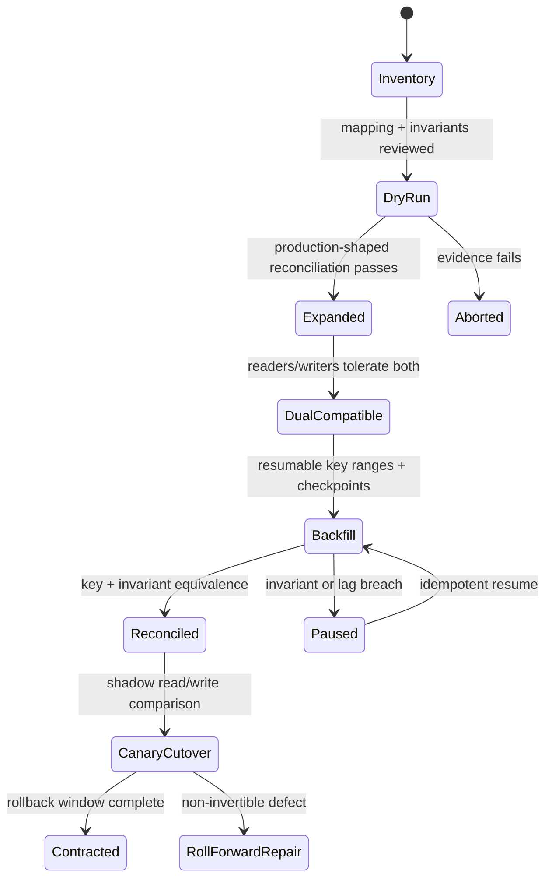

Expand-contract is the default: add compatible structures; deploy tolerant readers/writers; dual-write or derive; backfill in bounded idempotent chunks with concurrent-write fence; reconcile; canary cutover; remove old paths only after rollback/retention. Test interruption/retry at every checkpoint, old/new application overlap, partial failure, duplicates, rejects, precision/range, enum reader-before-producer ordering, and roll-forward/rollback. Research demonstrates zero-downtime and lazy-evolution techniques but not universal safety [NFR05-13; NFR05-14].

### 12.6 Evidence, failure modes, and maturity

The evidence bundle includes data contract diff, dependency graph, mapping, pre/post snapshots/manifests, dry run, row accounting, keyed comparisons, invariants, shadow responses, lineage, checkpoints, cutover, and rollback/roll-forward decision. Every claim states invariant/user need, observable boundary, and remaining assumption.

Failures include schema-only quality, global averages hiding critical records, isolation-name confidence, missing cross-resource protocol, retry duplicating side effects, global-order assumptions, target-only ETL checks, count-only reconciliation, silent coercion, lineage screenshots without replay, digests presented as semantics, backfill without write fence, irreversible mapping with fake rollback, old structures removed before proof, and migration success defined as DDL completion.

At **foundational** maturity, versioned data contracts, database constraints, transformation unit tests, keyed reconciliation, idempotency identities, and restore/persistence checks separate syntactic, structural, semantic, and storage evidence. At **advanced** maturity, generated concurrent histories, real isolation/driver verification, transactional outbox/inbox, restartable manifested pipelines, field-level lineage, expand-contract, shadow comparison, and invariant-based cutover govern distributed data. At **expert 2026** maturity, policy-as-code connects schema/migration CI, production-shaped clones, CDC replay, deterministic race schedules, old/new differential canaries, data-quality SLIs, and evidence catalogs; weaker coordination is used only where named operations and merge rules are proven to preserve the named invariant.

# Part V — Shift-Right and Production Quality

## 13. Observability-Driven Testing and Field Diagnosability

### 13.1 Signals as imperfect evidence

A log is a contextual event record; a metric an aggregate measurement; a trace a causally organized span graph for logical work; a profile a statistical sample of stacks/resources; an event a timestamped state-transition observation. Metrics detect population change but lose per-request causality. Logs retain detail but are difficult to join. Traces expose topology and propagation but sampling and missing boundaries make them incomplete. Profiles locate resource use but do not prove business causality. Combining signals triangulates evidence; it does not guarantee root cause.

Observability quality has four dimensions: required paths/events are complete; values and relations are correct; concepts are encoded consistently; and the evidence is fit to answer a declared diagnostic question. More volume can reduce fitness through cardinality, privacy, cost, perturbation, and drops.

### 13.2 Context and causal structure

Trace ID groups work; span IDs and parent relations model usual call trees; links model fan-in, batch, and asynchronous relationships. W3C Trace Context standardizes `traceparent` and `tracestate` [SR01-2]. OpenTelemetry context carries identity through process boundaries; baggage is user-defined propagated data, not authentication or proof of causality. Allowlist, bound, redact, and never authorize from baggage.

Queues, scheduled jobs, callbacks, thread pools, retries, and fan-out/fan-in require explicit parent-versus-link choices. Clock ordering is approximate under skew and buffering; prefer propagated causal relationships to wall-time proximity. Distinguish logical operation, attempt, and final outcome so retry traces do not overwrite causality.

### 13.3 OpenTelemetry contract

OpenTelemetry provides vendor-neutral APIs, SDKs, data models, context, OTLP, semantic conventions, and Collector architecture [SR01-3; SR01-4]. Pin specification and semantic-convention versions, distinguish stable from development fields, use schema URLs, and version organizational extensions.

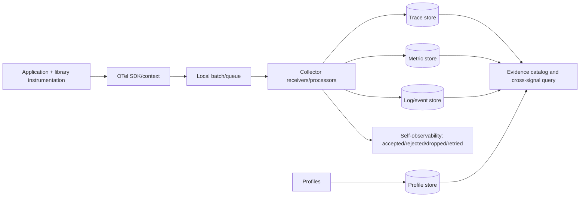

Instrument entry/exit, outbound clients, database/messaging, async handoffs, policy decisions, durable state transitions, and error boundaries. Metrics use bounded dimensions; logs correlate to trace/span where valid; profiles join only through defensible resource/time mappings. The Collector's own accepted, rejected, dropped, retried, queued, and aged-out counts constrain evidence interpretation.

### 13.4 SLIs, invariants, and runtime verification

An SLI specifies event population, valid event, boundary, aggregation, window, and exclusions. Missing or misclassified events can produce a deceptively good value. Runtime invariants make local temporal claims, for example: authorization precedes privileged effect; every transaction commits or rolls back; retry cannot duplicate a non-idempotent effect; all spans close; required context crosses known boundaries; telemetry contains no prohibited secret.

Classify safety (“bad event never occurs”), liveness (“expected event eventually occurs”), and telemetry data-quality properties. Runtime verification turns event traces into automata or temporal-logic checks [SR01-5]. It can expose forbidden intermediate states even when the final API response is correct. Trace validation compares concrete execution to a model/refinement relation; trace-guided generation can preserve data/control dependencies [SR01-9; SR01-10]. A generated or inferred model is a hypothesis until independently asserted.

### 13.5 Test the instrumentation

Instrumentation is production code. Unit tests assert names, kinds, attributes, status, exception events, timestamps, closure, and cancellation/timeout paths. Boundary contracts capture OTLP fixtures and assert resource identity, schema URL, context continuity, log/trace join, prohibited-data absence, and parent/link topology. Collector tests cover malformed data, schema migration, processor ordering, sampling, queue overflow, exporter failure, restart, and backpressure.

CI telemetry attaches bounded run/job/commit identity, structured test events, duration histograms, retry status, and infrastructure failure. Preserve failing traces/logs under access controls. Gate telemetry-contract conformance separately from functional pass; a green but non-diagnosable binary does not satisfy the evidence contract. Runtime-verification research also shows instrumentation overhead is a validity concern, so compare critical behavior with and without instrumentation [SR01-11].

### 13.6 Sampling, privacy, and field diagnosis

Uniform/head sampling can omit rare or minority paths; tail/diversity-aware selection improves some recall but depends on observable selection data and buffers. STEAM illustrates observability-preserving sampling research [SR01-6]. Record sampling rule and uncertainty with every diagnosis. Encrypt and authorize telemetry, minimize payloads, separate aggregate metrics from sensitive evidence, and test redaction.

Maintain a versioned catalog:

| Field | Purpose |
|---|---|
| Diagnostic question | Prevent signal collection without a decision need |
| Required signals/fields/relationships | Define minimum evidence |
| Schema/version/owner | Control meaning and change |
| Sampling/retention/access | Bound recall, cost, and privacy |
| Blind spots/confidence | Prevent overclaim |
| Replay/query recipe | Make diagnosis reproducible |

Health measures include critical-boundary coverage, propagation success, orphan-span rate, invalid schema, drop/queue loss, skew bounds, incident causal-path completeness, and questions answered without manual unstructured joins. Incident learning preserves query provenance and competing hypotheses, then converts missing evidence or ambiguous transitions into instrumentation requirements and regression tests.

### 13.7 Failure modes and maturity

Failures include telemetry volume mistaken for observability, metrics without populations, logs without join keys, parent trees misrepresenting async links, baggage trusted for identity, schema/convention drift, high-cardinality metrics, secrets in attributes, sampling rules hidden, dropped telemetry ignored, inferred zero-code topology treated as application causality, wall-clock correlation presented as cause, instrumentation perturbation unmeasured, and dashboards without reproducible diagnostic questions.

At **foundational** maturity, critical workflows define evidence contracts, stable resource/change identity, trace propagation, structured logs, bounded metrics, telemetry-loss counters, and instrumentation tests. At **advanced** maturity, pinned semantic schemas, Collector failure tests, cross-signal correlation, runtime invariants, trace/model checks, privacy-aware sampling, CI/test observability, and an evidence catalog make diagnosability measurable. At **expert 2026** maturity, schema governance and team-owned instrumentation coexist; sampling and inferred topology carry explicit confidence; high-value failures are causally reconstructible; diagnosis preserves evidence provenance; and every automated conclusion exposes uninstrumented boundaries and uncertainty.

## 14. Progressive Delivery and Production Experimentation

### 14.1 Exposure is a controlled experiment

Deployment installs an immutable artifact; release exposes behavior. A feature flag, route weight, ring, region, tenant, or cohort can therefore make exposure reversible without rebuilding. A canary gives a treatment population the candidate while a contemporaneous control retains the established version. Blue/green keeps full environments beside one another and changes a routing boundary. A shadow copies inputs to a non-authoritative candidate whose responses and side effects cannot reach users. These mechanisms answer different questions: canary evidence concerns experienced behavior; blue/green emphasizes cutover; shadowing emphasizes compatibility under production-shaped inputs.

Staged release has observational credibility only when assignment is stable, populations are comparable, instrumentation is complete, and the decision policy was fixed before results were seen. The statistical service described by Google compares a changed population with a control and permits an indeterminate verdict [SR02-4]. Sequential canary research addresses the false-detection inflation caused by repeatedly peeking at fixed-sample tests [SR02-6].

For outcome metric \(Y\), define the treatment effect over a declared window and population as

\[
\Delta = E[Y\mid C=\text{candidate}]-E[Y\mid C=\text{control}].
\]

The engineering decision depends on a practical harm limit \(\delta\), not merely \(p<0.05\). Promotion may require an anytime-valid upper confidence bound \(U_t(\Delta)<\delta\) for harm metrics, minimum duration and events, no critical invariant failure, sample-ratio agreement, and acceptable telemetry missingness. Multiple metrics, slices, and experiments require multiplicity control or a small preregistered guardrail set. Aggregate improvement cannot overrule a material regional, device, accessibility, or customer-tier regression without a declared weighting and risk rationale; Simpson's paradox is a documented online-experiment hazard [SR02-7].

### 14.2 Control-plane architecture

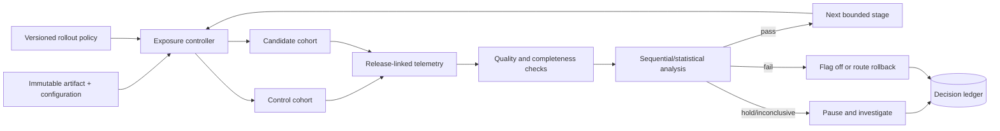

Persist five independently versioned records: artifact/configuration; cohort/exposure assignment; observation windows; analysis policy; and decision/action. Deterministically hash an appropriate unit such as account or session, preserve its assignment for the experiment, exclude interfering experiments, and reconcile assigned with observed samples. Telemetry loss can bias experiments, not just reduce power [SR02-9]. A `fail` routes to known good; `inconclusive` pauses; `pass` advances only when completeness and duration gates also pass.

```yaml
release_policy: checkout-2026.08
unit: account_id
stages:
  - exposure: 0.01
    min_duration: 30m
    min_events: 10000
  - exposure: 0.05
    min_duration: 2h
  - exposure: 0.25
    min_duration: 8h
guardrails:
  - {metric: wrong_charge_rate, direction: lower, max_delta: 0}
  - {metric: error_ratio, direction: lower, max_delta: 0.001}
  - {metric: latency_p95_ms, direction: lower, max_delta: 25}
on_missing_data: pause
on_critical_invariant: rollback
```

Binary rollback is insufficient where schema, cache format, external effects, or irreversible writes changed. Use expand-contract compatibility, idempotency, transactional boundaries, tested restoration, and a kill switch outside the candidate. A successful traffic shift does not prove data restoration.

### 14.3 Fail-closed traffic shadowing

Mirror only an authorized sample. Scrub/tokenize sensitive fields before replay; use isolated state, read-only identities, fake providers, egress denial, rate/resource quotas, deadlines, and circuit breakers. Sink email, message, payment, and queue writes. The shadow must not answer the user or mutate shared state; otherwise it is an uncontrolled canary. Research systems demonstrate that isolation is a core condition of online shadow verification [SR02-5].

Compare normalized schemas, invariants, status/error classes, selected field hashes, exceptions, latency, and resource distributions. Remove only declared nondeterminism such as generated IDs, time fields, or unordered collections. Shadow evidence is strong for read-path compatibility, weaker for write semantics, long-lived state, cold caches, and user-perceived usefulness.

### 14.4 Synthetic and real-user feedback

Synthetic monitoring actively executes known APIs and journeys from selected regions and conditions; it detects low-traffic outages and provides repeatable diagnosis. Real-user monitoring passively samples actual devices, networks, languages, assistive modes, and journeys; it estimates experienced distributions. Synthetic coverage misses unmodeled paths. RUM is silent when nobody can reach the service and biased by the active-user mix. Join both to release, cohort, flag, region, and environment while preserving the signal semantics of Chapter 13.

RUM requires purpose limitation, minimized fields, rotating pseudonymous cohort identity, bounded retention, redaction, and a privacy impact assessment for new fields, replay paths, or joins. Aggregation alone is not a privacy guarantee [SR02-11]. Stratified samples and missingness measures must accompany feedback. Confirmed field failures should update risk models, synthetic journeys, boundary corpora, and workload distributions, with a record of whether the evidence came from shadow, canary, or general release.

### 14.5 Failure modes and maturity

Failures include unstable assignment, an unrepresentative first ring, absolute-health checks without a control, fixed-sample peeking, metric shopping, sample-ratio mismatch, telemetry loss, aggregate-only decisions, flag debt, shadow side effects, nondeterministic differential noise, overload from mirroring, irreversible rollback, synthetic blind spots, privacy-invasive RUM, and automated rollback without a bounded operator contract.

At **foundational** maturity, immutable artifacts, one reversible exposure control, stable cohorts, control comparison, a small ring, critical synthetic checks, release-linked evidence, a manual rollback, and minimal RUM privacy review contain initial risk. At **advanced** maturity, staged controllers, explicit pass/hold/fail policy, sequential analysis, balance/missingness checks, multi-region synthetics, stratified RUM, isolated shadow comparison, schema compatibility, and flag expiry automate bounded decisions. At **expert 2026** maturity, overlapping experiments have exclusion and holdout policy; decisions are anytime-valid and segment-aware; the shadow plane is fail-closed; privacy-preserving field evidence and missingness are explicit; and every promotion or rollback is replayable and feeds a drift-checked test model.

# Part VI — AI-Native Quality Systems

## 15. Evaluation of ML, LLM, and Nondeterministic Systems

### 15.1 Assurance claim, estimand, and configuration

AI assurance concerns a socio-technical use, not a model-family score. Verification checks that data, model, configuration, and measurement implement stated requirements; validation asks whether those requirements and evidence support the intended population and consequences. NIST AI RMF organizes voluntary risk management around GOVERN, MAP, MEASURE, and MANAGE [AI01-1], while its generative-AI profile identifies risks and actions specific to generative systems [AI01-2]. Neither is a certificate of safety.

Begin with an estimand. If \(Y_{ir}\) is outcome for item \(i\), repeated stochastic run \(r\), and versioned configuration \(\theta\), then

\[
\mu_{B}(\theta)=\frac{1}{n}\sum_{i=1}^{n} E_r[Y_{ir}\mid i,\theta]
\]

describes performance on the fixed benchmark. A generalized claim instead estimates \(E_{I\sim\mathcal P,,r}[Y_{Ir}\mid\theta]\) for a declared future-item population \(\mathcal P\). NIST AI 800-3 distinguishes benchmark and generalized accuracy and the uncertainty each supports [AI01-3]. Repeats estimate within-item randomness; they do not turn one item into independent evidence. Preserve item/user/session clusters in bootstrap or hierarchical analysis.

The tested configuration includes model/provider snapshot, prompt and policy, decoding, tools/retrieval corpus, evaluator, environment, and time. A score is evidence for that configuration and sampling process—not a permanent property of a model name.

### 15.2 Risk-to-evidence architecture

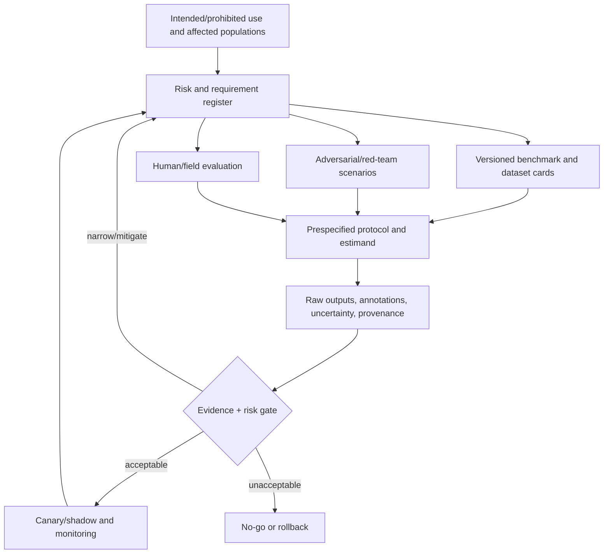

Maintain six linked records:

1. System/context: users, affected groups, stakes, operating limits, oversight, fallback, versions, and data provenance.
2. Risk/requirements: each likelihood/severity hypothesis, owner, control, tolerance, and evidence.
3. Benchmark/dataset card: construct, sampling frame, labels/adjudication, language/subgroups/time, known errors, license, contamination threat, hash/version, and intended claims.
4. Protocol: items, repeats, baselines, randomization, decoding, metrics, missing/abstained outputs, acceptance rules, power/precision, multiplicity, and sequential rules.
5. Evidence ledger: raw inputs/outputs, annotations, evaluator versions, confidence intervals, red-team findings, and review sign-off under privacy controls.
6. Decision/feedback: release scope, exceptions, compensating controls, field thresholds, rollback, incidents, and review date.

Separate development, tuning, sequestered holdout, and production-like field sets. Split by entity, conversation, source, near-duplicate cluster, or time when row-random splitting leaks. Stable anchor items support longitudinal comparisons; rotating private challenges reduce contamination but must retain label and sampling quality. Dataset and model reporting improve traceability but do not prove representativeness [AI01-9; AI01-10].

### 15.3 Measurement portfolio and uncertainty

Choose metrics by the construct and loss. Classification may require prevalence-aware precision/recall, PR-AUC, confusion costs, calibration, and subgroup errors. Generation may combine schema/execution checks, citation grounding, task rubrics, severity-weighted harm, refusal and false-refusal, human judgments, latency, and cost. Report risk-versus-coverage for abstaining systems:

\[
\operatorname{SelectiveRisk}(c)=E[L(Y,\hat Y)\mid \text{system answers at coverage }c].
\]

Prespecify practical non-inferiority/equivalence bounds and lower-confidence gates. Use paired comparisons on common items; Wilson/exact intervals for suitable proportions; cluster bootstrap for repeated generations; and mixed-effects models only after validating assumptions. Correct or constrain multiplicity. Statistical significance does not establish useful magnitude, and a narrow interval around an invalid proxy is still invalid evidence.

Fairness analysis selects context-relevant error/allocation harms, intersectional slices, uncertainty, and small-cell protection; parity definitions may conflict. Robustness measures degradation across perturbations, languages, domains, formats, and shifts. Privacy/security evaluation covers memorization/extraction, PII leakage, poisoning/evasion, adversarial input, prompt injection, and unsafe output handling. Safety assessment reports both attack success/severity and false-refusal/usability costs.

### 15.4 Human and model-based judges

Human evaluation needs a representative task/rater frame, trained anchored rubric, blinded randomized presentation, protections for harmful content, adjudication, and agreement/disagreement reporting. Reliability is not truth, and consensus can preserve a bad construct.

An LLM judge is a versioned instrument. Calibrate it against blinded representative human labels; randomize pair position; test verbosity, style, self-preference, language, task, and group bias; swap judges; retain human audit samples; and revalidate after any change. The MT-Bench/Arena study reported strong agreement in its setting while also documenting judge biases; it did not validate transfer to every domain or risk [AI01-12]. Deterministic or executable oracles should decide objective properties. Judge explanations are audit clues, not authorization.

### 15.5 Release and continuous evaluation

Red teams derive attack families from the threat model, include benign boundaries and adaptive/multilingual variants, version their budget and stopping rules, and turn verified findings into regression cases. Production separates data drift \(P(X)\), prior/label drift \(P(Y)\), concept drift \(P(Y\mid X)\), and configuration/workflow changes. Monitor quality, calibration, abstention, harm, security/privacy, fairness slices, cost/latency, overrides, appeals, and incidents with minimum samples and uncertainty. Re-evaluate after a model, prompt, retrieval corpus, evaluator, policy, or provider change.

NIST's TEVV-Athlon proposes Articulate & Organize, Define & Construct, Apply & Measure, and Synthesize & Interrogate [AI01-4]. As of 27 August 2026 it is an **Initial Public Draft**, not a finalized certification standard; the manuscript uses it only as an assessment-design pattern.

### 15.6 Failure modes and maturity

Failures include optimizing a public benchmark, confusing repeats with independent items, random splits that leak entities, unversioned prompts/evaluators, one scalar hiding a critical risk, accuracy without calibration/abstention, automatic metrics used outside construct, judge circularity or drift, human samples that omit affected populations, subgroup estimates without uncertainty, fairness metric shopping, static red-team prompts presented as robustness, passing guidance-framework checklists as safety proof, and production drift without rollback.

At **foundational** maturity, intended/prohibited uses, versioned cards, leakage-aware holdouts, deterministic contracts, repeated trials, basic confidence/calibration/slices, independent human review, threat-driven red team, and explicit fallback support risk-owner release. At **advanced** maturity, traceable risk statements, anchor-plus-private benchmarks, contamination audit, prespecified clustered statistics, judge calibration, robustness/fairness/privacy/security portfolios, independent adversarial review, and canary feedback support controlled evolution. At **expert 2026** maturity, living evidence blocks connect stakeholder impact to estimands, construct validity, hierarchical uncertainty, practical risk bounds, independent assessors, rotating challenges, field outcomes, and automatic narrowed-use/rollback triggers while every draft or framework limitation remains explicit.

## 16. Agentic-System Testing and Autonomous Quality Engineering

### 16.1 The trajectory is the test object

An agent is a closed-loop transition system. At step \(t\), policy \(\pi_\theta\) maps task, observation, memory, and available capabilities to action \(a_t\); environment transition \(T\) produces state \(s_{t+1}\) and observation \(o_{t+1}\). The evidence object is

\[
\tau=\{(s_t,o_t,a_t,result_t,\Delta s_t)\}_{t=0}^{T},
\]

including external side effects, messages, memory, queues, databases, files, and other agents. Final-answer quality can hide an unauthorized intermediate action. Evaluate utility, invariant safety, confidentiality/security, authorization, repeated-run reliability, recovery/handoff, and cost/latency separately.

Let goal predicate \(G\), invariant set \(I\), authorization policy \(P\), adversary objective \(A\), and budget \(B\) define a scenario. A run passes only when

\[
G(s_T)\land\bigwedge_{t=0}^{T}I(s_t)\land
\bigwedge_{t=0}^{T-1}P(s_t,a_t)\land\neg A(\tau)\land Cost(\tau)\le B.
\]

Partial utility may be reported, but cannot offset a critical invariant breach. For \(n\) tasks repeated \(k\) times, empirical strict consistency can be reported as

\[
\widehat{pass^k}=\frac{1}{n}\sum_{i=1}^{n}\mathbf 1(\text{all }k\text{ runs of task }i\text{ pass}),
\]

without assuming run independence. AgentBench, AgentDojo, and tau-bench respectively motivate broad interactive environments, adversarial stateful tool use, and user-policy interaction with repeated consistency [AI02-6; AI02-7; AI02-8]. No one benchmark proves deployment safety.

### 16.2 Harness and policy boundary

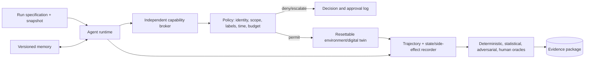

The harness pins model, instructions, tool schemas, policy, decoding, retrieval, environment image, clock, and fixtures. The simulator exposes typed, mutable production-like APIs with realistic permission errors, latency, timeouts, stale records, partial failure, concurrency, and untrusted instructions, but replaces money, customer data, credentials, external messages, and physical effects with reversible counterparts. Use snapshots, hidden scenario families, metamorphic variants, and seeded adversarial mutations.

Every tool proposal crosses an enforcement component independent of the model. Authenticate agent and delegation; resolve operation/resource; validate typed arguments; propagate confidentiality, integrity, and provenance labels; apply temporal/rate/side-effect policy; and check remaining budget. Least-privilege and domain-separation controls have formal precedent in NIST SP 800-53 [AI02-5], but must be instantiated and tested. Use ephemeral per-tool identity, egress allowlists, resource/system-call/filesystem bounds, secret redaction, transaction previews, and explicit approval or narrowly pre-authorized policy for writes, publication, permission change, code execution, money, or production effect.

Autonomy is risk-adaptive: forbidden flows are denied; low-risk operations are allowlisted; coupled obligations are must-lists; uncertain/irreversible actions require confirmation. Circuit breakers bound retries, repetition, depth, wall time, tokens, writes, and cost. An external kill switch must cancel queues, revoke credentials/leases, preserve the last consistent snapshot, and report completed effects. Handoff contains goal, state delta, attempts, uncertainties, policy decisions, and evidence links.

### 16.3 Oracles, memory, and multi-agent behavior

Record an append-only trajectory with messages, retrieved memory/provenance, advertised tools, proposed and executed arguments after redaction, broker decision, result, pre/post state hashes, side-effect diff, versions, latency/cost, retries, approvals, and stop/handoff. A protected raw view and minimized diagnostic view reconcile auditability with privacy. Chain-of-thought is neither required nor a substitute for observable evidence.

Evaluate three layers:

| Layer | Principal oracles |
|---|---|
| Trajectory | Forbidden calls, sequence/temporal rules, information flow, injection resistance, delegation, retry, handoff timing |
| State | Concrete goal state, invariant after every mutation, created/changed/deleted/shared/exfiltrated objects |
| Artifact | Parse/type/compile, isolated tests, static/security analysis, mutation, differential/reference checks, human business-oracle review |

Memory stores separate session, tenant, and long-term scope; attach source, author, timestamp, sensitivity, integrity, confidence, TTL, and revocation. Treat a memory write as a controlled side effect, quarantine untrusted content, and test conflicting or poisoned memories. Multi-agent systems need distinct identities/capabilities, typed purpose-bound messages, provenance, expiry, policy at every handoff, and tests for collusion, confused deputy, privilege laundering, stale messages, shared-memory leakage, and partial failure.

### 16.4 Governed autonomous QA

AI-produced tests, assertions, specifications, repairs, and review comments are untrusted proposals. Bound the loop:

```text
select change/requirement
→ generate candidate test/model/oracle/repair
→ parse, type-check, and constrain
→ execute in disposable environment
→ collect compiler/runtime/static/mutation/differential evidence
→ independent checker classifies evidence
→ propose patch or stop at iteration budget
→ accountable owner accepts consequential oracle/release changes
```

Keep acceptance criteria outside generator-controlled state. Validate generated oracles with independent execution, differential or metamorphic relations, and mutation sensitivity. ChatAssert and TARGET illustrate generation constrained by external tool feedback and semantic validation [AI02-12; AI02-13]; they do not establish completeness or business intent. Measure detection yield, surviving mutants, flaky rate, sampled false positives/negatives, escape rate, review burden, and p50/p95 token/tool cost and latency. Optimize decision quality and cycle time together.

### 16.5 Failure modes and maturity

Failures include answer-only scoring, simulator-to-production semantic gaps, LLM judges authorizing effects, model instructions used as the sole policy boundary, broad shared credentials, untracked side effects, irreversible tests, kill switches inside the failed process, stop without queue/lease revocation, silent budget overrun, retries duplicating effects, prompt injection through tool data, memory without provenance/revocation, cross-agent privilege laundering, visible benchmark memorization, aggregate success masking catastrophic violations, self-modified oracles/policies, generated tests accepted because they compile, and autonomous repair overfitting to the current suite.

At **foundational** maturity, inventory agents/tools/memory/effects, define goals/invariants/budgets, use resettable mocks and state oracles, put writes behind a least-privilege broker and approval, record replayable trajectories, and independently validate generated artifacts. At **advanced** maturity, mutable multi-application simulation, domain policy, untrusted content, memory provenance, multi-agent isolation, transactional rollback, temporal/information-flow checks, repeated long-horizon/recovery trials, hidden mutation suites, and shadow execution support a fail-closed gate. At **expert 2026** maturity, signed trajectories, typed handoffs, attested policy versions, revocable memory, enforceable data flow, production-derived but protected scenarios, independent validation, bounded autonomy loops, drift revalidation, and externally tested kill/rollback/human takeover make autonomy an auditable control system rather than delegated hope.

# Part VII — Departmental Governance and Economics

## 17. Risk, Defects, Quality Metrics, and Cost of Quality

### 17.1 Metrics are decision instruments

A metric is an operationalized construct: purpose, population/unit, raw events, inclusion rules, transformation, uncertainty, and intended decision. Bug-report count is not defect content, tester effectiveness, reliability, or readiness. ISO/IEC/IEEE 15939 starts measurement from an information need [GOV01-1]; ISO/IEC 25010 supplies quality vocabulary rather than universal thresholds [GOV01-2].

Every metric contract records owner/question; scope; numerator, denominator, exposure; deduplication and missingness; window and version boundary; aggregation; uncertainty; known confounders; guardrails; action; and definition version. Store raw events immutably and publish numerator and denominator with rates. A rate may improve while its numerator worsens.

### 17.2 Risk and value of information

A risk is a scenario with cause/precondition, uncertain event, affected mission/asset/population, consequence, horizon, and response. For mutually exclusive scenarios,

\[
E[L]=\sum_i p_iC_i,
\qquad
EAL=\sum_i\lambda_iC_i
\]

uses probability \(p_i\) or recurrent rate \(\lambda_i\) and consequence \(C_i\). Model overlapping risks jointly; use ranges/distributions and sensitivity rather than multiplying ordinal colors. Expected utility for action \(a\) is

\[
EU(a)=\sum_sP(s)U(outcome(a,s))-Cost(a).
\]

Hard safety, security, legal, and contractual constraints remain separate from expected value. Residual risk is a post-control distribution with an owner, not a green cell. The expected value of additional evidence is

\[
VoI=E[\max_a EU(a\mid\text{new evidence})]-\max_a EU(a)-Cost(evidence),
\]

which helps decide whether a test, pilot, telemetry change, or review is worth delaying a decision. NIST SP 800-30 supplies a reusable threat/precondition/likelihood/impact discipline, though its security setting does not make it a universal product-risk formula [GOV01-8].

### 17.3 Defect and failure semantics

Preserve the causal chain: human error/decision may insert a **fault/defect**; execution can produce an internal erroneous state; observable deviation is a **failure**. An anomaly report may later be duplicate, change request, accepted risk, or confirmed defect. IEEE 1044 standardizes anomaly classification [GOV01-5]; Orthogonal Defect Classification uses attributes for process feedback [GOV01-12].

Record product/version, requirement, type, origin and causal mechanism, introducing change, detection phase/method, escape boundary, environment/profile, effect, severity, priority, status, fix/verification, reopen/regression, closure reason, and classification confidence/history. Severity is consequence; priority is work ordering considering exposure, exploitability, deadline, workaround, and cost of delay. Do not invent root cause at intake. Sample independent agreement and retain `unknown`.

### 17.4 Formula contracts

Each formula is valid only for its named population and boundary:

\[
DD=\frac{\text{confirmed defects}}{\text{declared delivered size}},\qquad
FPY=\frac{\text{outputs accepted without rework}}{\text{outputs entering stage}}
\]

\[
DRE=\frac{D_{pre}}{D_{pre}+D_{post}}\times100\%,\qquad
EDR=\frac{\text{unique defects first found after release}}{\text{all lifecycle defects first found}}
\]

Declare DRE's post-release observation window and incident-to-root-cause rules; neither formula estimates unseen latent defects. Exposure-normalized escapes per customer-month or transaction often support better comparisons than size density.

For a declared operational profile,

\[
\hat\lambda=\frac{\text{failures}}{\text{exposure}},\quad
\widehat{MTTF}=\frac{\text{operating time}}{\text{failures}},\quad
A=\frac{uptime}{uptime+downtime}.
\]

The approximation \(A=MTBF/(MTBF+MTTR)\) assumes stable and consistently bounded failure/repair processes. MTTD, mitigation, restoration, full repair, and reopen are different intervals. Report medians/tails and use survival methods for open/censored incidents. Change-failure rate is deployments meeting a declared production-failure predicate divided by all production deployments in the same window; pair it with frequency, lead time, user impact, reliability, and escapes so fewer deployments or suppressed incident reports cannot masquerade as quality.

### 17.5 Measurement architecture and statistical control

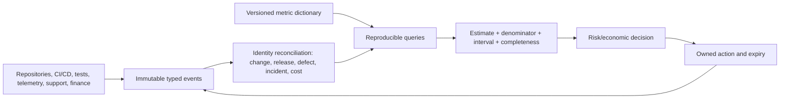

Required event times include commit, deployment, first impact, detection, acknowledgement, mitigation, restore, repair, and closure. Reconcile reports to root causes before DRE/escape calculations and deployments to incidents before CFR. A balanced decision packet combines leading, lagging, and guardrail measures; no single metric is an independent release authority.

Use Wilson/exact intervals for suitable proportions, overdispersion-aware count models for rare events, and quantiles/survival methods for incident time. Separate instrument error and classification disagreement from process variation. A control limit describes estimated process behavior; a specification/SLO/risk limit describes acceptability. Choose p/np charts for proportions, c/u for counts/opportunities, I-MR for suitable individual measures, and EWMA/CUSUM for small sustained shifts. Define rational subgroups, seasonality treatment, signal rules, investigator, and permitted response. Stability does not mean capability.

Association is not intervention effect. Release size, exposure, architecture, test effort, staffing, season, and reporting incentives confound quality metrics. Use randomized/stepped interventions where feasible, otherwise interrupted time series, matching, or difference-in-differences with explicit threats to validity.

### 17.6 Cost of Quality

Classify **prevention** (training, architecture, standards, automation), **appraisal** (review, analysis, testing, monitoring), **internal failure** (pre-transfer rework, rerun, scrap, delay), and **external failure** (support, outage, credits, rollback, regulatory/safety harm, churn):

\[
TCoQ=P+A+IF+EF.
\]

These are accounting lenses; publish allocation rules and prevent double counting. For investment \(a\), estimate labor/infrastructure, opportunity cost, defect/failure probability, detection effectiveness, remediation cost by boundary, exposure, and residual tail loss. Invest when marginal expected loss avoided exceeds marginal lifecycle cost, subject to hard constraints. Model ranges and dependent activity costs for severe events. The familiar phase-of-detection cost multiplier is not a universal law; architecture, coupling, tooling, exposure, and re-release controls change it.

### 17.7 Anti-gaming and maturity

Never rank individuals or teams by raw defects, lines, tests, coverage, DRE, MTTR, or CFR. Pair targets with counter-metrics and audits: DRE with escapes/customer harm; coverage with mutation/defect yield; frequency with CFR/reliability; MTTR with recurrence/durable repair. Lock definitions for a reporting period, audit exclusions/classification, and red-team how a rational actor could improve the number without improving the construct.

At **foundational** maturity, controlled vocabulary, linked immutable identities, metric contracts, explicit risk scenarios, denominators/windows, distinct severity/priority, basic reliability/restoration, and four-category CoQ support a monthly decision review. At **advanced** maturity, federated event contracts, root-cause reconciliation, exposure-normalized reliability, uncertainty/tail statistics, scenario distributions, appropriate SPC, counter-metrics, and intervention baselines support cross-product learning. At **expert 2026** maturity, a privacy-minimized evidence platform produces reproducible decision packets with data quality and causal caveats, combines expected utility with hard constraints and tail loss, evaluates interventions causally where feasible, institutionalizes anti-gaming audits, and retires measures that no longer predict quality, user outcome, reliability, or economic loss.

## 18. Test-Data Management, Privacy, Regulation, and Audit Evidence

### 18.1 Optimize privacy, utility, and evidence together

Test-data governance is an information lifecycle balancing three claims: confidential and personal information is protected; the data preserve enough relational, behavioral, statistical, and tail fidelity to reveal relevant defects; and an independent reviewer can reproduce the transformation and results. Production subsets tend to offer fidelity with the greatest disclosure, residency, retention, insider, and contract exposure. Masking/tokenization can preserve format and joins but retain linkage, frequency, small-domain, and auxiliary-data risk. Synthetic generation can memorize or expose membership. Hand-built fixtures minimize exposure but often omit histories, correlations, long tails, and invalid-but-plausible values.

Select a method from purpose and threat model, not its label. Removing direct identifiers does not defeat singling out by dates, geography, device, occupation, free text, or event sequence. Pseudonymization is a linkability/access control, not proof that privacy obligations disappear. Repeated releases and joins change re-identification risk; ISO/IEC 27559 treats de-identification as lifecycle risk management [GOV02-4].

For equivalence classes over quasi-identifiers, k-anonymity requires

\[
\min_{g\in Groups(QI)}|g|\ge k,
\]

but does not by itself control attribute homogeneity, background knowledge, repeated-release differencing, or utility. Differential privacy bounds adjacent-dataset output distributions:

\[
Pr[M(D)\in S]\le e^\varepsilon Pr[M(D')\in S]+\delta.
\]

The guarantee belongs to a specified mechanism, adjacency definition, \((\varepsilon,\delta)\), composition, and query workload. It does not replace access, inventory, retention, or a threat model. Empirical testing has shown that privacy transformations can reduce program path coverage [GOV02-13]; privacy and utility must be measured concurrently.

### 18.2 Representativeness and integrity contracts

Define four layers: population/business distribution; schema/relational integrity; path/state/history coverage; and rare/boundary/negative scenarios. Validate foreign keys, uniqueness, cardinality, nulls, cross-field correlation, temporal order, concurrency relationships, authorization roles, locale/time zone, invalid-but-plausible states, and expected error paths. Random row sampling can preserve size while losing a minority cohort or a sequence-dependent failure. Coverage-preserving dataset reduction is possible for bounded objectives but does not prove privacy, fairness, drift, or production representativeness [GOV02-15].

Use purpose-specific utility measures: constraint validity, path/model/mutation coverage, distribution distance with uncertainty, relationship and state-transition preservation, defect detection, scenario/tail presence, and stability over versions. A single realism score cannot authorize a dataset.

### 18.3 Policy-controlled supply chain

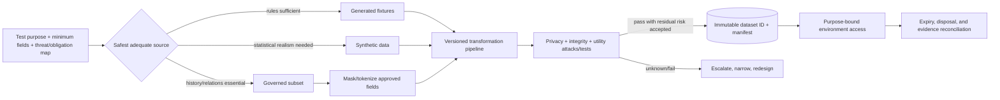

Before acquisition, record purpose, required journeys/defect classes, minimum fields, classifications, jurisdictions/residency and contractual sources, environments, processors, retention/disposal, and a threat model. ISO/IEC 29100:2024 supplies current common privacy roles and safeguarding concepts [GOV02-1]; ISO/IEC 29134:2023 structures a privacy impact assessment [GOV02-2]. These are engineering frameworks, not determinations of which law applies. As of this edition, NIST Privacy Framework 1.0 remains the final voluntary framework; version 1.1 is still an Initial Public Draft, so this manual does not present it as finalized [GOV02-5].

Prefer fixtures when deterministic rules suffice. Use synthetic data when broad sharing or long retention would otherwise expose people, after membership/reconstruction and utility testing. Use a relationally closed subset only when authentic distributions/history are needed. Use deterministic masking/tokenization when cross-record identity is essential, with vault/key separation and tests for frequency, collision, and linkage. Production-derived data requires a scoped exception, owner, purpose, expiry, compensating controls, and verified disposal. Never send raw or reversibly mapped data to an unapproved model or service.

Every output gets an immutable dataset identifier and manifest: source snapshot; extraction rule; transform/policy/schema versions; token key identifier (not key); generator/model/parameters; seed policy; container/dependency digests; service identity; time; row/quality/privacy results; approvals; access; expiry; and disposal. Fail closed on unmapped fields, schema drift, missing approval, unexpected count, unsupported transform, or `unknown` privacy result. Keep data outside source control and logs.

### 18.4 Access, environments, third parties, and disposal

Separate production, restricted staging, build, CI, developer, performance, and demonstration stores by account/network/project/encryption domain and credentials. Deny production-to-development movement except through the broker. Use short-lived workload identity, RBAC/ABAC, MFA/JIT elevation, read-only access, dual approval for sensitive export, and automatic expiry; NIST SP 800-162 provides ABAC concepts for subject, object, operation, and environment attributes [GOV02-7]. Log actor, purpose, dataset, operation/scope, environment, policy, ticket, time, and outcome. Backups, dumps, caches, notebooks, screenshots, tickets, messages, and CI artifacts are copies under the same controls.

Third-party lineage records processor/subprocessor, location, purpose/fields, retention/deletion, support access, encryption/key ownership, model-training restrictions, incident notification, audit rights, and destruction evidence. Contract and technical validation complement each other. Re-review on provider, terms, region, model, or subprocessor change.

Expiry covers primary objects, versions, temporary tables, caches, queues, snapshots, backups where feasible, developer copies, and artifacts. Reconcile inventory so orphaned copies become findings. NIST SP 800-88 Rev. 2, finalized September 2025, defines current media-sanitization program guidance [GOV02-10]. A deletion job is not disposal evidence until scope and outcome are verified.

### 18.5 Audit evidence and cross-track controls

An audit bundle contains approved data-use decision, obligation/control applicability, manifest and lineage, transformation/environment fingerprints, privacy/utility results, access slice, approvals, defects/exceptions, execution IDs, raw-result hashes, signer/key state, and expiry/disposal. Hashes detect byte changes; digital signatures bind an accountable signer [GOV02-11]; append-only/WORM storage protects history. None proves source correctness or safe transformation. Pin containers, libraries, database, generator, seed policy, locale/time zone, and oracle. When exact replay would retain unnecessary PII, offer a controlled replay service or attested synthetic surrogate and document the evidence loss.

This governance reaches upstream. Static analyzers in Chapter 4 need fixture sensitivity/provenance labels to test prohibited flows without classifying permitted synthetic identifiers as leaked production data. Contract and property tests in Chapter 5 require constraint-preserving generators. Hermetic CI in Chapter 6 must bind a dataset manifest but not copy secrets into artifact provenance. Performance and AI evaluations require representative distributions while respecting purpose and access. Data-integrity checks in Chapter 12 validate product data; this chapter governs whether that data may be used and how the evidence is retained.

### 18.6 Failure modes and maturity

Failures include name removal presented as anonymity, routine production copies, masking that breaks joins, stable tokens with accessible vaults, synthetic-equals-private assumptions, random subsets missing tails, optimizing one privacy/utility metric, invalid generated records, incomplete lineage, screenshots as immutable evidence, raw PII in CI/tickets, standing broad/vendor access, draft or inapplicable guidance presented as law, partial deletion, and `cannot tell` accepted as pass.

At **foundational** maturity, inventory/classification, default prohibition of production copies, fixtures first, approved subset/masking, referential checks, separated environments, least privilege/expiry, owner/purpose/source/transform/access/disposal records, and centralized review establish control. At **advanced** maturity, a policy broker, versioned transforms, token/key separation, relational closure, risk-stratified subsets, privacy attacks, utility/scenario metrics, third-party lineage, automated expiry, and append-only manifests integrate with CI/release. At **expert 2026** maturity, minimum-copy supply, signed manifests, attested keys, reproducible containers, continuous linkage/differencing/membership/reconstruction tests, drift/access/provider monitoring, multi-dimensional utility, verified disposal, independent review, and explicit unresolved uncertainty make test data both safer and scientifically useful.

## 19. QA Operating Model, Leadership, Capability Maturity, and Workforce

### 19.1 Design accountability, not an organization chart

An operating model allocates accountability, authority, expertise, evidence, and escalation across product teams, enabling functions, executives, independent assurance, and suppliers. Distinguish three functions:

- **Outcome ownership:** product/business authority owns intended use, quality outcome, treatment, and residual-risk/release decision.
- **Enablement:** specialists, chapters, and platforms make competent practice faster and repeatable.
- **Independent challenge:** a role with evidence access and protected escalation tests the credibility of claims and decisions.

A small enterprise may combine roles; high-consequence work may require separation of reporting, budget, selection, or final decision. Combination is defensible only when conflicts and compensating controls are explicit. The risk acceptor cannot merely self-approve unreviewed evidence.

Centralized quality functions improve consistency, specialist pooling, cross-product learning, and independence but can become late queues. Embedded engineers improve domain context and feedback speed but can duplicate services and lose independence under delivery-only incentives. Federated systems combine central standards/platform/career stewardship with embedded outcome work and professional chapters. Platforms scale common environments, evidence, and guardrails only when treated as internal products with ownership, reliability, user research, and adoption feedback. Communities spread tacit knowledge but cannot replace line authority.

Select by consequence, obligations, architecture coupling, cadence, geography, team count, supplier dependence, specialist scarcity, independence need, and coordination tolerance—not fashion. Empirical studies associate organizational structure with software outcomes but are mainly observational and context-dependent [GOV03-16; GOV03-18]. A risk-tiered hybrid is a contingency design, not a universal theorem.

### 19.2 Layered governance architecture

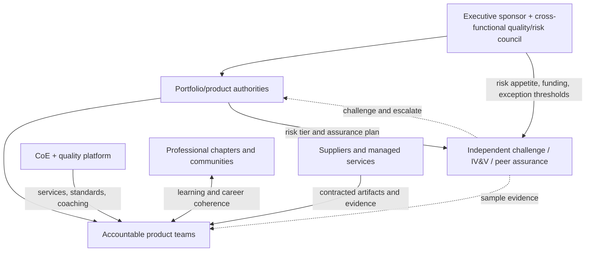

The enterprise layer sets risk appetite, minimum assurance, funding, and escalation, and reviews concentration risk, material exceptions, shared dependencies, supplier concentration, and capability gaps. It does not take over routine product decisions. Each product has a business/product authority accountable for residual risk, delivery roles responsible for execution, and a quality/assurance lead responsible for a living quality strategy and assurance plan. Independent challenge has access, sampling freedom, protected reporting, and no incentive to conceal findings. The CoE owns interpretation, reference practice, coaching, assessment methods, and professional development; the platform owns reusable services—not product outcomes.

ISO/IEC/IEEE 12207:2026 supplies lifecycle process architecture without choosing a development method or organization chart [GOV03-1]. IEEE 730-2026 frames SQA planning/control [GOV03-3]. Tailoring, decision rights, and evidence are still organizational responsibilities.

### 19.3 Decision rights and assurance plans

RACI is insufficient without threshold, evidence, deadline, exception, and escalation semantics. Keep one accountable owner per decision.

| Decision | Accountable | Responsible/evidence producer | Independent input | Escalation trigger |
|---|---|---|---|---|
| Enterprise quality policy/risk appetite | Executive sponsor/board authority | Quality council | Risk, legal, safety/security specialists | Conflict with duty, capital, or portfolio tolerance |
| Product strategy/assurance plan | Product/business owner | Product quality lead + team | Independent assurance | High-consequence gap or unowned risk |
| Release/residual-risk acceptance | Delegated product/system authority | Delivery proves readiness | Evidence-based recommend/hold challenge | Exceeds delegated threshold or evidence incomplete |
| Exception | Authority named by policy | Control owner records rationale/compensation/expiry | Quality/risk review | Material, repeated, cross-product, or expired |
| Supplier award/renewal | Business/procurement authority per policy | Supplier manager + product | Quality/security/legal due diligence | Critical concentration, missing rights/evidence, exit risk |
| Workforce/platform investment | Engineering/quality executives | People/platform leaders | Users and capability assessors | Systemic bottleneck or capability concentration |

A living assurance plan names scope and intended use, risk tier, selected quality claims, independence, evidence, supplier interfaces, release authority, exceptions, and escalation. Portfolio review examines shared-system and concentration risk rather than aggregating traffic-light status. Leaders fund prevention and learning, inspect uncertainty, protect dissent, and demonstrate culture through actual incident, promotion, exception, and renewal decisions. The professional code emphasizes public interest, honest judgment, competent work, and ethical management [GOV03-20]; speak-up protection, non-retaliation, conflicts review, and traceable decisions turn those principles into controls.

### 19.4 Capability and workforce system

Process capability asks whether a defined process is implemented, managed, measured, and improved toward business goals; workforce capability asks whether required knowledge, skills, judgment, and behaviors can be attracted, developed, deployed, and retained. ISO/IEC 33020 supplies a process-capability measurement framework [GOV03-8]; SEI CMM/P-CMM are historical models useful for concepts, not current product-quality certificates [GOV03-13; GOV03-14]. Triangulate interviews, work products, observed decisions, sampled evidence, workforce data, and outcomes. Expose team variation. A maturity label never proves defect absence.

Define role families for quality/test engineering, reliability, security/accessibility/data specialists, assurance/risk, architecture, platform enablement, process improvement, and leadership. Competency levels describe observable knowledge, skills, behavior, evidence, and judgment, then connect hiring, onboarding, education, mentoring, rotations, performance, promotion, succession, and workforce planning. ISO 10015 and ISO 10018 provide competence-development and engagement guidance [GOV03-5; GOV03-6]. Chapters and academies provide structured learning and peer calibration. Maintain deputies, runbooks, cross-training, and handovers for key-person risk.

2026 capability includes AI-assisted engineering provenance, validation of generated artifacts, agent authorization limits, model/data uncertainty, privacy/security, and clear risk communication. Tool familiarity is not competency unless paired with reasoning and observed evidence.

### 19.5 Supplier and change governance

Outsourcing execution does not outsource the acquirer's product-risk accountability. Map critical and sub-tier dependencies; name owner/criticality; specify quality/assurance evidence, acceptance, access/audit, confidentiality, material-change/incident/subcontract notification, continuity, and executable exit/transition. Reassess providers and evidence. NIST SP 800-161 Rev. 1 and ISO/IEC/IEEE 41062:2024 supply supply-chain risk and acquisition process structures [GOV03-11; GOV03-12]. Attestations are inputs, not the buyer's decision.

Implement organizational change iteratively:

1. Baseline products, suppliers, obligations, roles/reporting, decision latency, capability, and evidence; surface conflicts and unowned decisions.
2. Design risk tiers, charter, owners, decision register, independence and exception policy, assurance template, supplier controls, competency model, and target hybrid.
3. Build the council/calendar, CoE/platform backlog, career/learning/succession paths, repositories, review workflows, and leader/team education.
4. Pilot across two or three materially different products; observe bypasses, workload, adoption, and decision latency.
5. Scale by risk tier, retire duplicates, review independently, and reassess after incidents, acquisitions, outsourcing, architecture shifts, or major AI-assisted-delivery changes.

SEI's IDEAL model remains a useful improvement-cycle reference [GOV03-15]. Change theater announces a chart; real adoption changes decisions, evidence quality, latency, escalation, and outcomes.

### 19.6 Failure modes and maturity

Failures include “QA owns quality,” central teams as late gates, embedding without professional independence, a platform without product ownership, communities mistaken for authority, dual accountability, RACI without thresholds, assessors writing the evidence they approve, executives delegating risk invisibly to tools, maturity/certification presented as product quality, one score hiding team variation, courses substituted for demonstrated competence, promotion paths that eject technical specialists, unprotected dissent, supplier activity accepted without evidence/exit, and top-down reorganization without pilots or feedback.

At **foundational** maturity, explicit product ownership, release authority, quality charter, basic assurance plans, exception/escalation paths, role profiles, fragmented capability baseline, supplier responsibilities, and manually independent reviews replace ambiguity. At **advanced** maturity, a risk-tailored federated model combines embedded ownership, central enablement/platform, independent sampling, portfolio governance, decision/exception registers, evidence-based process assessment, career/competency/mentoring/succession, and critical-supplier evidence/change/exit controls. At **expert 2026** maturity, adaptive networks select structure and independence by context; decisions are time-bounded and evidence-linked; escalation and truth-telling are protected; workforce and supplier capability are managed as living portfolios; internal platforms reduce cognitive load; maturity is demonstrated by resilient decision behavior and sustained learning; and causal uncertainty about organization-model superiority remains visible.

<!-- COMPILED_APPENDICES_BEGIN -->

# Appendix A — Enterprise Control Architecture and Reference Pipelines

## A.1 Closed-loop quality control system

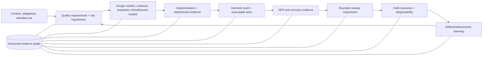

The control loop has three authorities that must remain distinct: engineering mechanisms produce evidence; policy evaluates evidence against versioned decision rules; an accountable role accepts residual risk. Automation may perform a decision whose authority has already been delegated by policy, but a test runner, scanner, model judge, dashboard, or deployment controller is never its own risk owner.

## A.2 Cross-track dependency matrix

| Producer | Downstream consumer | Required interface | Failure when disconnected |
|---|---|---|---|
| Quality/risk model (Ch. 1, 17) | Every assurance track | Requirement/risk ID, population, threshold, uncertainty, owner | Activity volume substitutes for a decision claim |
| Behavioral models (Ch. 2–3) | Contracts, test generation, runtime verification | State/transition/property identity and coverage semantics | Generated tests lack a traceable oracle |
| Static/formal verification (Ch. 4) | Developer feedback, CI, security | Finding identity, rule/version, proof assumptions, code/config scope | “No findings” is presented as defect absence |
| Test-data governance (Ch. 18) | Static verification (Ch. 4) | Fixture sensitivity labels, synthetic/masked provenance, allowed flows, retention | Taint/secret rules cannot distinguish permitted synthetic fixtures from leaked production data |
| Test-data governance (Ch. 18) | Contracts/PBT (Ch. 5), CI (Ch. 6), AI evaluation (Ch. 15–16) | Schema/lineage, representativeness, constraint preservation, access purpose | Privacy-safe data are statistically useless, or realistic data are unlawfully exposed |
| Hermetic build identity (Ch. 6) | All dynamic evidence | Source, dependency, toolchain, image, config, fixture and environment digests | Results cannot be reproduced or attached to the shipped artifact |
| Suite-trust service (Ch. 7) | Release gate and economics | Selection basis, flake posterior, retry history, shard/attempt IDs | Red builds are ignored or green retries hide defects |
| Observability contract (Ch. 13) | Performance/resilience, canary, incident metrics | Semantic schema, context propagation, sampling/loss, release/cohort identity | Field comparison and causal diagnosis are invalid |
| Data integrity controls (Ch. 12) | Rollback, shadowing, audit | Reconciliation invariants, migration phase, state snapshot, idempotency | Binary rollback is claimed while data remain irreversibly changed |
| Production experiment (Ch. 14) | Regression models, metrics/economics | Stable assignment, control/treatment, missingness, effect interval, decision | Traffic becomes exposure without learning |
| AI/agent assurance (Ch. 15–16) | Governance and operating model | Versioned configuration, estimand, risk suite, trajectory/side effects, human authority | Benchmark score silently grants autonomy |
| Defect/risk/economic ledger (Ch. 17) | Portfolio planning and test impact | Root cause, escape boundary, exposure, consequence, evidence provenance | Metrics are gamed and assurance investment cannot be evaluated |

## A.3 Vendor-neutral reference pipeline

```yaml
quality_pipeline: 2026.1
identity:
  bind: [source_commit, dependency_lock, toolchain, build_image, artifact_digest]
context:
  require: [intended_use, risk_register, quality_requirements, obligations]
stages:
  - name: precommit
    controls: [format, type_effect, secret_scan, focused_unit_property]
    evidence_ttl: 30d
  - name: pull_request
    controls: [review, static_dataflow, contract, impacted_tests, mutation_sample]
    require_independent_oracle_for: [critical_business_rule, security_control]
  - name: hermetic_ci
    network: deny_by_default
    environment: ephemeral
    controls: [full_unit, integration, schema_migration, fixture_policy, suite_trust]
  - name: qualification
    controls: [performance, resilience_recovery, security_dynamic, accessibility, data_reconciliation]
    production_shaped_data: governed
  - name: release
    strategy: progressive
    require: [artifact_attestation, compatibility, rollback_rehearsal, evidence_completeness]
    verdicts: [pass, hold, fail]
  - name: operate
    controls: [synthetic, runtime_invariants, field_quality, incident_learning]
decision:
  fail_closed_on: [critical_invariant, unauthorized_side_effect, evidence_tamper]
  pause_on: [missing_data, cohort_imbalance, uncertain_rollback, inconclusive_statistics]
  exceptions: {owner_required: true, expiry_required: true, compensating_control_required: true}
evidence:
  append_only: true
  minimum: [claim_id, risk_id, artifact, environment, method, oracle, raw_result, uncertainty, limitations, disposition]
```

This is a reference information architecture, not a universal gate order. A medical device, payment rail, game, internal tool, and public information site require different independence, retention, evidence, and exposure policy. Tailoring is itself a controlled decision with rationale.

## A.4 Release decision packet

The minimum packet contains: decision scope and artifact; intended/prohibited use; applicable obligations; quality/risk claims; evidence coverage and gaps; open defects/exceptions; uncertainty and data completeness; migration and rollback state; canary/shadow plan; accountable approvers; compensating controls and expiry; field thresholds; and immutable evidence links. The packet records why release is acceptable, not merely which jobs ran.

# Appendix B — Formula and Statistical-Method Reference

| Concept | Expression | Preconditions and interpretation |
|---|---|---|
| Expected risk/loss | \(E[L]=\sum_i p_iC_i\) | Scenarios and dependencies are defined; ordinal scores are not probabilities |
| Value of information | \(E[\max_a EU(a\mid E)]-\max_a EU(a)-Cost(E)\) | Evidence can change a choice; model and sensitivity are explicit |
| Equivalence coverage | \(C_{EP}=\lvert P_{hit}\rvert/\lvert P_{required}\rvert\) | Partitions are justified and infeasible regions recorded |
| State-transition coverage | \(C_T=\lvert T_{executed}\rvert/\lvert T_{required}\rvert\) | Model/version and feasible paths are explicit |
| t-way interaction universe | \(\sum_{I,|I|=t}\prod_{i\in I}v_i\) | Unconstrained parameter domains; constraints reduce feasible tuples |
| Mutation score | \(K/(M-E)\) | Equivalent/invalid mutants \(E\) are handled and killing oracle is meaningful |
| Property-test miss probability | \((1-p)^n\) | IID draws with failure-region probability \(p\); biased generators invalidate claim |
| APFD | \(1-\frac{\sum_iTF_i}{nm}+\frac{1}{2n}\) | Known fault set and first-detection positions; historical estimate, not future guarantee |
| Utilization | \(\rho=\lambda/(c\mu)\) | Stationary arrival/service assumptions; tail behavior and bottlenecks still measured |
| Little's law | \(L=\lambda W\) | Stable conserved system over matching boundary/window |
| Exponential reliability | \(R(t)=e^{-\lambda t}\) | Constant independent failure rate—often only a local approximation |
| Availability | \(uptime/(uptime+downtime)\) | Service boundary, exclusions, and clock semantics declared |
| Recovery point | \(RPO=t_{failure}-t_{newest\ recoverable}\) | Restore is also semantically reconciled, not merely readable |
| Reconciliation discrepancy | \(\Delta_k=T_k-S_k\) | Key/field/currency/time semantics and tolerances fixed before migration |
| Canary effect | \(E[Y\mid candidate]-E[Y\mid control]\) | Stable comparable cohorts, complete outcomes, predeclared window/metric |
| Benchmark-conditional mean | \(n^{-1}\sum_iE_r[Y_{ir}\mid i,\theta]\) | Repeats cluster within items; claim is bound to benchmark/configuration |
| Strict agent consistency | \(n^{-1}\sum_i\mathbf1(all\ k\ runs\ pass)\) | Reports reliability across repeats; do not infer independence |
| Defect density | \(D/Size\) | Defect unit, size measure, snapshot, domain, and observation window fixed |
| DRE | \(D_{pre}/(D_{pre}+D_{post})\) | Root-cause deduplication and post-release window fixed; latent defects unknown |
| Cost of Quality | \(P+A+IF+EF\) | Allocation rules prevent double counting and modeled loss is labeled |

### B.1 Method-selection rules

- Use an interval and denominator with every estimated proportion; prefer Wilson or exact intervals for small/simple binomial samples.
- Preserve item, user, session, service, or time clustering in bootstrap or hierarchical analysis; repeats are rarely independent evidence.
- Use non-inferiority/equivalence bounds when the question is “not unacceptably worse,” not a null-difference test.
- Use sequential or anytime-valid methods for continuously observed canaries; repeated fixed-sample peeking inflates false detection.
- Control familywise or false-discovery risk when many metrics or slices can trigger a decision; separate preregistered gates from exploration.
- Report effect magnitude and uncertainty. Statistical significance neither establishes practical importance nor repairs construct bias.
- Treat control limits as process-behavior estimates and specifications as acceptability limits. One cannot replace the other.
- Use causal language only with a defensible comparison design and assumptions; prediction, correlation, and feature importance are not intervention effects.

# Appendix C — Consolidated Maturity Matrix

| Subject | Foundational | Advanced | Expert 2026 |
|---|---|---|---|
| FND-01 — Quality Theory, Quality Models, Testing Standards, and Evidence | Define intended use, stakeholders, system boundary, and a tailored ISO/IEC 25010:2023 profile. Write measurable quality requirements and acceptance criteria; maintain a risk register with consequence, likelihood, owner, treatment, and residual-risk decision. Establish basic 29119-2 test processes, 29119-3 evidence records, lifecycle traceability, configuration identity, and independent review for high-consequence work. Distinguish QA process checks, verification, validation, testing, and release approval; document exact standard editions and justified tailoring. | Operationalize each important quality attribute through goal-question-measure reasoning and domain-specific measures validated with stakeholders. Integrate 12207 lifecycle activities, IEEE 730 SQA controls, IEEE 1012 V&V and integrity levels, 29119 process/documentation outputs, 15289 information-item governance, and 15026 claim-argument-evidence cases. Maintain a versioned requirement-risk-evidence-defect-residual-risk graph with provenance, reproducible environments, trends/distributions, supplier/COTS boundaries, and independent challenge. Review interactions among attributes and update the model after incidents and major changes. | Run a continuously governed, product-family quality system aligned to current 12207:2026, IEEE 730-2026, IEEE 1012-2024, ISO 25010:2023, ISO 29119:2021/2022, ISO 15026:2025/2022, 15289:2019, and applicable NIST guidance, with explicit edition-migration maps. Make claims, trace links, evidence provenance, assumptions, uncertainty, residual risk, and exception expiry machine-readable and independently assessable; use signed or tamper-evident records where stakes warrant it. Allocate verification and assurance dynamically from consequence and changing context while avoiding opaque scores, metric gaming, and automation overreach. Treat domain-specific quality profiles, third-party evidence, lifecycle change, quality-attribute conflicts, and quality-in-use feedback as first-class assurance inputs, and continuously test the validity of the quality model itself. |
| FND-02 — Specification-Based Test Design and Behavioral Modeling | Maintain a reviewed requirement-to-test traceability matrix. For each functional requirement, derive explicit EP classes and BVA points where ranges exist; use decision tables for rule-heavy behavior, use-case main and exception paths for user goals, and a state table for lifecycle behavior. Store expected outputs, postconditions, setup, and verdict rules with each test. Measure coverage of the chosen classes, boundaries, rules, flows, and states, and record infeasible or unobservable items instead of silently dropping them. | Represent behavior as versioned partition specifications, decision/cause-effect tables, classification trees, scenario models, and finite-state models with machine-checkable constraints. Add model consistency checks for completeness, disjointness, determinism, and reachability; generate abstract cases and bind them to concrete interfaces; use transition, rule, boundary, exception, and postcondition coverage ledgers; review independent oracles; and use risk to select deeper transition sequences or additional boundary combinations. Recompute impact and traceability when requirements evolve. | Operate a model-centered assurance layer across APIs, event-driven services, workflows, and embedded or regulated products. Keep requirement IDs, model versions, constraints, oracle assertions, generated cases, and coverage evidence auditable and reproducible; use formal consistency analysis and constrained generation where scale warrants it; treat invalid transitions, negative rules, recovery paths, and nondeterministic allowed outcomes as first-class evidence; and evaluate model/technique effectiveness locally rather than accepting universal rankings. AI-assisted extraction can propose partitions and scenarios, but experts approve semantics, feasibility, observability, and oracle independence before evidence is accepted. |
| FND-03 — Combinatorial, Model-Based, Search-Based, Mutation, and Coverage-Adequacy Methods | Create explicit parameter/constraint tables and model basic lifecycle or protocol state where applicable. Generate legal 2-way covering arrays for configuration risks, measure existing suites for t-way coverage, and use reviewed state/transition traces for behavior. Collect statement and branch coverage with declared exclusions and meaningful assertions; run a small, documented mutation sample to expose weak tests. Store generator settings, model versions, seeds, oracle provenance, and unresolved/infeasible obligations. Interpret every metric as evidence of exercised obligations, never as proof of correctness. | Adopt variable-strength, weighted, and constraint-aware arrays; use IPOG-family generation plus coverage supplementation and bounded sequence coverage for order-sensitive risks. Maintain MBT test purposes, guard/data solving, conformance or relation-based oracles, and separate model from implementation coverage. Use whole-suite or multiobjective SBST with legal object seeds, fixed budgets, repeated seeds, and suite minimization. Introduce strong mutation with selective operators, equivalent-mutant triage, kill matrices, and subsumption analysis; compare mutation and structural results rather than assuming subsumption. Calibrate criteria on representative historical or seeded faults and publish effect sizes and unknown categories. | Engineer an evidence portfolio across heterogeneous constrained/partial/locating or sequence arrays, model-based conformance and model mutation, solver/search hybrids, and strong mutation focused on changed or risk-weighted code. Use algorithm portfolios and recent local-search/validity-guaranteed sampling where high-strength arrays exceed budget, but benchmark on the organization’s legal configuration and execution environment. Keep independent requirement/domain oracles, explicit model and code baselines, MC/DC semantics, equivalent-mutant uncertainty, and cross-version coverage deltas. Make residual uncovered interactions, infeasible model paths, surviving mutant classes, flaky executions, and cost per marginal fault evidence first-class decisions. Treat standards as documented process/technique guidance and validate effectiveness empirically for each safety, security, platform, and product context. |
| SL-01 — Static Program Analysis and Formal Verification | Make the representation and evidence boundary reliable. Parse supported languages into ASTs with source spans; run compiler-backed type and basic effect checks; build CFGs and simple intraprocedural data-flow/lint rules; maintain a versioned baseline and triage records; fail only on deterministic, high-confidence type or rule violations. Document unsupported constructs, dependency/library models, compiler flags, and the difference between warning, witness, and proof. Use fast editor/pre-commit and pull-request feedback, but do not claim whole-program soundness or absence of defects. | Introduce a canonical SSA/IR with source maps, call-graph and points-to summaries, incremental invalidation, IFDS/IDE taint/typestate, and abstract interpretation with a documented domain and soundness envelope. Add targeted CEGAR/model checking and weakest-precondition/SMT obligations for high-risk modules; archive SMT-LIB, solver outcomes, models/cores/proofs, traces, and assumptions. Validate counterexamples, preserve unknown/timeouts, measure precision on independent corpora, and use staged gates based on evidence class rather than raw warning counts. | Operate semantics-first, proof-aware verification as a portfolio. Version language/framework/environment models and specifications; combine sound abstract invariants, context-sensitive taint, CEGAR/model checking, symbolic/concolic witness generation, SMT with replayable proof artifacts, and proof-assistant/kernel-checked obligations. Use independent checkers or solver proof replay for release-critical claims, verified validators or translation validation across compiler/IR boundaries, and CompCert-like semantic-preservation reasoning where justified. Maintain an explicit trusted-computing-base register, coverage/unknown ledger, specification-vacuity checks, artifact hashes, reproducible replays, expiry-governed suppressions, and human review for model gaps. This is an assurance progression, not a universal prescription: choose depth by property criticality, model coverage, scalability, and the organization’s ability to maintain specifications and proofs. |
| SL-02 — Executable Specifications, Contract Testing, Property-Based Testing, and Developer Feedback | Define versioned OpenAPI and/or AsyncAPI documents with pinned JSON Schema dialects; validate documents and request/response or message examples locally. Adopt red-green-refactor examples for core behaviors, a small deterministic property suite for pure functions, and explicit seeds and minimized failures. Add IDE/on-save and pre-commit commands for changed-file tests, schema lint, and contract syntax checks. Record what is structural versus behavioral and treat passing samples as conditional evidence. | Introduce consumer-driven contracts for known service dependencies and provider replay verification, with immutable broker/repository artifacts, consumer/provider/version metadata, compatibility diffs, deprecation windows, and a can-I-deploy matrix. Add stateful protocol tests, metamorphic and differential properties, valid-by-construction generators, domain-aware shrinking, boundary weighting, generator health metrics, and replayable failure capsules. Make IDE, pre-commit, and local provider commands share configuration, and use tiered budgets so feedback remains fast while broader suites remain available. | Operate a specification-centered feedback system in which structural schemas, interaction contracts, behavioral properties, examples, and state-machine models are versioned, cross-linked, and tested against implementation and generated artifacts. Use explicit semantic compatibility policy in addition to SemVer; classify additive and narrowing changes against actual consumer contracts; maintain coverage for represented and unrepresented consumers; and document external-system gaps. Apply coverage-guided or corpus-seeded generation only where measurements show sparse semantic regions, preserve deterministic replay and domain-valid shrinking, and expose generator/property health in developer diagnostics. The expert posture is evidence-aware: release claims identify the exact contract population, sampled domains, budgets, seeds, known blind spots, and remaining human or end-to-end oracle work rather than treating any single green layer as universal correctness. |
| CT-01 — Hermetic Continuous-Test Infrastructure and Ephemeral Environments | Version all build, test, dependency, image, and IaC definitions; use lockfiles and immutable image digests; run CI on clean containers or VMs; deny unneeded network egress; inject UTC and a deterministic seed; standardize locale; namespace fixtures; set resource limits; and export JUnit/log artifacts before cleanup. Add basic format, lint, schema, secret, dependency, and IaC policy gates. Record source revision, runner image, command, result, artifact hashes, and run identifier. Measure environment creation/teardown, orphan rate, evidence completeness, and a sampled clean rebuild rate. | Provision a fresh environment per job through declarative orchestration, with rootless hardened containers for ordinary tests and microVM/VM lanes for untrusted or kernel-sensitive tests. Mirror and verify dependencies by digest, use sandboxed/hermetic action graphs, authenticate caches, and run adversarial rebuilds with varied clock, hostname, locale, filesystem ordering, path, and CPU settings. Layer mocks, contract tests, emulators, and bounded real-service tests; test IaC with generators/oracles plus ephemeral apply-and-assert and drift detection. Generate signed SBOM/provenance, attach evidence to artifact digests, and enforce policy gates for source, builder, dependencies, environment, tests, and promotion. | Operate a multi-tenant test platform with a documented trust model and selectable container, microVM, and VM isolation profiles. Use content-addressed dependency mirrors, reproducibility canaries, independent rebuilders or attestable builders for high-consequence artifacts, provenance verification summaries, OCI referrers, append-only evidence storage, and automated forensic retention. The control plane issues short-lived identities, records all external parameters and policy decisions, validates full cache keys, and promotes only immutable digests whose source, IaC, environment, test, SBOM, and provenance attestations agree. Continuously test the platform itself for escape, contamination, cache poisoning, time skew, network policy bypass, provider drift, fixture leakage, and evidence loss; publish reproducibility, evidence-completeness, teardown, and cost/error-budget metrics. Treat standards as adaptable control baselines, document residual risk and exceptions, and use independent review for equivalence rules and trust-boundary changes. |
| CT-02 — Test Selection, Prioritization, Parallelism, and Suite Trust | Run retest-all on merge/release-critical paths and establish stable test identity, attempt-level results, duration, order/seed, and resource telemetry. Add transparent changed-file/module heuristics only in shadow mode. Use deterministic static sharding at safe suite/binary boundaries, bounded one-time diagnostic retries that preserve first failures, and a manual flake quarantine with owner and expiry. Baseline trust with pass/fail counts, first-pass failure burden, mixed-outcome prevalence, retry-masking rate, selection recall against retest-all, and shard imbalance. | Adopt versioned static-plus-dynamic impact models with freshness and unknown-edge handling, mandatory safety sets, abstention, and scheduled retest-all differential audits. Add coverage/change/history features to a calibrated deterministic priority score with fairness/aging and APFDc measurement. Use duration/resource-aware LPT assignment followed by dynamic pull scheduling, precedence/conflict edges, bounded resource semaphores, and per-shard replay metadata. Operate active flake diagnosis using same-order reruns, order permutations, controlled timing/randomness, coverage, and runtime-log comparison; classify NOD/OD/resource/infrastructure mechanisms and route quarantine into a monitored lane. Set SLOs for safety violations, retry masking, quarantine age, calibration, and shard skew. | Operate a multi-language test-intelligence control plane that joins change graphs, static/dynamic dependency evidence, coverage, historical failures, duration distributions, resource vectors, and flake posteriors while preserving an auditable decision trace. Use hybrid safe closure plus risk-budgeted heuristics with confidence-aware abstention, mandatory full-suite and changed-contract lanes, temporal model validation, drift/subgroup calibration, and automatic fallback. Schedule a dependency/resource DAG across hierarchical workers with dynamic work stealing, admission control, contention telemetry, retry-aware makespan/early-signal optimization, exactly-once shard reconciliation, and deterministic replay. Treat flakes as distributions with sequential stopping and Wilson/Beta uncertainty, apply perturbation/causal diagnosis, and require reviewed mechanism-level repair or bounded quarantine. Publish a trust scorecard with component metrics (selection safety recall/precision, APFDc, first-pass signal precision, flake burden, retry masking, coverage debt, repair age, shard imbalance), evidence windows, denominators, confidence intervals, and policy/model versions; use 2026 research classifiers and API perturbation detectors as triage accelerators rather than opaque gates. |
| NFR-01 — Performance, Scalability, and Capacity Assurance | Performance requirements name a workload, boundary, throughput/concurrency, latency target, error budget, and resource assumptions. Teams run reproducible baseline/load tests plus selected stress and soak tests on a documented environment, separate warmup from steady state, collect rate/errors/duration and basic CPU/memory/queue metrics, and use Little's Law as a sanity check. Results report p50/p95 and counts; regressions are manually reviewed. Open versus closed control, tail uncertainty, dependency demand, and capacity headroom are explicit risks but not yet systematically automated. | Workload models are versioned and calibrated from redacted traces plus stateful/stochastic journeys; open, closed, and partly-open tests are selected by arrival semantics. A pinned production-shaped environment, independently monitored load generators, synchronized telemetry, duration/queue histograms, traces, and resource saturation metrics support baseline, step/ramp breakpoint, spike, volume, scalability, and soak suites. Acceptance uses p95/p99, error/timeout, achieved-rate, queue-age, and resource/headroom conjunctions with replicated confidence or bootstrap intervals. Regression tests use practical effect thresholds, environment controls, change-point/distribution analysis, and risk-based prioritization. | Performance is an evidence-producing quality contract spanning requirements, architecture budgets, implementation instrumentation, CI regression, release qualification, and forecasted capacity. Hybrid arrival/session models preserve both exogenous bursts and user journeys; coordinated omission is actively detected with scheduled-arrival accounting; tail-safe histograms, exemplars, traces, profiles, and low-cardinality semantic telemetry are governed as data products. Capacity is measured as the largest workload meeting tail/error/queue/resource constraints, with bottleneck-demand tables, autoscaling and scaling-delay models, uncertainty-aware growth scenarios, and validated nonlinear scalability curves. Adaptive sample sizing, reproducible experiment manifests, automated validity checks, and inconclusive outcomes prevent overconfident gates; heterogeneous cloud/serverless/accelerator and multi-tenant effects are measured locally, with explicit evidence gaps and decision provenance. |
| NFR-02 — Reliability, Resilience, Chaos, and Recovery Assurance | Define fault, error, failure, reliability, availability, maintainability, resilience, degraded mode, RTO, RPO, and MTD for each critical capability. Maintain a dependency and failure-mode register; identify single points and common causes with simple FMEA, fault trees, or block diagrams. Establish basic R(t), availability, MTTF/MTTR assumptions, and a small reliability-growth dataset. Test recovery handlers, failover paths, backups, and restores in isolated environments; validate checksums, schemas, and core business invariants. Run tabletop exercises and timed restore tests with named owners, documented aborts, and evidence packets. Treat all targets as hypotheses until measured. | Use representative operational profiles and classified failure data for reliability-growth analysis with confidence intervals and model checks. Apply CTMC, RBD, fault-tree, event-tree, or simulation analysis to high-consequence paths, including common-cause and human assumptions. Implement layered containment, bounded retries, bulkheads, idempotency, fencing, quorum, safe degraded modes, cross-domain redundancy, and tested handback. Run scheduled component/integration fault injection, dependency failover, restore drills, and risk-based game days; use steady-state hypotheses, comparison data where feasible, independent kill switches, narrow blast radius, and semantic recovery gates. Track achieved RTO/RPO distributions per scenario and link findings to regression tests, architecture decisions, and dependency contracts. | Operate an evidence graph linking requirements, invariants, architecture boundaries, fault models, experiments, incidents, restores, model versions, and corrective actions. Select or ensemble reliability models based on data quality, nonstationarity, profile changes, and consequence; show uncertainty, residuals, sensitivity, and common-cause exposure. Automate policy-as-code admission and abort controls while reserving human authority for high-consequence decisions. Exercise multi-region, edge, provider/control-plane, supply-chain, event-driven, and agentic-service failures, including replay-safe side effects, nondeterministic dependency loss, deterministic/manual fallback, and handback correctness. Use independent challenge reviews, cross-organization game days, cryptographically or content-attested restore artifacts, adaptive fault-model coverage from incidents and near misses, and explicit evidence limits; never treat a standard, model, or chaos program as universal proof. |
| NFR-03 — Security Assurance Across the SDLC | Inventory assets, trust boundaries, dependencies, build and deployment identities; review abuse/misuse cases for critical flows; define security claims and negative acceptance tests. Run baseline SAST, SCA, secret, and IaC/container configuration scans on every change, a small authenticated DAST suite in staging, sanitizer-backed fuzzing for critical parsers, and an authorized periodic penetration test. Establish a CVSS-plus-context triage record, owners and time-bound exceptions, minimal artifact/SBOM signing, a vulnerability response process, and release evidence keyed to commit and artifact digest. | Maintain threat-to-requirement-to-test traceability and security champions or specialist ownership. Use framework-aware differential and full SAST with calibrated rules, complete dependency graph and reachability analysis, history/artifact/provider-aware secret verification with rotation, effective-runtime configuration checks, IAST for selected staging paths, grammar and stateful protocol fuzzing with sanitizers and durable regression corpora, and threat-derived purple-team exercises. Enforce risk-based gates using exploit maturity, reachability, asset impact, and confidence; verify signed SBOM/provenance at promotion; measure claim coverage, reproducible defect rate, retest latency, inventory completeness, secret revocation time, and provenance pass rate. | Operate a continuously updated evidence graph and threat model across source, dependency, build, release, runtime, and response, with independently reproducible security claims for high-consequence releases. Use SLSA v1.2 provenance and verified builder/parameter bindings, hardened or hermetic isolated builds where justified, protected short-lived identities, digest-pinned inputs, cross-build or reproducibility checks, artifact admission, complete transitive SBOMs, and continuous supplier and registry reassessment. Scale stateful and directed fuzzing against changed and threat-critical paths; use metamorphic or seeded-vulnerability validation to calibrate SAST/SCA; perform bounded adversarial exploit validation in safe sandboxes; continuously exercise detection and response; and automatically reopen residual risk as reachability, exploit intelligence, provenance, or deployment context changes. Keep explicit evidence gaps and uncertainty: this is a high-assurance operating model, not a universal guarantee. |
| NFR-04 — Accessibility, Usability, Compatibility, and Internationalization Assurance | Adopt WCAG 2.2 A/AA criteria as traceable requirements; define an accessibility-support and browser/OS/AT baseline; use semantic native controls and an accessible component checklist; run deterministic automated checks plus keyboard, zoom/reflow, contrast, language, and basic screen-reader smoke tests on critical journeys; maintain a small locale set including long text and one RTL case; record criterion, environment, defect, and retest evidence. Do not publish an aggregate score as a conformance claim. | Apply WCAG-EM 2.0 enclosure and structured/random sampling to all views, states, complete processes, authenticated/error paths, and third-party content; implement ACT 1.1-style versioned rules with cantTell/untested outcomes; exercise rendered routes and state fixtures in CI; run a risk-based browser/OS/AT/mobile matrix and WPT/Interop regression checks; conduct formative studies with people using relevant AT and locales; measure task success, errors/recovery, effort/time, workload, and satisfaction; add pseudolocalization, Unicode/bidi, CLDR/ECMA-402, calendar/time-zone, IME, and 200/400% reflow suites. | Operate accessibility, usability, compatibility, and i18n as a release-quality system with product-specific contracts, design-system semantic invariants, accessibility-tree assertions, complete-process oracles, machine-readable EARL-equivalent evidence, and environment/locale dependency pinning. Use inclusive participatory research and recurring summative measurement with transparent uncertainty; stratify results by disability/AT/context and distinguish conformance, usability, platform, and localization defects. Continuously consume WPT/Interop and browser/AT changes, detect regressions across risk-based interaction/locale triples, and make blocked/unsupported/cantTell evidence visible. Release decisions use user-impact severity, critical-journey blockers, documented residual risk, owners, expiry/retest dates, and accessible customer communication rather than universal claims or vendor marketing scores. |
| NFR-05 — Data Quality, Integrity, Persistence, and Migration Assurance | Versioned schemas and data contracts exist for critical datasets. Database constraints cover keys, nullability, domains, and foreign keys; transformation unit tests cover boundary values; batch loads emit source/target row counts, reject/quarantine counts, and basic checksums. Critical writes use explicit transaction boundaries and idempotency keys. ETL runs have a source cutoff, batch ID, restart behavior, and a manual release gate. Migrations are rehearsed on a production-shaped copy, use additive/expand-contract steps where practical, capture a pre-change snapshot, and verify counts, key differences, and core invariants before cleanup. | Contracts generate compatibility checks and executable quality assertions. Pipelines use immutable landing, CDC/high-water marks, deterministic versioned transformations, keyed reconciliation, canonical digests, aggregate deltas, quarantine reason codes, and W3C-PROV-aligned lineage. CI runs real-database transaction schedules for lost update/write skew/phantom cases at each production isolation setting; retries replay idempotently. Outbox/inbox or an equivalent durable log pattern governs cross-resource effects, with per-aggregate sequencing and duplicate/late-event tests. Migrations use resumable checkpointed backfills, dual-read/write or compatibility views, source-position fences, old/new shadow comparisons, canary cutover, and documented roll-forward/rollback evidence. | Data correctness is continuously evidenced as a graph of contracts, invariants, lineage, snapshots, event positions, code/config hashes, and validation results. Policy-as-code gates schema compatibility, migration mappings, reconciliation equations, provenance coverage, and risk-weighted quality thresholds in CI/CD and production promotion. Schedule exploration and deterministic fault injection cover commit, checkpoint, acknowledgement, object publish, consumer replay, and migration race windows; serializability or invariant-confluence claims are explicit and scoped. Critical materialized views are reproducible from durable event/CDC history or versioned snapshots; lakehouse metadata commits and schema evolution are tested atomically across engines. Enterprise operations support canary migrations, automated quarantine/repair with human approval, old/new semantic shadowing, source-position-aware replay, cryptographic integrity evidence, and a defined roll-forward preference for lossy changes. The maturity claim remains bounded by domain semantics, external side effects, third-party data truth, and evidence gaps in broad zero-downtime/exactly-once generalization. |
| SR-01 — Observability-Driven Testing and Field Diagnosability | Define an observability evidence contract for critical workflows; instrument stable request/resource identity and basic server/client spans; propagate W3C context across supported HTTP/RPC boundaries; emit structured logs correlated by trace/span IDs, low-cardinality SLIs, and explicit error/status semantics. Add CI contract tests for required fields, span closure, no-secret/no-prohibited-PII rules, exporter health, and basic collector loss. Track blind spots and treat a green functional test without valid telemetry as incomplete evidence. | Operate versioned OTel semantic schemas and Collector pipelines across asynchronous, messaging, database, and retry boundaries; test baggage policy, parent/link topology, schema migrations, sampling recall, queue/backpressure behavior, and parser robustness. Monitor temporal invariants and cross-service trace contracts in integration/system tests, preserve failing evidence with provenance, and use layered diagnosis (trace topology plus contextual logs plus metrics/profiles) with ranked hypotheses. Feed incident evidence gaps into instrumentation requirements and regression tests while separating CI telemetry from production data. | Treat diagnosability as an engineered quality attribute with measurable evidence coverage, confidence, and loss budgets. Pin and continuously compatibility-test OTel/API/SDK/Collector/schema versions; combine propagated and explicitly labeled inferred traces; use runtime verification and model/trace validation for safety-critical workflows; apply trace-guided generation to target under-covered state transitions; and expose sampling, clock, parser, privacy, and causal limitations to automated consumers. Governance links each diagnostic question to signal owners, access/retention, schema evolution, replay/query recipes, and incident-learning closure, while independent behavioral assertions prevent telemetry algorithms from becoming the sole oracle. |
| SR-02 — Progressive Delivery, Synthetic Monitoring, Traffic Shadowing, and RUM Feedback | Use immutable artifacts, health/readiness checks, one reversible feature flag, a blue/green or small canary ring, basic synthetic checks for critical journeys, and a documented manual rollback. Assign stable cohorts, compare candidate with control on error rate and latency, record exposure and verdicts, isolate shadow writes if shadowing is attempted, and perform a minimal privacy review before collecting RUM. | Operate a shared rollout controller with deterministic cohort assignment, ring/region stages, automatic pause and rollback, flag expiry, schema compatibility checks, multi-region synthetic journeys, and RUM stratified by device, region, network, and release. Use predeclared guardrails, effect sizes, confidence intervals or sequential tests, sample-ratio and telemetry-loss checks, normalized shadow differential analysis, privacy impact assessments, retention limits, and a release-linked feedback process that updates regression cases and synthetic workloads. | Treat production quality as a closed-loop experiment system: immutable release/config evidence, policy-versioned exposure control, exclusion-aware overlapping experiments, anytime-valid multi-metric decisions, causal and segment diagnostics, and a fail-closed shadow plane with state/egress isolation. Combine synthetic probes, canary/control evidence, and privacy-preserving RUM with explicit uncertainty and missingness; feed de-identified field distributions and confirmed failures into test-model and journey selection under drift checks. Every promotion, hold, and rollback produces a replayable evidence record, while universal holdouts, incident labels, privacy threat models, and periodic calibration expose blind spots rather than allowing automation to silently normalize them. |
| AI-01 — Evaluation and Assurance of ML, LLM, and Nondeterministic Systems | Inventory each ML/LLM system and intended use; define prohibited use and operating limits; maintain dataset and model cards; create development, sequestered holdout, and production-like test sets with leakage-aware splits; run deterministic contract/schema/quality tests plus repeated stochastic trials; report item-level results, basic confidence intervals, calibration, subgroup slices, abstention behavior, and known limitations; perform a small independent human review and threat-model red-team; log model/provider/prompt/data/evaluator versions; gate release on explicit risk-owner approval and safe fallback. | Trace AI RMF/ISO risk statements to measurable requirements and evidence Blocks; use versioned anchor plus rotating/private benchmarks, contamination and near-duplicate audits, temporal/external validation, distribution-shift and robustness suites, fairness/intersectional and privacy/security tests, and severity-weighted harm metrics. Prespecify estimands, precision/power, paired comparisons, multiplicity and sequential rules; use cluster bootstrap or mixed-effects/GLMM analysis for item/trial variance; calibrate LLM judges to blinded representative humans and audit position/verbosity/self-preference bias; run independent red-team and field/user testing; deploy canary/shadow monitoring with drift, quality, calibration, abstention, incident and appeal feedback tied to rollback/re-evaluation triggers. | Operate a continuous, evidence-centered assurance program: custom TEVV-Athlon-style assessments connect organizational goals and affected-community impacts to risk taxonomies, measurement constructs, Events, Tools, Blocks, estimands, uncertainty, and release decisions. Preserve benchmark comparability with immutable manifests, hashes, anchors, rotating contamination-resistant items, data/provenance and judge versioning, and public/private evidence boundaries. Use hierarchical statistical models with diagnostics, practical non-inferiority/equivalence gates, adaptive sampling for rare harms, independent assessors, domain experts, representative human and field evaluation, calibrated abstention and safe failure, and adversarial red-team regression. Treat provider/model/prompt/retrieval/evaluator changes as new configurations; continuously monitor shift, fairness, privacy, security, toxicity, factuality, calibration, user outcomes, overrides, appeals and incidents; automatically open evidence gaps, trigger rollback or narrowed use, and feed post-deployment findings back into benchmark/risk redesign. Label NIST AI 200-2 as an August 2026 Initial Public Draft (not final) and document where enterprise controls extend beyond it. |
| AI-02 — Agentic-System Testing and Autonomous Quality Engineering | Inventory every agent, model, tool, memory store, data domain, owner, and side effect. Define task goals, prohibited actions, risk classes, stop/handoff criteria, and resource budgets. Run deterministic resettable mocks with concrete goal-state and side-effect oracles; log complete trajectories and state hashes. Put all writes behind a capability broker, least-privilege identities, sandboxing, and human approval for irreversible actions. Gate generated tests, code, requirements, and oracles on parse/type/compile, isolated execution, static checks, and owner review. Track pass rate, unsafe-action rate, flake rate, cost, latency, and review burden. | Add mutable multi-application environments, domain policies, realistic simulated users, untrusted external content, adaptive prompt-injection/red-team suites, memory provenance and quarantine, multi-agent identity/capability isolation, snapshots and transactional rollback, temporal and information-flow invariants, and repeated-trial pass^k reporting. Run long-horizon, recovery, concurrency, permission-failure, and drift scenarios in CI and pre-release. Use hidden holdouts, mutation/differential testing, artifact provenance, independent evaluators, p50/p95 cost and latency SLOs, canary/shadow execution, and formal escalation packets. Make broker enforcement independent of model prompts and fail closed on critical invariants. | Operate a risk-adaptive autonomy platform with capability-scoped agents, signed append-only trajectories, typed cross-agent handoffs, policy/version attestation, revocable memory, and enforceable data-flow plus temporal specifications at every tool boundary. Continuously generate and mutate scenarios from incident and production evidence while protecting hidden holdouts; triangulate formal checks, stateful simulation, adversarial trajectory analysis, human review, and shadow/canary telemetry. Permit autonomous test/oracle/repair loops only inside immutable acceptance criteria, disposable sandboxes, bounded budgets, and independent validation; block self-modification of policies, oracles, and release gates. Revalidate grants, models, retrieval stores, and simulators on drift; quantify utility, safety, security, recovery, consistency, cost, latency, and human workload separately; preserve evidence packages for audit and provide tested external kill, rollback, and human takeover controls. |
| GOV-01 — Risk, Defects, Quality Metrics, Reliability Measures, and Cost of Quality | A single product/project maintains a controlled vocabulary and immutable IDs for requirements, changes, deployments, defects, incidents, and risks. Metric definitions include purpose, numerator, denominator, scope, release boundary, observation window, and owner. The team reports defect counts/density with denominators, severity separate from priority, origin/detection/escape fields, basic DRE and escaped-defect rate, uptime, MTTD/MTTR definitions, and CFR with explicit predicates. A monthly review checks data completeness, duplicates, classification quality, residual risks, and prevention/appraisal/internal/external failure cost categories. Targets are product-specific, not individual quotas; raw events and definition changes are auditable. | Several products share machine-readable event contracts and lineage across version control, CI/CD, observability, support, customer exposure, and finance. Root-cause reconciliation supports DRE/escape metrics; reliability uses declared operational profiles and exposure-normalized failure intensity; restoration and repair are separate, with median/P90/P95 and censoring treatment. Risk registers use probability/impact distributions, sensitivity, residual-risk decisions, and value-of-information reasoning. SPC uses rational subgroups and chart families appropriate to count, proportion, and skewed time data, with control limits separated from specifications. CoQ interventions are evaluated with baselines, counter-metrics, uncertainty, and lifecycle marginal-cost decisions. Independent samples audit severity, priority, origin, root cause, and incident-to-deployment links; dashboards are never sole release gates. | An enterprise quality evidence platform federates products while preserving local operating profiles and thresholds. Event-sourced metric contracts are versioned, reproducible, privacy-minimized, and continuously reconciled; every decision packet contains point estimate, interval/credible range, data quality, causal caveats, P50/P90/tail loss, and accountable action. Portfolio decisions combine expected utility, hard safety/security constraints, Monte Carlo or state-transition CoQ models, reliability/error-budget economics, and rollback/recovery readiness. Interventions use randomized, stepped, interrupted-series, or matched causal designs where feasible; otherwise findings explicitly remain associative. Anti-gaming red teams, independent classification audits, denominator lock, counter-metrics, and confidential challenge are institutionalized. AI-assisted changes are provenance-stratified and drift-monitored without unsupported causal attribution. Governance continuously retires weak metrics, updates definitions against current standards, and validates that quality, user outcomes, reliability, and economic loss improve together. |
| GOV-02 — Test-Data Management, Privacy, Regulation, and Audit Evidence | Inventory test datasets and fields; classify sensitivity; prohibit unapproved production copies; prefer generated fixtures; use approved subsetting or masking with basic referential-integrity checks; separate environments; apply least privilege and expiry; retain a dataset owner, purpose, source identifier, transform version, approval, access log, and disposal record. Evidence is centralized but may still require manual review, and privacy or utility testing is limited to deterministic checks. | Operate a policy-enforced provisioning broker with versioned transforms, token/key separation, relational dependency graphs, risk-stratified subsets, synthetic-data validation, linkage and rare-combination tests, distribution and scenario metrics, CI gates, third-party lineage, automated expiry, and append-only evidence. Every release has a manifest linking requirement, data decision, environment fingerprint, test results, defects, exceptions, and retest; controls are tailored to sensitivity, exposure, release cadence, and applicable obligations. | Treat test data as a continuously monitored, zero-copy or minimum-copy supply chain. Policy-as-code selects the least-exposing source; signed manifests, content hashes, key attestations, immutable evidence, and reproducible containers bind source, transformation, model, seed policy, environment, oracle, and result. Privacy attacks include linkage, differencing, membership inference, reconstruction, prompt/model leakage, and vendor paths; utility includes relational, temporal, cohort, tail, locale, authorization, coverage, mutation, and defect-detection evidence. Continuous controls detect drift, schema changes, provider or residency changes, anomalous access, key expiry, and orphaned copies, while unresolved uncertainty and residual risk remain explicit to independent assessors and authorized decision-makers. |
| GOV-03 — QA Operating Model, Leadership, Capability Maturity, and Workforce | Quality is mostly a project or team concern. Product ownership, quality accountability, release authority, and independent challenge are implicit or inconsistent. Central QA, embedded specialists, and suppliers operate through informal relationships; standards and assurance plans vary widely. RACI is incomplete, evidence is fragmented, and exceptions are negotiated late. Workforce development is course-driven and person-dependent; career paths, skill inventories, mentoring, and succession are weak. Supplier contracts emphasize activities or outputs without clear evidence, access, escalation, continuity, or residual-risk ownership. Change is announced top-down and maturity assessments are treated as scores or compliance exercises. | A federated or otherwise risk-tailored operating model is explicit. Product teams own quality outcomes and evidence; a central CoE or platform team provides standards, coaching, reusable services, and learning; independent assurance has defined sampling and escalation. Executives set risk appetite and review portfolio risk, exceptions, systemic learning, supplier concentration, and capability investment. Each product maintains a living quality strategy and assurance plan, with decision-rights and exception registers. Process capability is assessed with evidence and team variation; workforce capability uses role/competency profiles linked to hiring, development, career paths, mentoring, and succession. Supplier governance covers criticality, named roles, evidence, change and incident notification, audit/access, continuity, and exit. | The enterprise operates an adaptive network of accountable product teams, independent challenge, internal quality platforms, professional chapters, and communities, with structure chosen by consequence, coupling, cadence, scarcity, geography, and sourcing context. Decision rights are explicit, time-bounded, evidence-based, and revisited after major change; risk acceptance is never hidden inside delivery activity. Assurance is continuous and proportionate, with protected executive escalation and transparent uncertainty. Workforce capability is managed as a living portfolio of observable knowledge, skills, behaviors, judgment, AI-assisted engineering competence, and succession coverage. Suppliers are governed as part of the SDLC ecosystem with multi-tier visibility, independent evidence, resilience, and executable exit paths. Leaders reward learning and truth-telling, and culture is tested through actual responses to incidents and dissent. Maturity is demonstrated by resilient decisions and sustained capability, not by a label; causal evidence for any single operating-model pattern remains limited and context-dependent. |

# Appendix D — Taxonomy and Isolated-Research Dispatch Record

## D.1 Master taxonomy

The taxonomy partitions the software-quality domain by assurance object and lifecycle control point. A subject owns a concept only when it is the principal place where that concept is specified; later chapters may cross-reference it without redefining it.

| ID | Track | Subject | Inclusion boundary | Principal exclusions |
|---|---|---|---|---|
| FND-01 | Foundations and theory | Quality theory, quality models, testing standards, and evidence | V&V concepts; quality attributes; ISO/IEC 25010; ISO/IEC/IEEE 29119; evidence semantics | Detailed design techniques and execution architectures |
| FND-02 | Foundations and theory | Specification-based test design and behavioral modeling | Partitions, boundaries, decision tables, cause-effect graphs, classification trees, scenarios, state transitions, oracles | Combinatorial, mutation, static, and NFR methods |
| FND-03 | Foundations and theory | Combinatorial, model-based, search-based, mutation, and coverage-adequacy methods | Covering arrays, generation algorithms, mutation, structural adequacy, empirical limits | Basic black-box techniques and program analysis |
| SL-01 | Shift-left architecture | Static program analysis and formal verification | AST/IR inspection, data-flow, abstract interpretation, symbolic/concolic execution, SMT, formal proof | Runtime security scanning and executable API contracts |
| SL-02 | Shift-left architecture | Executable specifications, contract testing, property-based testing, and developer feedback | OpenAPI/schema validation, consumer/provider contracts, generative properties, TDD/IDE/pre-commit feedback | General static analysis and pipeline fleet design |
| CT-01 | Continuous testing | Hermetic continuous-test infrastructure and ephemeral environments | Reproducible builds, isolation, containers, service virtualization, environment orchestration, artifact provenance | Selection, scheduling, flakes, and release experimentation |
| CT-02 | Continuous testing | Test selection, prioritization, parallelism, and suite trust | TIA/regression selection, prioritization, sharding, flake detection, quarantine, retry semantics | Environment construction and NFR execution |
| NFR-01 | Non-functional engineering | Performance, scalability, and capacity assurance | Load/stress/spike/endurance tests, workload models, queuing, SLO-aligned capacity | Fault injection, disaster recovery, and field observability |
| NFR-02 | Non-functional engineering | Reliability, resilience, chaos, and recovery assurance | Fault models, injection, steady-state hypotheses, failover, backup/restore, disaster recovery, reliability growth | Nominal capacity testing and progressive delivery |
| NFR-03 | Non-functional engineering | Security assurance across the SDLC | Threat-informed testing, SAST/DAST/IAST/SCA, fuzzing, penetration evidence, supply-chain security checks | General static correctness and compliance governance |
| NFR-04 | Non-functional engineering | Accessibility, usability, compatibility, and internationalization | WCAG 2.2+, assistive technology, human evaluation, cross-platform and locale behavior | Performance and data correctness |
| NFR-05 | Non-functional engineering | Data quality, integrity, persistence, and migration assurance | Constraints, transactions, concurrency, ETL, lineage behavior, migrations, reconciliation | Test-data provisioning policy, privacy governance, analytics economics |
| SR-01 | Shift-right quality | Observability-driven testing and field diagnosability | OpenTelemetry, logs/metrics/traces, correlation, runtime invariants, test observability | Release control and end-user experimentation |
| SR-02 | Shift-right quality | Progressive delivery, synthetic monitoring, traffic shadowing, and RUM | Canary analysis, feature flags, synthetic probes, shadow traffic, RUM feedback, rollback decisions | Telemetry instrumentation internals and preproduction NFR testing |
| AI-01 | AI-native systems | Evaluation and assurance of ML, LLM, and nondeterministic systems | Statistical evaluation, benchmark design, robustness, safety, fairness, drift, LLM judges and human evaluation | Multi-tool agent control and QA-process automation |
| AI-02 | AI-native systems | Agentic-system testing and autonomous quality engineering | Multi-step agent trajectories, tool safety, simulation, metamorphic oracles, AI-generated tests, autonomous QA controls | General model benchmarking and conventional static analysis |
| GOV-01 | Governance and economics | Risk, defects, quality metrics, reliability measures, and Cost of Quality | Defect taxonomy, DRE, density, escapes, MTTD/MTTR, CoQ, control charts, decision economics | Data/privacy compliance and organizational design |
| GOV-02 | Governance and economics | Test-data management, privacy, regulation, and audit evidence | Synthetic/masked data, environments, retention, access, privacy, regulated validation, traceability, audit packages | Product-data correctness algorithms and staffing models |
| GOV-03 | Governance and economics | QA operating model, leadership, capability maturity, and workforce | Team topology, accountability, strategy, portfolio risk, competency, communities of practice, maturity and vendor governance | Metric definitions and regulatory control details |

## D.2 Taxonomy construction evidence

The partition is anchored in the lifecycle/process decomposition of ISO/IEC/IEEE 29119, the nine-characteristic product-quality model of ISO/IEC 25010:2023, and the broader software-engineering knowledge-area framing used by SWEBOK. It is expanded where 2026 practice requires distinct control systems: hermetic CI, change-aware execution, observability, progressive delivery, AI/agent evaluation, and governed production feedback.

## D.3 Exact prompt protocol and subject substitutions

The following record is copied into the compiled manual from `research/dispatch-prompts.md`. It preserves the model/inference settings, context isolation, exact common prompt text, subject-specific substitutions, output paths, and the two editorially distinct but criteria-equivalent suffixes actually dispatched.


## Reconstruction rule

The exact dispatch text is recorded compositionally so repeated instructions are not copied nineteen times. For FND-01 through AI-02, concatenate **Common prefix**, the subject's first four block lines, and **Protocol A suffix**, separated by one blank line. For GOV-01 through GOV-03, concatenate **Common prefix**, all five research lines in the subject block, and **Protocol B suffix**, separated by one blank line. In either suffix, replace `OUTPUT_PATH` in instruction 7 with the literal path in the subject block; the `OUTPUT_PATH:` metadata line itself was not sent. The two suffixes use the same research criteria with minor editorial wording differences, retained here rather than silently normalized.

No orchestration conversation or other research was inherited (`fork_turns: none`). Every dispatch used `model: gpt-5.6-luna` and `reasoning_effort: xhigh`.

## Common prefix

```text
You are the sole isolated research subagent for one subject in a 2026 university-grade quality-engineering manual. Do not delegate or inspect other agents’ work.
```

## Protocol A suffix

```text
NEUTRAL FRAMING: Evaluate definitions, evidence, disagreements, limitations, and applicability without assuming that any named standard, method, or organizational model is universally effective.

STANDARDIZED RESEARCH INSTRUCTIONS:
1. Browse and research primary sources. Apply this strict hierarchy: Tier 1—peer-reviewed papers from ACM Digital Library or IEEE Xplore, formal standards from ISO/IEC/IEEE or NIST, and university/CMU SEI/MIT/Stanford research or courseware. Tier 2—industry consensus specifications, official framework architecture documentation, and validated vendor-neutral whitepapers. Prohibited—SEO marketing blogs, unverified Medium-style posts, content farms, and commercial promotional material.
2. Prefer authoritative sources current through 2026, but include older seminal work when foundational. Record the actual publication year; never relabel an older work as 2026.
3. Use at least 8 strong sources, with at least 5 from Tier 1 when the literature permits. Cross-check pivotal claims. Distinguish normative requirements from guidance, empirical findings, and your own inference.
4. Every evidence item must have a stable DOI or direct authoritative URL. Exact quotations must be verified against the source, include enough local context in the excerpt field to be intelligible, and contain no more than 20 verbatim words from any one source. Do not invent quotations or citation metadata.
5. Provide concrete theory, engineering mechanisms, decision criteria, tradeoffs, implementation detail where within scope, evaluated failure modes, and a three-stage maturity progression. Identify evidence gaps and contested claims.
6. Return valid JSON only, encoded as UTF-8, following the schema below. Strings may contain Markdown. Map a peer-reviewed ACM paper to ACM, peer-reviewed IEEE paper to IEEE, ISO/NIST/W3C/industry consensus specifications to Formal_Standard, and university or SEI sources to University_Courseware. Use the actual year integer in `year`.
7. Also write the identical JSON deliverable to `OUTPUT_PATH` using apply_patch. Do not modify any other file.

DELIVERABLE SCHEMA:
{
  "subject_id": "STRING",
  "subject_title": "STRING",
  "theoretical_foundations": "DETAILED_SYNTHESIS",
  "practical_architecture_and_implementation": "DETAILED_SPECS",
  "primary_evidence": [
    {
      "source_title": "STRING",
      "authors_or_institution": "STRING",
      "year": 2026,
      "source_type": "ACM | IEEE | ISO | University_Courseware | Formal_Standard",
      "doi_or_url": "STRING",
      "verbatim_excerpt": "EXACT_QUOTATION_WITH_CONTEXT_MAX_20_WORDS_PER_SOURCE",
      "analytical_interpretation": "HOW_THIS_APPLIES_TO_2026_SDLC"
    }
  ],
  "failure_modes_and_antipatterns": ["LIST_OF_EVALUATED_FAILURE_MODES"],
  "maturity_matrix": {
    "foundational": "STRING",
    "advanced": "STRING",
    "expert_2026": "STRING"
  }
}
```

`OUTPUT_PATH` above is replaced in the dispatched text by the literal backtick-delimited absolute path listed in the relevant subject block; it is not sent as a placeholder. The `OUTPUT_PATH:` metadata line in a subject block is part of this audit record and is not separately sent.

## Protocol B suffix

```text
STANDARD RESEARCH INSTRUCTIONS:
1. Use sources in this strict priority order. Tier 1: peer-reviewed ACM/IEEE papers; formal ISO/IEC/IEEE and NIST standards/publications; university courseware or research-lab publications (for example CMU SEI, MIT, Stanford). Tier 2: industry-consensus specifications, official framework architecture documentation, and validated vendor-neutral whitepapers. Do not use SEO marketing blogs, Medium-style posts, or commercial promotional material.
2. Search for the strongest primary evidence available through 2026, but preserve each source’s actual publication year. Do not label an older source as 2026. Clearly distinguish normative requirements, empirical findings, and your synthesis or inference.
3. Include at least 8 primary-evidence entries and at least 5 Tier-1 entries when available. Cross-check consequential claims across independent sources.
4. Every evidence entry must provide a stable DOI or direct primary URL and a verified exact excerpt of no more than 20 words. Never invent a quotation, DOI, URL, author, title, result, or standard requirement.
5. Cover theory, mechanisms, architecture, implementation controls, decision criteria, trade-offs, limitations, failure modes, maturity levels, and unresolved gaps. Make the synthesis concrete enough for a senior enterprise QA department.
6. Return valid JSON only matching the schema below. Map source types to the allowed enum; use Formal_Standard for NIST and official framework/specification sources when no narrower enum applies. Use the source’s actual integer year.
7. Also write the identical JSON deliverable to OUTPUT_PATH using apply_patch only. Modify no other file.

DELIVERABLE SCHEMA:
{
  "subject_id": "STRING",
  "subject_title": "STRING",
  "theoretical_foundations": "DETAILED_SYNTHESIS",
  "practical_architecture_and_implementation": "DETAILED_SPECS",
  "primary_evidence": [
    {
      "source_title": "STRING",
      "authors_or_institution": "STRING",
      "year": 2026,
      "source_type": "ACM | IEEE | ISO | University_Courseware | Formal_Standard",
      "doi_or_url": "STRING",
      "verbatim_excerpt": "EXACT_QUOTATION_WITH_CONTEXT",
      "analytical_interpretation": "HOW_THIS_APPLIES_TO_2026_SDLC"
    }
  ],
  "failure_modes_and_antipatterns": ["LIST_OF_EVALUATED_FAILURE_MODES"],
  "maturity_matrix": {
    "foundational": "STRING",
    "advanced": "STRING",
    "expert_2026": "STRING"
  }
}
```

## Subject blocks

### FND-01

```text
SUBJECT_ID: FND-01
SUBJECT_TITLE: Quality Theory, Quality Models, Testing Standards, and Evidence
SCOPE DEFINITION: Research the conceptual foundations of software quality and verification/validation; quality attributes and models; test-process, documentation, and terminology standards, especially ISO/IEC 25010 and ISO/IEC/IEEE 29119; the relationship among quality risk, assurance, testing, and evidence. Exclude detailed test-design techniques, pipeline implementation, non-functional test execution, production experimentation, AI-system evaluation, and departmental economics.
STRUCTURAL OBJECTIVE: Produce a self-contained research module that can ground the vocabulary, conceptual model, standards map, limitations, and 2026 enterprise implications of the manual.
OUTPUT_PATH: D:\Documents\GitRoot\aegolius-labs\agentic-qa-kit\research\FND-01.json
```

### FND-02

```text
SUBJECT_ID: FND-02
SUBJECT_TITLE: Specification-Based Test Design and Behavioral Modeling
SCOPE DEFINITION: Research formal and systematic black-box test-design techniques: equivalence partitioning, boundary-value analysis, decision tables, cause-effect graphs, classification trees, use-case/scenario testing, state-transition models, and coverage criteria for those models. Include derivation procedures, adequacy logic, oracle construction, and worked engineering patterns. Exclude combinatorial interaction testing, mutation testing, search-based testing, static program analysis, CI execution architecture, non-functional testing, and organizational governance.
STRUCTURAL OBJECTIVE: Produce a self-contained module explaining theoretical foundations, rigorous test-derivation workflows, artifact formats, selection criteria, limitations, and 2026 enterprise applications.
OUTPUT_PATH: D:\Documents\GitRoot\aegolius-labs\agentic-qa-kit\research\FND-02.json
```

### FND-03

```text
SUBJECT_ID: FND-03
SUBJECT_TITLE: Combinatorial, Model-Based, Search-Based, Mutation, and Coverage-Adequacy Methods
SCOPE DEFINITION: Research combinatorial interaction testing and covering arrays; model-based test generation from behavioral or formal models; search-based software testing; mutation analysis; structural coverage and adequacy criteria; and the coupling-effect/subsumption assumptions used to reason about test strength. Include mathematics, algorithms, generation constraints, tool-agnostic workflows, and empirical limitations. Exclude basic specification-based techniques, static program analysis, production AI/LLM evaluation, CI orchestration, and organizational metrics.
STRUCTURAL OBJECTIVE: Produce a self-contained module that explains advanced test-generation and adequacy theory, operational algorithms, decision criteria, failure modes, and 2026 enterprise use.
OUTPUT_PATH: D:\Documents\GitRoot\aegolius-labs\agentic-qa-kit\research\FND-03.json
```

### SL-01

```text
SUBJECT_ID: SL-01
SUBJECT_TITLE: Static Program Analysis and Formal Verification
SCOPE DEFINITION: Research static verification of software without executing the target program: parsing and AST/IR inspection, type and effect systems, control/data-flow analysis, taint analysis, abstract interpretation, model checking, symbolic and concolic execution, weakest preconditions, SMT/SAT solving, proof assistants, and soundness/precision/scalability tradeoffs. Include integration points and evidence semantics. Exclude runtime security scanning, executable API/consumer contracts, property-based runtime testing, CI fleet orchestration, and governance economics.
STRUCTURAL OBJECTIVE: Produce a self-contained module explaining theoretical foundations, analysis architecture, solver workflows, finding triage, assurance limits, adoption criteria, and 2026 enterprise implementation.
OUTPUT_PATH: D:\Documents\GitRoot\aegolius-labs\agentic-qa-kit\research\SL-01.json
```

### SL-02

```text
SUBJECT_ID: SL-02
SUBJECT_TITLE: Executable Specifications, Contract Testing, Property-Based Testing, and Developer Feedback
SCOPE DEFINITION: Research executable interface and behavioral specifications; schema validation with OpenAPI/AsyncAPI or equivalent consensus specifications; consumer-driven and provider contract testing; compatibility and versioning; property-based and generative testing; metamorphic relations when used as developer-loop properties; example-based TDD/BDD as feedback mechanisms; and IDE, pre-commit, and local test-loop architecture. Exclude general static program analysis, organization-wide CI fleet orchestration, runtime production monitoring, AI-system evaluation, and governance economics.
STRUCTURAL OBJECTIVE: Produce a self-contained module explaining contract and property semantics, generator/shrinker design, compatibility architecture, developer-loop implementation, evidence limits, failure modes, and 2026 enterprise adoption.
OUTPUT_PATH: D:\Documents\GitRoot\aegolius-labs\agentic-qa-kit\research\SL-02.json
```

### CT-01

```text
SUBJECT_ID: CT-01
SUBJECT_TITLE: Hermetic Continuous-Test Infrastructure and Ephemeral Environments
SCOPE DEFINITION: Research reproducible and hermetic builds/tests; dependency and network isolation; artifact provenance; ephemeral environment design with containers, virtual machines, or equivalent isolation; environment orchestration; service virtualization and test doubles; fixture lifecycle; clock, randomness, locale, and concurrency controls; infrastructure-as-code validation; and integration of the test harness with CI/CD. Exclude regression-test selection, prioritization, parallel scheduling algorithms, flaky-test classification, production release experimentation, and detailed NFR test methods.
STRUCTURAL OBJECTIVE: Produce a self-contained module explaining continuous-test infrastructure architecture, reproducibility controls, ephemeral topology, evidence capture, tradeoffs, failure modes, and 2026 enterprise implementation.
OUTPUT_PATH: D:\Documents\GitRoot\aegolius-labs\agentic-qa-kit\research\CT-01.json
```

### CT-02

```text
SUBJECT_ID: CT-02
SUBJECT_TITLE: Test Selection, Prioritization, Parallelism, and Suite Trust
SCOPE DEFINITION: Research regression-test selection and test impact analysis; safe versus heuristic selection; test prioritization; change, dependency, coverage, and history models; execution scheduling and parallel sharding topologies; resource/contention-aware execution; flaky-test definitions, detection algorithms, classification, quarantine, retry semantics, and repair; and quantitative suite-trust measures. Exclude ephemeral environment construction, hermetic build design, detailed NFR methods, production rollout analysis, and organizational economics.
STRUCTURAL OBJECTIVE: Produce a self-contained module explaining selection and scheduling algorithms, evidence tradeoffs, flake statistics, parallel execution architecture, trust controls, failure modes, and 2026 enterprise implementation.
OUTPUT_PATH: D:\Documents\GitRoot\aegolius-labs\agentic-qa-kit\research\CT-02.json
```

### NFR-01

```text
SUBJECT_ID: NFR-01
SUBJECT_TITLE: Performance, Scalability, and Capacity Assurance
SCOPE DEFINITION: Research workload modeling; latency, throughput, utilization, saturation, and queueing theory; load, stress, spike, breakpoint, volume, and endurance/soak testing; coordinated-omission and open/closed workload issues; statistical analysis of tails; capacity planning; performance regression detection; and performance test environment and observability requirements. Exclude fault-injection/chaos engineering, disaster recovery, security performance, general CI orchestration, and production canary/RUM decision systems.
STRUCTURAL OBJECTIVE: Produce a self-contained module explaining performance theory, workload and experiment design, capacity mathematics, instrumentation, acceptance analysis, failure modes, and 2026 enterprise implementation.
OUTPUT_PATH: D:\Documents\GitRoot\aegolius-labs\agentic-qa-kit\research\NFR-01.json
```

### NFR-02

```text
SUBJECT_ID: NFR-02
SUBJECT_TITLE: Reliability, Resilience, Chaos, and Recovery Assurance
SCOPE DEFINITION: Research reliability theory and reliability-growth modeling; fault/error/failure semantics; resilience, availability, graceful degradation, redundancy, and fault containment; fault injection and chaos engineering with steady-state hypotheses and blast-radius controls; recovery, backup/restore, failover, disaster recovery, RTO/RPO, game days, and evidence of recovery correctness. Exclude nominal performance/capacity testing, security penetration methods, field observability architecture, and progressive-delivery canary analysis.
STRUCTURAL OBJECTIVE: Produce a self-contained module explaining reliability and recovery mathematics, experiment architecture, safe fault injection, recovery validation, evidence limits, failure modes, and 2026 enterprise implementation.
OUTPUT_PATH: D:\Documents\GitRoot\aegolius-labs\agentic-qa-kit\research\NFR-02.json
```

### NFR-03

```text
SUBJECT_ID: NFR-03
SUBJECT_TITLE: Security Assurance Across the SDLC
SCOPE DEFINITION: Research threat-informed security testing; abuse/misuse cases; secure-design and verification controls; SAST, DAST, IAST, software-composition analysis, secret and configuration scanning; coverage-guided and protocol fuzzing; penetration testing and adversarial validation; vulnerability severity/exploitability triage; software-supply-chain verification; and evidence integration with NIST SSDF and related formal guidance. Exclude general static correctness theory, performance/reliability testing, broad regulatory governance, and test-data privacy operations.
STRUCTURAL OBJECTIVE: Produce a self-contained module explaining layered security-assurance architecture, technique semantics and limits, fuzzing and dynamic-analysis workflows, risk triage, evidence, failure modes, and 2026 enterprise implementation.
OUTPUT_PATH: D:\Documents\GitRoot\aegolius-labs\agentic-qa-kit\research\NFR-03.json
```

### NFR-04

```text
SUBJECT_ID: NFR-04
SUBJECT_TITLE: Accessibility, Usability, Compatibility, and Internationalization Assurance
SCOPE DEFINITION: Research accessibility conformance and usability evaluation, especially WCAG 2.2 and ISO/IEC 40500:2025; automated versus manual accessibility testing; assistive-technology and disability-inclusive testing; keyboard, focus, semantics, contrast, authentication, cognitive and mobile needs; human-subject usability methods; browser/device/platform compatibility; localization and internationalization behavior including Unicode, locale, bidi, calendars, formatting, and text expansion. Exclude performance, security penetration, product-data integrity, and regulatory governance beyond what is needed to interpret applicable accessibility standards.
STRUCTURAL OBJECTIVE: Produce a self-contained module explaining normative criteria, evaluation architecture, automation limits, representative human testing, compatibility/i18n matrices, evidence, failure modes, and 2026 enterprise implementation.
OUTPUT_PATH: D:\Documents\GitRoot\aegolius-labs\agentic-qa-kit\research\NFR-04.json
```

### NFR-05

```text
SUBJECT_ID: NFR-05
SUBJECT_TITLE: Data Quality, Integrity, Persistence, and Migration Assurance
SCOPE DEFINITION: Research product-data correctness and persistence behavior: data-quality dimensions and ISO/IEC 25012; schema and domain constraints; transactions, isolation, consistency, concurrency anomalies, idempotency, and event ordering; database and storage verification; ETL/ELT and analytical-pipeline correctness; lineage and reconciliation; schema/data migrations, backfills, roll-forward/rollback, and data-loss detection. Exclude test-data provisioning and privacy governance, general disaster-recovery exercises, performance capacity, and business intelligence economics.
STRUCTURAL OBJECTIVE: Produce a self-contained module explaining data-quality theory, transactional and pipeline test architecture, integrity oracles, migration protocols, reconciliation mathematics, failure modes, and 2026 enterprise implementation.
OUTPUT_PATH: D:\Documents\GitRoot\aegolius-labs\agentic-qa-kit\research\NFR-05.json
```

### SR-01

```text
SUBJECT_ID: SR-01
SUBJECT_TITLE: Observability-Driven Testing and Field Diagnosability
SCOPE DEFINITION: Research logs, metrics, traces, profiles, events, and causal correlation as quality evidence; OpenTelemetry data/context/semantic conventions; distributed tracing and baggage; service-level indicators and runtime invariants; observability requirements and testing instrumentation itself; CI/test observability; trace-based test generation or verification; field diagnosability and incident learning. Exclude synthetic monitoring, canary/progressive-delivery decisions, traffic shadowing, RUM product feedback, detailed performance/chaos methods, and organizational incident economics.
STRUCTURAL OBJECTIVE: Produce a self-contained module explaining observability semantics, telemetry architecture, instrumentation validation, invariant and trace-based testing, evidence limits, failure modes, and 2026 enterprise implementation.
OUTPUT_PATH: D:\Documents\GitRoot\aegolius-labs\agentic-qa-kit\research\SR-01.json
```

### SR-02

```text
SUBJECT_ID: SR-02
SUBJECT_TITLE: Progressive Delivery, Synthetic Monitoring, Traffic Shadowing, and RUM Feedback
SCOPE DEFINITION: Research production quality controls after preproduction testing: feature flags and progressive exposure; canary and control cohorts; statistical canary analysis and rollback; blue/green and staged deployment; synthetic monitoring; traffic mirroring/shadowing and differential response analysis; real-user monitoring (RUM), field quality signals, feedback to test models, and privacy-aware sampling. Exclude telemetry instrumentation internals, preproduction performance/chaos methods, AI-system evaluation, and governance economics.
STRUCTURAL OBJECTIVE: Produce a self-contained module explaining production-experiment architecture, cohort/statistical validity, shadow safety, synthetic/RUM controls, rollback evidence, failure modes, and 2026 enterprise implementation.
OUTPUT_PATH: D:\Documents\GitRoot\aegolius-labs\agentic-qa-kit\research\SR-02.json
```

### AI-01

```text
SUBJECT_ID: AI-01
SUBJECT_TITLE: Evaluation and Assurance of ML, LLM, and Nondeterministic Systems
SCOPE DEFINITION: Research test/evaluation/verification/validation of statistical ML, generative AI, and LLM applications; nondeterministic output and repeated-sampling design; task and risk taxonomies; benchmark construction, contamination, leakage, representativeness, and versioning; statistical metrics and uncertainty; robustness, distribution shift, drift, fairness, privacy, security, toxicity/harm, calibration, and abstention; human evaluation and LLM-as-judge validity; red teaming and production evaluation feedback. Include current NIST AI RMF/GenAI Profile and August 2026 TEVV-Athlon draft with status clearly labeled. Exclude multi-tool agent trajectory/control evaluation and use of AI to automate conventional QA work.
STRUCTURAL OBJECTIVE: Produce a self-contained module explaining AI evaluation theory, experiment architecture, statistical assurance, benchmark and judge validity, risk evidence, failure modes, and 2026 enterprise implementation.
OUTPUT_PATH: D:\Documents\GitRoot\aegolius-labs\agentic-qa-kit\research\AI-01.json
```

### AI-02

```text
SUBJECT_ID: AI-02
SUBJECT_TITLE: Agentic-System Testing and Autonomous Quality Engineering
SCOPE DEFINITION: Research evaluation of multi-step LLM/AI agents that plan, use tools, maintain memory, act in environments, and may coordinate with other agents; trajectory and state evaluation; environment simulation; tool authorization, least privilege, side-effect safety, sandboxing, reversibility, stop/hand-off controls, adversarial instructions, memory contamination, long-horizon robustness, recovery, benchmark realism, and cost/latency. Also research AI-assisted generation of conventional tests, models, oracles, repairs, and autonomous QA loops, including validation controls for generated artifacts. Exclude general single-model/LLM benchmark theory except where needed to contrast agent trajectories.
STRUCTURAL OBJECTIVE: Produce a self-contained module explaining agent evaluation theory, harness and simulation architecture, trajectory/side-effect oracles, autonomous-QA control limits, failure modes, and 2026 enterprise implementation.
OUTPUT_PATH: D:\Documents\GitRoot\aegolius-labs\agentic-qa-kit\research\AI-02.json
```

### GOV-01

```text
SUBJECT_ID: GOV-01
SUBJECT_TITLE: Risk, Defects, Quality Metrics, Reliability Measures, and Cost of Quality
SCOPE: Research product/project risk quantification and decision theory; defect taxonomies, severity/priority, origin and escape classification; defect density, yield, DRE, escaped-defect, reliability, MTTD/MTTR, change-failure and restoration measures; measurement theory, Goodhart effects, statistical process control, control charts, confidence/uncertainty, and causal limits; prevention/appraisal/internal-failure/external-failure Cost of Quality and decision-economic models. Exclude detailed test methods, TDM/privacy compliance, and organizational/team topology.
STRUCTURAL_OBJECTIVE: Produce a self-contained module explaining defensible metric semantics and formulas, economic decision models, measurement governance, anti-gaming controls, failure modes, and 2026 enterprise implementation.
NEUTRAL_FRAMING: Characterize mechanisms, evidence, limitations, uncertainty, and trade-offs without assuming any metric, economic model, organizational target, tool, or conclusion.
OUTPUT_PATH: D:\Documents\GitRoot\aegolius-labs\agentic-qa-kit\research\GOV-01.json
```

### GOV-02

```text
SUBJECT_ID: GOV-02
SUBJECT_TITLE: Test-Data Management, Privacy, Regulation, and Audit Evidence
SCOPE: Research governed test-data provisioning, subsetting, generation, masking, tokenization, and synthetic data; representativeness and referential integrity; access control, retention, lineage, environment separation, and third-party data; privacy principles and privacy risk; risk-based regulated validation and audit traceability across applicable software contexts; immutable or tamper-evident evidence and reproducibility. Exclude product-data correctness algorithms (NFR-05), detailed organizational leadership, and legal advice.
STRUCTURAL_OBJECTIVE: Produce a self-contained module explaining governance architecture, control selection, privacy-safe and statistically useful test data, regulatory/audit evidence design, applicability limits, failure modes, and 2026 enterprise implementation.
NEUTRAL_FRAMING: Characterize mechanisms, evidence, limitations, uncertainty, and trade-offs without assuming any tool, vendor, development method, regulatory regime, or conclusion.
OUTPUT_PATH: D:\Documents\GitRoot\aegolius-labs\agentic-qa-kit\research\GOV-02.json
```

### GOV-03

```text
SUBJECT_ID: GOV-03
SUBJECT_TITLE: QA Operating Model, Leadership, Capability Maturity, and Workforce
SCOPE: Research enterprise quality-engineering operating models; centralized, embedded, federated, platform, and community structures; product-team ownership and independent challenge; RACI/decision rights; quality strategy, portfolio risk, assurance planning, and executive governance; capability and maturity assessment; competency models, career paths, education, communities of practice, succession, and ethical professional conduct; vendor, supplier, outsourcing, and managed-service governance; organizational change and adoption. Exclude metric definitions and Cost of Quality calculations (GOV-01), regulatory/test-data controls (GOV-02), and detailed test techniques.
STRUCTURAL_OBJECTIVE: Produce a self-contained module explaining organizational design choices and contingencies, decision/accountability architecture, leadership mechanisms, capability maturity, workforce systems, supplier governance, failure modes, and 2026 enterprise implementation.
NEUTRAL_FRAMING: Characterize mechanisms, evidence, limitations, uncertainty, and trade-offs without assuming any organization chart, sourcing strategy, development method, tool, or conclusion.
OUTPUT_PATH: D:\Documents\GitRoot\aegolius-labs\agentic-qa-kit\research\GOV-03.json
```

# Appendix E — Academic Bibliography and Quotation Index

## E.1 Bibliography

- **[FND03-12]** A. Jefferson Offutt; ACM Transactions on Software Engineering and Methodology (1992). *Investigations of the Software Testing Coupling Effect.* ACM. [https://doi.org/10.1145/125489.125473](https://doi.org/10.1145/125489.125473)
- **[AI02-9]** Aarya Doshi, Yining Hong, Congying Xu, Eunsuk Kang, Alexandros Kapravelos, and Christian Kästner, Georgia Tech, Carnegie Mellon University, HKUST, and NC State (2026). *Towards Verifiably Safe Tool Use for LLM Agents.* ACM. [https://doi.org/10.1145/3786582.3786839](https://doi.org/10.1145/3786582.3786839)
- **[CT02-16]** Abdulrahman Alshammari, Christopher Morris, Michael Hilton, and Jonathan Bell (2021). *FlakeFlagger: Predicting Flakiness Without Rerunning Tests.* IEEE. [https://doi.org/10.1109/ICSE43902.2021.00140](https://doi.org/10.1109/ICSE43902.2021.00140)
- **[FND03-16]** Ajitha Rajan, Michael W. Whalen, Mats P. E. Heimdahl; ICSE (2008). *The Effect of Program and Model Structure on MC/DC Test Adequacy Coverage.* ACM. [https://doi.org/10.1145/1368088.1368111](https://doi.org/10.1145/1368088.1368111)
- **[NFR05-6]** Alan Fekete, Dimitrios Liarokapis, Elizabeth J. O'Neil, Patrick E. O'Neil, and Dennis Shasha (2005). *Making Snapshot Isolation Serializable.* ACM. [https://doi.org/10.1145/1071610.1071615](https://doi.org/10.1145/1071610.1071615)
- **[CT02-11]** Alex Gyori, August Shi, Farah Hariri, and Darko Marinov, University of Illinois at Urbana-Champaign (2015). *Reliable Testing: Detecting State-Polluting Tests to Prevent Test Dependency.* ACM. [https://doi.org/10.1145/2771783.2771793](https://doi.org/10.1145/2771783.2771793)
- **[FND03-9]** Alexander Pretschner, Wolfgang Prenninger, Stefan Wagner, Christian Kühnel, Martin Baumgartner, Bernd Sostawa, Rüdiger Zölch, Thomas Stauner; ICSE (2005). *One Evaluation of Model-Based Testing and Its Automation.* IEEE. [https://doi.org/10.1109/ICSE.2005.1553582](https://doi.org/10.1109/ICSE.2005.1553582)
- **[SR02-1]** Alexander Tarvo, Peter F. Sweeney, Nick Mitchell, V. T. Rajan, Matthew Arnold, and Ioana Baldini; IBM Research (2015). *CanaryAdvisor: a Statistical-Based Tool for Canary Testing (Demo).* ACM. [https://doi.org/10.1145/2771783.2784770](https://doi.org/10.1145/2771783.2784770)
- **[NFR02-1]** Algirdas Avižienis, Jean-Claude Laprie, Brian Randell, Carl E. Landwehr (2004). *Basic Concepts and Taxonomy of Dependable and Secure Computing.* IEEE. [https://doi.org/10.1109/TDSC.2004.2](https://doi.org/10.1109/TDSC.2004.2)
- **[NFR02-5]** Ali Basiri, Niosha Behnam, Ruud de Rooij, Lorin Hochstein, Luke Kosewski, Justin Reynolds, Casey Rosenthal (2016). *Chaos Engineering.* IEEE. [https://doi.org/10.1109/MS.2016.60](https://doi.org/10.1109/MS.2016.60)
- **[FND02-9]** Alistair G. Sutcliffe, Neil A. Maiden, Shahrzad Minocha, and David Manuel (1998). *Supporting scenario-based requirements engineering.* IEEE. [https://doi.org/10.1109/32.738340](https://doi.org/10.1109/32.738340)
- **[AI02-14]** Amirhossein Deljouyi, Delft University of Technology (2024). *Understandable Test Generation Through Capture/Replay and LLMs.* ACM. [https://doi.org/10.1145/3639478.3639789](https://doi.org/10.1145/3639478.3639789)
- **[NFR01-6]** Andy Georges, Dries Buytaert, and Lieven Eeckhout, Ghent University (2007). *Statistically Rigorous Java Performance Evaluation.* ACM. [https://doi.org/10.1145/1297105.1297033](https://doi.org/10.1145/1297105.1297033)
- **[FND02-5]** Angelo Gargantini and Constance L. Heitmeyer (1999). *Using model checking to generate tests from requirements specifications.* ACM. [https://doi.org/10.1145/318774.318939](https://doi.org/10.1145/318774.318939)
- **[AI01-7]** Apostol Vassilev, Alina Oprea, Alie Fordyce, Hyrum Andersen; National Institute of Standards and Technology (2024). *Adversarial Machine Learning: A Taxonomy and Terminology of Attacks and Mitigations (NIST AI 100-2e2023).* Formal_Standard. [https://doi.org/10.6028/NIST.AI.100-2e2023](https://doi.org/10.6028/NIST.AI.100-2e2023)
- **[SL01-15]** Arthur Charguéraud; University of Strasbourg/Inria, Software Foundations courseware (2023). *Foundations of Separation Logic for Sequential Programs, Software Foundations Volume 6, WPsem chapter.* University_Courseware. [https://softwarefoundations.cis.upenn.edu/current/current/slf-current/WPsem.html](https://softwarefoundations.cis.upenn.edu/current/current/slf-current/WPsem.html)
- **[SL02-11]** AsyncAPI Initiative (2023). *AsyncAPI Specification v3.0.0.* Formal_Standard. [https://www.asyncapi.com/docs/reference/specification/v3.0.0](https://www.asyncapi.com/docs/reference/specification/v3.0.0)
- **[NFR05-5]** Atul Adya, Barbara Liskov, and Patrick E. O'Neil (2000). *Generalized Isolation Level Definitions.* IEEE. [https://doi.org/10.1109/ICDE.2000.839388](https://doi.org/10.1109/ICDE.2000.839388)
- **[CT02-17]** August Shi, Wing Lam, Reed Oei, Tao Xie, and Darko Marinov (2019). *iFixFlakies: A Framework for Automatically Fixing Order-Dependent Flaky Tests.* ACM. [https://doi.org/10.1145/3338906.3338925](https://doi.org/10.1145/3338906.3338925)
- **[GOV01-15]** Austen Rainer and Tracy Hall (University of Hertfordshire; IBM Hursley case studies) (2004). *Identifying the Causes of Poor Progress in Software Projects.* IEEE. [https://doi.org/10.1109/METRIC.2004.1357902](https://doi.org/10.1109/METRIC.2004.1357902)
- **[SL02-12]** Austin Wright, Henry Andrews, Ben Hutton, and Greg Dennis; JSON Schema and IETF contributors (2022). *JSON Schema Draft 2020-12: Validation Vocabulary.* Formal_Standard. [https://json-schema.org/draft/2020-12/json-schema-validation.html](https://json-schema.org/draft/2020-12/json-schema-validation.html)
- **[CT02-21]** Bazel project maintainers (2026). *Bazel Test Encyclopedia: Test Sharding and Runner Contract.* Formal_Standard. [https://bazel.build/reference/test-encyclopedia](https://bazel.build/reference/test-encyclopedia)
- **[SL01-14]** Benjamin C. Pierce, Arthur Azevedo de Amorim, Chris Casinghino, Marco Gaboardi, Michael Greenberg, Cătălin Hrițcu, Vilhelm Sjöberg, Andrew Tolmach, and Brent Yorgey; University of Pennsylvania and Princeton University courseware (2024). *Programming Language Foundations (Software Foundations, Volume 2, Version 6.5).* University_Courseware. [https://www.cs.princeton.edu/courses/archive/spring24/cos510/sf/plf/Preface.html](https://www.cs.princeton.edu/courses/archive/spring24/cos510/sf/plf/Preface.html)
- **[NFR01-14]** Bianca Schroeder, Adam Wierman, and Mor Harchol-Balter, Carnegie Mellon University; USENIX NSDI (2006). *Open Versus Closed: A Cautionary Tale.* University_Courseware. [https://www.usenix.org/conference/nsdi-06/open-versus-closed-cautionary-tale](https://www.usenix.org/conference/nsdi-06/open-versus-closed-cautionary-tale)
- **[GOV02-17]** Bristena Oprisanu, Georgi Ganev, and Emiliano De Cristofaro, University College London (2022). *On Utility and Privacy in Synthetic Genomic Data.* University_Courseware. [https://doi.org/10.14722/ndss.2022.24092](https://doi.org/10.14722/ndss.2022.24092)
- **[SL01-1]** C. A. R. Hoare; Queen's University of Belfast (1969). *An axiomatic basis for computer programming.* ACM. [https://doi.org/10.1145/363235.363259](https://doi.org/10.1145/363235.363259)
- **[GOV03-15]** Carnegie Mellon University Software Engineering Institute (2001). *The IDEAL Model.* University_Courseware. [https://www.sei.cmu.edu/library/the-ideal-model/](https://www.sei.cmu.edu/library/the-ideal-model/)
- **[GOV01-11]** Carnegie Mellon University Software Engineering Institute (2003). *Tool Tip: Statistical Process Control (SPC) Charts.* University_Courseware. [https://www.sei.cmu.edu/documents/3000/2003_017_001_22903.pdf](https://www.sei.cmu.edu/documents/3000/2003_017_001_22903.pdf)
- **[GOV03-13]** Carnegie Mellon University Software Engineering Institute; Bill Curtis, Sally Miller, William E. Hefley (2001). *People Capability Maturity Model (P-CMM) Version 2.0.* University_Courseware. [https://www.sei.cmu.edu/library/people-capability-maturity-model-p-cmm-version-20/](https://www.sei.cmu.edu/library/people-capability-maturity-model-p-cmm-version-20/)
- **[GOV03-14]** Carnegie Mellon University Software Engineering Institute; Mark C. Paulk, Bill Curtis, Mary Beth Chrissis, Charlie Weber (1993). *Capability Maturity Model for Software (Version 1.1).* University_Courseware. [https://www.sei.cmu.edu/library/capability-maturity-model-for-software-version-11/](https://www.sei.cmu.edu/library/capability-maturity-model-for-software-version-11/)
- **[GOV03-19]** Carnegie Mellon University Software Engineering Institute; Satyendra Kumar and Ramakrishnan M. (2011). *IEEE Computer Society/Software Engineering Institute Software Process Achievement (SPA) Award 2009.* University_Courseware. [https://doi.org/10.1184/R1/6574172.v1](https://doi.org/10.1184/R1/6574172.v1)
- **[CT02-6]** Chenguang Zhu, Owolabi Legunsen, August Shi, and Milos Gligoric, University of Texas at Austin and University of Illinois (2019). *A Framework for Checking Regression Test Selection Tools.* IEEE. [https://doi.org/10.1109/ICSE.2019.00056](https://doi.org/10.1109/ICSE.2019.00056)
- **[CT01-1]** Chris Lamb and Stefano Zacchiroli; IEEE Software (2022). *Reproducible Builds: Increasing the Integrity of Software Supply Chains.* IEEE. [https://doi.org/10.1109/MS.2021.3073045](https://doi.org/10.1109/MS.2021.3073045)
- **[NFR01-10]** Christof Lutteroth and Gerald Weber, University of Bath (2009). *Modeling a Realistic Workload for Performance Testing.* IEEE. [https://doi.org/10.1109/EDOC.2008.40](https://doi.org/10.1109/EDOC.2008.40)
- **[FND03-6]** Chuan Luo, Jianping Song, Qiyuan Zhao, Binqi Sun, Junjie Chen, Hongyu Zhang, Jinkun Lin, Chunming Hu; ACM Transactions on Software Engineering and Methodology (2025). *Solving the t-Wise Coverage Maximum Problem via Effective and Efficient Local Search-Based Sampling.* ACM. [https://doi.org/10.1145/3688836](https://doi.org/10.1145/3688836)
- **[FND03-5]** Chuan Luo, Jinkun Lin, Shaowei Cai, Xin Chen, Bing He, Bo Qiao, Pu Zhao, Qingwei Lin, Hongyu Zhang, Wei Wu, Saravanakumar Rajmohan, Dongmei Zhang; IEEE/ACM ICSE (2021). *AutoCCAG: An Automated Approach to Constrained Covering Array Generation.* IEEE. [https://doi.org/10.1109/ICSE43902.2021.00030](https://doi.org/10.1109/ICSE43902.2021.00030)
- **[SL01-13]** Clark Barrett, Pascal Fontaine, and Cesare Tinelli; SMT-LIB Initiative (2024). *The SMT-LIB Standard: Version 2.6 (release 2024-09-20).* Formal_Standard. [https://smt-lib.org/papers/smt-lib-reference-v2.6-r2024-09-20.pdf](https://smt-lib.org/papers/smt-lib-reference-v2.6-r2024-09-20.pdf)
- **[NFR05-15]** Cloud Native Computing Foundation Serverless Working Group (2019). *CloudEvents Specification, Version 1.0.* Formal_Standard. [https://github.com/cloudevents/spec/blob/main/cloudevents/spec.md](https://github.com/cloudevents/spec/blob/main/cloudevents/spec.md)
- **[FND02-4]** Constance L. Heitmeyer, Ralph D. Jeffords, and Bruce G. Labaw (1996). *Automated Consistency Checking of Requirements Specifications.* ACM. [https://doi.org/10.1145/234426.234431](https://doi.org/10.1145/234426.234431)
- **[SL01-7]** Cristian Cadar and Koushik Sen; Imperial College London and University of California, Berkeley (2013). *Symbolic execution for software testing: three decades later.* ACM. [https://doi.org/10.1145/2408776.2408795](https://doi.org/10.1145/2408776.2408795)
- **[FND03-4]** D. Richard Kuhn, Raghu N. Kacker, Yu Lei; National Institute of Standards and Technology (2012). *Combinatorial Coverage Measurement (NISTIR 7878).* Formal_Standard. [https://doi.org/10.6028/NIST.IR.7878](https://doi.org/10.6028/NIST.IR.7878)
- **[GOV03-17]** Damian A. Tamburri, Patricia Lago, Hans van Vliet; ACM Computing Surveys (2013). *Organizational social structures for software engineering.* ACM. [https://doi.org/10.1145/2522968.2522971](https://doi.org/10.1145/2522968.2522971)
- **[CT01-5]** Daniel Sokolowski, David Spielmann, and Guido Salvaneschi; IEEE Transactions on Software Engineering (2024). *Automated Infrastructure as Code Program Testing.* IEEE. [https://doi.org/10.1109/TSE.2024.3393070](https://doi.org/10.1109/TSE.2024.3393070)
- **[FND03-2]** David M. Cohen, Siddhartha R. Dalal, Michael L. Fredman, Gardner C. Patton (1997). *The AETG System: An Approach to Testing Based on Combinatorial Design.* IEEE. [https://doi.org/10.1109/32.605761](https://doi.org/10.1109/32.605761)
- **[FND02-12]** David P. Gluch, Santiago Comella-Dorda, John J. Hudak, Grace Lewis, Julie A. Walker, Charles Weinstock, and David Zubrow; Carnegie Mellon University Software Engineering Institute (2002). *Model-Based Verification: An Engineering Practice.* University_Courseware. [https://doi.org/10.1184/R1/6575579.v1](https://doi.org/10.1184/R1/6575579.v1)
- **[CT01-6]** Davide Spadini, Maurício Aniche, Magiel Bruntink, and Alberto Bacchelli; IEEE/ACM MSR (2017). *To Mock or Not To Mock? An Empirical Study on Mocking Practices.* IEEE. [https://doi.org/10.1109/MSR.2017.61](https://doi.org/10.1109/MSR.2017.61)
- **[SL01-5]** Dawson Engler, David Yu Chen, Seth Hallem, Andy Chou, and Benjamin Chelf; Stanford University (2001). *Bugs as deviant behavior: a general approach to inferring errors in systems code.* ACM. [https://doi.org/10.1145/502034.502041](https://doi.org/10.1145/502034.502041)
- **[GOV01-16]** DevOps Research and Assessment (DORA), Google Cloud (2024). *Accelerate State of DevOps 2024 — DORA software delivery performance metrics.* Formal_Standard. [https://dora.dev/research/2024/dora-report/2024-dora-accelerate-state-of-devops-report.pdf](https://dora.dev/research/2024/dora-report/2024-dora-accelerate-state-of-devops-report.pdf)
- **[SR02-8]** Diane Tang, Ashish Agarwal, Deirdre O’Brien, and Mike Meyer; Google (2010). *Overlapping Experiment Infrastructure: More, Better, Faster Experimentation.* ACM. [https://doi.org/10.1145/1835804.1835810](https://doi.org/10.1145/1835804.1835810)
- **[FND01-13]** Dolores R. Wallace and Roger U. Fujii, National Institute of Standards and Technology (1989). *Software Verification and Validation: Its Role in Computer Assurance and Its Relationship with Software Project Management Standards, NIST SP 500-165.* Formal_Standard. [https://nvlpubs.nist.gov/nistpubs/Legacy/SP/nistspecialpublication500-165.pdf](https://nvlpubs.nist.gov/nistpubs/Legacy/SP/nistspecialpublication500-165.pdf)
- **[AI01-3]** Drew Keller, Kweku Kwegyir-Aggrey, Ryan Steed, Anita K. Rao, Julia L. Sharp, A. Stevie Bergman; National Institute of Standards and Technology (2026). *Expanding the AI Evaluation Toolbox with Statistical Models (NIST AI 800-3).* Formal_Standard. [https://doi.org/10.6028/NIST.AI.800-3](https://doi.org/10.6028/NIST.AI.800-3)
- **[SL02-2; NFR05-8]** Earl T. Barr, Mark Harman, Phil McMinn, Muzammil Shahbaz, and Shin Yoo (2015). *The Oracle Problem in Software Testing: A Survey.* IEEE. [https://doi.org/10.1109/TSE.2014.2372785](https://doi.org/10.1109/TSE.2014.2372785)
- **[NFR04-11]** Ecma International Technical Committee TC39 (2026). *ECMAScript 2026 Internationalization API Specification (ECMA-402, 13th Edition).* Formal_Standard. [https://402.ecma-international.org/](https://402.ecma-international.org/)
- **[SL01-4]** Edmund M. Clarke, Orna Grumberg, Somesh Jha, Yuan Lu, and Helmut Veith; Carnegie Mellon University, Technion, University of Wisconsin, Broadcom, Vienna University of Technology (2003). *Counterexample-guided abstraction refinement for symbolic model checking.* ACM. [https://doi.org/10.1145/876638.876643](https://doi.org/10.1145/876638.876643)
- **[AI02-7]** Edoardo Debenedetti, Jie Zhang, Mislav Balunović, Luca Beurer-Kellner, Marc Fischer, and Florian Tramèr, ETH Zurich and Invariant Labs (2024). *AgentDojo: A Dynamic Environment to Evaluate Prompt Injection Attacks and Defenses for LLM Agents.* University_Courseware. [https://proceedings.neurips.cc/paper_files/paper/2024/file/97091a5177d8dc64b1da8bf3e1f6fb54-Paper-Datasets_and_Benchmarks_Track.pdf](https://proceedings.neurips.cc/paper_files/paper/2024/file/97091a5177d8dc64b1da8bf3e1f6fb54-Paper-Datasets_and_Benchmarks_Track.pdf)
- **[FND02-11]** Ehlimana Krupalija, Emir Cogo, Seila Bećirović, Irfan Prazina, Kerim Hodžić, and Ingmar Bešić (2022). *Forward-Propagation Approach for Generating Feasible and Minimum Test Case Suites From Cause-Effect Graph Specifications.* IEEE. [https://doi.org/10.1109/ACCESS.2022.3225097](https://doi.org/10.1109/ACCESS.2022.3225097)
- **[NFR01-11]** Elaine J. Weyuker and Filippos I. Vokolos (2000). *Experience with Performance Testing of Software Systems: Issues, an Approach, and Case Study.* IEEE. [https://doi.org/10.1109/32.888628](https://doi.org/10.1109/32.888628)
- **[AI01-1; AI02-1]** Elham Tabassi; National Institute of Standards and Technology (2023). *Artificial Intelligence Risk Management Framework (AI RMF 1.0).* Formal_Standard. [https://doi.org/10.6028/NIST.AI.100-1](https://doi.org/10.6028/NIST.AI.100-1)
- **[AI01-8]** Eric Breck, Shanqing Cai, Eric Nielsen, Michael Salib, D. Sculley (2017). *The ML Test Score: A Rubric for ML Production Readiness and Technical Debt Reduction.* IEEE. [https://doi.org/10.1109/BigData.2017.8258038](https://doi.org/10.1109/BigData.2017.8258038)
- **[GOV02-6]** Erika McCallister, Tim Grance, and Karen Scarfone, National Institute of Standards and Technology (2010). *SP 800-122, Guide to Protecting the Confidentiality of Personally Identifiable Information (PII).* Formal_Standard. [https://doi.org/10.6028/NIST.SP.800-122](https://doi.org/10.6028/NIST.SP.800-122)
- **[SR01-5]** Feng Chen and Grigore Roșu (2007). *MOP: An Efficient and Generic Runtime Verification Framework.* ACM. [https://doi.org/10.1145/1297027.1297069](https://doi.org/10.1145/1297027.1297069)
- **[SR01-9]** Finn Hackett and Ivan Beschastnikh (2025). *TraceLinking Implementations with Their Verified Designs.* ACM. [https://doi.org/10.1145/3763128](https://doi.org/10.1145/3763128)
- **[NFR03-6]** FIRST.Org, Inc., CVSS Special Interest Group (2024). *Common Vulnerability Scoring System version 4.0: Specification Document.* Formal_Standard. [https://www.first.org/cvss/v4.0/specification-document](https://www.first.org/cvss/v4.0/specification-document)
- **[NFR03-14]** Gareth Bennett, Tracy Hall, Steve Counsell, Emily Winter, Thomas Shippey (2024). *Do Developers Use Static Application Security Testing (SAST) Tools Straight Out of the Box? A large-scale Empirical Study.* ACM. [https://doi.org/10.1145/3674805.3690750](https://doi.org/10.1145/3674805.3690750)
- **[SL02-9]** Georg-Daniel Schwarz, Felix Quast, and Dirk Riehle; Friedrich-Alexander-Universität Erlangen-Nürnberg (2025). *Ensuring Syntactic Interoperability Using Consumer-Driven Contract Testing.* University_Courseware. [https://doi.org/10.1002/stvr.70006](https://doi.org/10.1002/stvr.70006)
- **[NFR02-2]** George Candea, Aaron B. Brown, Armando Fox, David Patterson (2004). *Recovery-Oriented Computing: Building Multitier Dependability.* IEEE. [https://doi.org/10.1109/MC.2004.219](https://doi.org/10.1109/MC.2004.219)
- **[CT02-19]** George Vegelien, Carolin Brandt, Bas Graaf, and Andy van Deursen (2026). *Addressing Test Flakiness: Practical Approaches in a Database-Reliant Industrial System.* ACM. [https://doi.org/10.1145/3786583.3786891](https://doi.org/10.1145/3786583.3786891)
- **[CT01-4]** Giacomo Benedetti, Oreofe Solarin, Courtney Miller, Greg Tystahl, William Enck, Christian Kästner, Alexandros Kapravelos, Alessio Merlo, and Luca Verderame; IEEE/ACM ICSE (2025). *An Empirical Study on Reproducible Packaging in Open-Source Ecosystems.* IEEE. [https://doi.org/10.1109/ICSE55347.2025.00136](https://doi.org/10.1109/ICSE55347.2025.00136)
- **[SL02-7]** Giuseppe Scanniello, Simone Romano, Davide Fucci, Burak Turhan, and Natalia Juristo (2016). *Students' and Professionals' Perceptions of Test-Driven Development: A Focus Group Study.* ACM. [https://doi.org/10.1145/2851613.2851778](https://doi.org/10.1145/2851613.2851778)
- **[SR02-14]** Google Cloud (2026). *Synthetic monitoring overview — Cloud Monitoring.* Formal_Standard. [https://docs.cloud.google.com/monitoring/uptime-checks/introduction](https://docs.cloud.google.com/monitoring/uptime-checks/introduction)
- **[SR02-15]** Google Cloud (2026). *Use a canary deployment strategy — Cloud Deploy.* Formal_Standard. [https://docs.cloud.google.com/deploy/docs/deployment-strategies/canary](https://docs.cloud.google.com/deploy/docs/deployment-strategies/canary)
- **[CT02-20]** GoogleTest project maintainers (2026). *GoogleTest Advanced Topics: Distributing Test Functions to Multiple Machines.* Formal_Standard. [https://google.github.io/googletest/advanced.html](https://google.github.io/googletest/advanced.html)
- **[FND03-11]** Gordon Fraser, Andrea Arcuri; ACM SIGSOFT FSE (2011). *EvoSuite: Automatic Test Suite Generation for Object-Oriented Software.* ACM. [https://doi.org/10.1145/2025113.2025179](https://doi.org/10.1145/2025113.2025179)
- **[CT02-22]** Gradle project maintainers (2026). *Gradle Performance Guide: Optimize Test Execution.* Formal_Standard. [https://docs.gradle.org/current/userguide/performance.html](https://docs.gradle.org/current/userguide/performance.html)
- **[CT02-23]** Gradle project maintainers (2026). *Gradle User Manual: Shared Build Services.* Formal_Standard. [https://docs.gradle.org/current/userguide/build_services.html](https://docs.gradle.org/current/userguide/build_services.html)
- **[CT02-1]** Gregg Rothermel and Mary Jean Harrold (1997). *A Safe, Efficient Regression Test Selection Technique.* ACM. [https://doi.org/10.1145/248233.248262](https://doi.org/10.1145/248233.248262)
- **[CT02-3]** Gregg Rothermel, Roland H. Untch, Chengyun Chu, and Mary Jean Harrold (2001). *Prioritizing Test Cases for Regression Testing.* IEEE. [https://doi.org/10.1109/32.962562](https://doi.org/10.1109/32.962562)
- **[FND03-17]** Gregory Gay, Ajitha Rajan, Matt Staats, Michael W. Whalen, Mats P. E. Heimdahl; ACM Transactions on Software Engineering and Methodology (2016). *The Effect of Program and Model Structure on the Effectiveness of MC/DC Test Adequacy Coverage.* ACM. [https://doi.org/10.1145/2934672](https://doi.org/10.1145/2934672)
- **[NFR05-9]** Hajar Homayouni, Colorado State University (2018). *Testing Extract-Transform-Load Process in Data Warehouse Systems.* IEEE. [https://doi.org/10.1109/ISSREW.2018.000-6](https://doi.org/10.1109/ISSREW.2018.000-6)
- **[NFR05-4]** Hal Berenson, Philip Bernstein, Jim Gray, Jim Melton, Elizabeth J. O'Neil, and Patrick E. O'Neil (1995). *A Critique of ANSI SQL Isolation Levels.* ACM. [https://doi.org/10.1145/223784.223785](https://doi.org/10.1145/223784.223785)
- **[SL02-8]** Hamdy Michael Ayas, Hartmut Fischer, Philipp Leitner, and Francisco Gomes; Chalmers University of Technology and University of Gothenburg (2022). *An Empirical Analysis of Microservices Systems Using Consumer-Driven Contract Testing.* IEEE. [https://doi.org/10.1109/SEAA56994.2022.00022](https://doi.org/10.1109/SEAA56994.2022.00022)
- **[SL02-5]** Harrison Goldstein, Joseph W. Cutler, Daniel Dickstein, Benjamin C. Pierce, and Andrew Head (2024). *Property-Based Testing in Practice.* ACM. [https://doi.org/10.1145/3597503.3639581](https://doi.org/10.1145/3597503.3639581)
- **[CT02-18]** Hengchen Yuan, Jiefang Lin, and August Shi, University of Texas at Austin (2026). *Detecting Flaky Tests by Controlling Nondeterministic API Behavior.* ACM. [https://doi.org/10.1145/3798265](https://doi.org/10.1145/3798265)
- **[GOV02-16]** Hrishikesh Karmarkar, Supriya Agrawal, Avriti Chauhan, and Pranav Shete (2024). *Navigating Confidentiality in Test Automation: A Case Study in LLM Driven Test Data Generation.* IEEE. [https://doi.org/10.1109/SANER60148.2024.00041](https://doi.org/10.1109/SANER60148.2024.00041)
- **[SL02-3]** Huai Liu, Fei-Ching Kuo, Dave Towey, and Tsong Yueh Chen (2014). *How Effectively Does Metamorphic Testing Alleviate the Oracle Problem?.* IEEE. [https://doi.org/10.1109/TSE.2013.46](https://doi.org/10.1109/TSE.2013.46)
- **[GOV01-6]** IEEE Computer Society Software & Systems Engineering Standards Committee and IEEE Reliability Society Standards Committee (2024). *IEEE 982-2024 — IEEE Standard for Measures of the Software Aspects of Dependability.* Formal_Standard. [https://standards.ieee.org/ieee/982/10550/](https://standards.ieee.org/ieee/982/10550/)
- **[FND01-7]** IEEE Computer Society, Software and Systems Engineering Standards Committee (2025). *IEEE Standard for System, Software, and Hardware Verification and Validation, IEEE 1012-2024.* IEEE. [https://standards.ieee.org/ieee/1012/7324/](https://standards.ieee.org/ieee/1012/7324/)
- **[FND01-6; GOV03-3]** IEEE Computer Society, Software and Systems Engineering Standards Committee (2026). *IEEE Standard for Software Quality Assurance Processes, IEEE 730-2026.* IEEE. [https://standards.ieee.org/ieee/730/10854/](https://standards.ieee.org/ieee/730/10854/)
- **[GOV01-7]** IEEE Reliability Society Software Reliability Working Group (2017). *IEEE Recommended Practice on Software Reliability (IEEE 1633-2016; published 2017).* Formal_Standard. [https://standards.ieee.org/ieee/1633/5726/](https://standards.ieee.org/ieee/1633/5726/)
- **[GOV01-5]** IEEE Reliability Society Standards Committee (2010). *IEEE Standard Classification for Software Anomalies (IEEE 1044-2009; published 2010).* Formal_Standard. [https://standards.ieee.org/ieee/1044/4607/](https://standards.ieee.org/ieee/1044/4607/)
- **[AI02-11]** IEEE Transactions on Dependable and Secure Computing authors (2026). *RedAgent: An Autonomous Agent for Context-Aware Red Teaming of LLM Jailbreaks.* IEEE. [https://doi.org/10.1109/TDSC.2026.3665230](https://doi.org/10.1109/TDSC.2026.3665230)
- **[GOV03-20]** IEEE-CS/ACM Joint Task Force on Software Engineering Ethics and Professional Practices (2001). *Software Engineering Code of Ethics and Professional Practice.* Formal_Standard. [https://doi.org/10.1007/s11948-001-0044-4](https://doi.org/10.1007/s11948-001-0044-4)
- **[SR01-13]** IEEE/ACM ASE authors (2021). *Log-based Anomaly Detection Without Log Parsing.* IEEE. [https://doi.org/10.1109/ASE51524.2021.9678773](https://doi.org/10.1109/ASE51524.2021.9678773)
- **[SR01-12]** IEEE/ACM ICSE authors (2025). *Instrumentation-Driven Evolution-Aware Runtime Verification.* IEEE. [https://doi.org/10.1109/ICSE55347.2025.00099](https://doi.org/10.1109/ICSE55347.2025.00099)
- **[NFR05-3]** International Organization for Standardization (2015). *ISO 8000-8:2015 — Information and data quality: Concepts and measuring.* Formal_Standard. [https://www.iso.org/standard/60805.html](https://www.iso.org/standard/60805.html)
- **[NFR02-12]** International Organization for Standardization (2019). *ISO 22301:2019, Security and resilience — Business continuity management systems — Requirements.* Formal_Standard. [https://www.iso.org/standard/75106.html](https://www.iso.org/standard/75106.html)
- **[NFR04-7]** International Organization for Standardization (2019). *ISO 9241-210:2019 — Human-centred design for interactive systems.* ISO. [https://www.iso.org/standard/77520.html](https://www.iso.org/standard/77520.html)
- **[GOV03-8]** International Organization for Standardization / IEC (2019). *ISO/IEC 33020:2019 — Information technology — Process assessment — Process measurement framework for assessment of process capability.* ISO. [https://www.iso.org/cms/%20render/live/en/sites/isoorg/contents/data/standard/07/85/78526.html?browse=tc](https://www.iso.org/cms/%20render/live/en/sites/isoorg/contents/data/standard/07/85/78526.html?browse=tc)
- **[GOV03-4]** International Organization for Standardization / IEC / IEEE (2019). *ISO/IEC/IEEE 16326:2019 — Systems and software engineering — Life cycle processes — Project management.* ISO. [https://www.iso.org/standard/75276.html](https://www.iso.org/standard/75276.html)
- **[GOV03-2]** International Organization for Standardization / IEC / IEEE (2023). *ISO/IEC/IEEE 15288:2023 — Systems and software engineering — System life cycle processes.* ISO. [https://www.iso.org/cms/%20render/live/en/sites/isoorg/contents/data/standard/08/17/81702.html?browse=tc](https://www.iso.org/cms/%20render/live/en/sites/isoorg/contents/data/standard/08/17/81702.html?browse=tc)
- **[GOV03-12]** International Organization for Standardization / IEC / IEEE (2024). *ISO/IEC/IEEE 41062:2024 — Software engineering — Life cycle processes — Software acquisition.* ISO. [https://www.iso.org/standard/81503.html](https://www.iso.org/standard/81503.html)
- **[GOV03-1]** International Organization for Standardization / IEC / IEEE (2026). *ISO/IEC/IEEE 12207:2026 — Systems and software engineering — Software life cycle processes.* ISO. [https://www.iso.org/cms/%20render/live/en/sites/isoorg/contents/data/standard/09/02/90219.html](https://www.iso.org/cms/%20render/live/en/sites/isoorg/contents/data/standard/09/02/90219.html)
- **[NFR05-1]** International Organization for Standardization and International Electrotechnical Commission (2008). *ISO/IEC 25012:2008 — Data quality model.* Formal_Standard. [https://www.iso.org/obp/ui/?_escaped_fragment_=iso:std:iso-iec:25012:ed-1:v1:en](https://www.iso.org/obp/ui/?_escaped_fragment_=iso:std:iso-iec:25012:ed-1:v1:en)
- **[NFR05-2]** International Organization for Standardization and International Electrotechnical Commission (2015). *ISO/IEC 25024:2015 — Measurement of data quality.* Formal_Standard. [https://www.iso.org/standard/35749.html](https://www.iso.org/standard/35749.html)
- **[GOV02-3]** International Organization for Standardization and International Electrotechnical Commission (2018). *ISO/IEC 20889:2018 — Privacy enhancing data de-identification terminology and classification of techniques.* ISO. [https://www.iso.org/standard/69373.html?browse=tc](https://www.iso.org/standard/69373.html?browse=tc)
- **[GOV02-4]** International Organization for Standardization and International Electrotechnical Commission (2022). *ISO/IEC 27559:2022 — Information security, cybersecurity and privacy protection — Privacy enhancing data de-identification framework.* ISO. [https://www.iso.org/standard/71677.html?browse=tc](https://www.iso.org/standard/71677.html?browse=tc)
- **[SR02-13; GOV02-2]** International Organization for Standardization and International Electrotechnical Commission (2023). *ISO/IEC 29134:2023, Information technology — Security techniques — Guidelines for privacy impact assessment.* Formal_Standard. [https://www.iso.org/standard/86012.html](https://www.iso.org/standard/86012.html)
- **[AI02-4]** International Organization for Standardization and International Electrotechnical Commission (2023). *ISO/IEC 42001:2023 Information technology — Artificial intelligence — Management system.* Formal_Standard. [https://www.iso.org/standard/81230.html](https://www.iso.org/standard/81230.html)
- **[GOV02-1]** International Organization for Standardization and International Electrotechnical Commission (2024). *ISO/IEC 29100:2024 — Information technology — Security techniques — Privacy framework.* ISO. [https://www.iso.org/standard/85938.html](https://www.iso.org/standard/85938.html)
- **[NFR04-2]** International Organization for Standardization and International Electrotechnical Commission (2025). *ISO/IEC 40500:2025 — Information technology — W3C Web Content Accessibility Guidelines (WCAG) 2.2.* ISO. [https://www.iso.org/standard/91029.html](https://www.iso.org/standard/91029.html)
- **[FND01-1; NFR01-1; NFR02-13; GOV01-2]** International Organization for Standardization and International Electrotechnical Commission, ISO/IEC JTC 1/SC 7 (2023). *ISO/IEC 25010:2023 — Systems and software engineering — Systems and software Quality Requirements and Evaluation (SQuaRE) — Product quality model.* ISO. [https://www.iso.org/standard/78176.html](https://www.iso.org/standard/78176.html)
- **[FND01-8]** International Organization for Standardization and International Electrotechnical Commission, ISO/IEC JTC 1/SC 7 with IEEE (2019). *ISO/IEC/IEEE 15289:2019 — Systems and software engineering — Content of life-cycle information items (documentation).* ISO. [https://www.iso.org/cms/render/live/en/sites/isoorg/contents/data/standard/07/49/74909.html](https://www.iso.org/cms/render/live/en/sites/isoorg/contents/data/standard/07/49/74909.html)
- **[FND01-10]** International Organization for Standardization and International Electrotechnical Commission, ISO/IEC JTC 1/SC 7 with IEEE (2022). *ISO/IEC/IEEE 15026-2:2022 — Systems and software engineering — Systems and software assurance — Part 2: Assurance case.* ISO. [https://www.iso.org/standard/80625.html](https://www.iso.org/standard/80625.html)
- **[FND01-9]** International Organization for Standardization and International Electrotechnical Commission, ISO/IEC JTC 1/SC 7 with IEEE (2025). *ISO/IEC/IEEE 15026-1:2025 — Systems and software engineering — Systems and software assurance — Part 1: Vocabulary and concepts.* ISO. [https://www.iso.org/standard/89808.html](https://www.iso.org/standard/89808.html)
- **[FND01-5]** International Organization for Standardization and International Electrotechnical Commission, ISO/IEC JTC 1/SC 7 with IEEE (2026). *ISO/IEC/IEEE 12207:2026 — Systems and software engineering — Software life cycle processes.* ISO. [https://www.iso.org/standard/90219.html](https://www.iso.org/standard/90219.html)
- **[FND02-1; FND03-19; NFR01-4]** International Organization for Standardization, International Electrotechnical Commission, and IEEE (2021). *ISO/IEC/IEEE 29119-4:2021 — Software and systems engineering — Software testing — Part 4: Test techniques.* Formal_Standard. [https://www.iso.org/standard/79430.html](https://www.iso.org/standard/79430.html)
- **[FND02-2]** International Organization for Standardization, International Electrotechnical Commission, and IEEE (2022). *ISO/IEC/IEEE 29119-1:2022 — Software and systems engineering — Software testing — Part 1: General concepts.* Formal_Standard. [https://www.iso.org/obp/ui/?_escaped_fragment_=iso%3Astd%3Aiso-iec-ieee%3A29119%3A-1%3Aed-2%3Av1%3Aen](https://www.iso.org/obp/ui/?_escaped_fragment_=iso%3Astd%3Aiso-iec-ieee%3A29119%3A-1%3Aed-2%3Av1%3Aen)
- **[GOV03-5]** International Organization for Standardization, ISO/TC 176/SC 3 (2019). *ISO 10015:2019 — Quality management — Guidelines for competence management and people development.* ISO. [https://www.iso.org/cms/%20render/live/en/sites/isoorg/contents/data/standard/06/94/69459.html?browse=ics](https://www.iso.org/cms/%20render/live/en/sites/isoorg/contents/data/standard/06/94/69459.html?browse=ics)
- **[GOV03-6]** International Organization for Standardization, ISO/TC 176/SC 3 (2020). *ISO 10018:2020 — Quality management — Guidance for people engagement.* ISO. [https://www.iso.org/cms/%20render/live/en/sites/isoorg/contents/data/standard/06/99/69979.html](https://www.iso.org/cms/%20render/live/en/sites/isoorg/contents/data/standard/06/99/69979.html)
- **[GOV03-7]** International Organization for Standardization, ISO/TC 176/SC 3 (2022). *ISO 10010:2022 — Quality management — Guidance to understand, evaluate and improve organizational quality culture.* ISO. [https://www.iso.org/standard/38457.html](https://www.iso.org/standard/38457.html)
- **[FND01-15]** Ipek Ozkaya, Robert L. Nord, Heiko Koziolek, and Paris Avgeriou, ACM SIGSOFT Software Engineering Notes / Carnegie Mellon Software Engineering Institute (2015). *Toward Simpler, not Simplistic, Quantification of Software Architecture and Metrics.* ACM. [https://doi.org/10.1145/2815021.2815037](https://doi.org/10.1145/2815021.2815037)
- **[SL02-14]** Isadora de Oliveira; Federal University of Minas Gerais, advised by Marco Túlio de Oliveira Valente and Henrique Santos Camargo Rocha (2026). *Property-Based Testing in Python: Empirical Insights.* University_Courseware. [https://homepages.dcc.ufmg.br/~mtov/diss/2026-isadora.pdf](https://homepages.dcc.ufmg.br/~mtov/diss/2026-isadora.pdf)
- **[AI02-13]** Ishrak Hayet, Adam Scott, and Marcelo d’Amorim, North Carolina State University (2025). *CHATASSERT: LLM-based Test Oracle Generation with External Tools Assistance.* IEEE. [https://doi.org/10.1109/TSE.2024.3519159](https://doi.org/10.1109/TSE.2024.3519159)
- **[SL01-12]** ISO/IEC JTC 1 (2021). *ISO/IEC 5055:2021 Information technology — Software measurement — Software quality measurement — Automated source code quality measures.* Formal_Standard. [https://www.iso.org/standard/80623.html](https://www.iso.org/standard/80623.html)
- **[AI01-5]** ISO/IEC JTC 1/SC 42 (2021). *Artificial Intelligence (AI) — Assessment of the Robustness of Neural Networks — Part 1: Overview (ISO/IEC TR 24029-1:2021).* Formal_Standard. [https://www.iso.org/standard/77609.html](https://www.iso.org/standard/77609.html)
- **[AI01-6; AI02-3]** ISO/IEC JTC 1/SC 42 (2023). *Information technology — Artificial intelligence — Guidance on risk management (ISO/IEC 23894:2023).* Formal_Standard. [https://www.iso.org/standard/77304.html](https://www.iso.org/standard/77304.html)
- **[GOV01-3]** ISO/IEC JTC 1/SC 7 (2016). *ISO/IEC 25023:2016 — Measurement of system and software product quality.* Formal_Standard. [https://www.iso.org/standard/35747.html](https://www.iso.org/standard/35747.html)
- **[NFR01-2]** ISO/IEC JTC 1/SC 7 (2016). *ISO/IEC 25023:2016 — Systems and software engineering — Measurement of system and software product quality.* Formal_Standard. [https://www.iso.org/standard/35747.html?browse=tc](https://www.iso.org/standard/35747.html?browse=tc)
- **[GOV01-1]** ISO/IEC JTC 1/SC 7 (2017). *ISO/IEC/IEEE 15939:2017 — Systems and software engineering — Measurement process.* Formal_Standard. [https://www.iso.org/cms/live/live/en/sites/isoorg/contents/data/standard/07/11/71197.html](https://www.iso.org/cms/live/live/en/sites/isoorg/contents/data/standard/07/11/71197.html)
- **[GOV01-4]** ISO/IEC JTC 1/SC 7 (2017). *ISO/IEC/IEEE 24765:2017 — Systems and software engineering — Vocabulary.* Formal_Standard. [https://www.iso.org/cms/%20render/live/en/sites/isoorg/contents/data/standard/07/19/71952.html](https://www.iso.org/cms/%20render/live/en/sites/isoorg/contents/data/standard/07/19/71952.html)
- **[FND01-3; CT02-25]** ISO/IEC/IEEE Joint Technical Committee ISO/IEC JTC 1/SC 7 (2021). *ISO/IEC/IEEE 29119-2:2021 — Software testing — Part 2: Test processes.* ISO. [https://www.iso.org/standard/79428.html](https://www.iso.org/standard/79428.html)
- **[FND01-4]** ISO/IEC/IEEE Joint Technical Committee ISO/IEC JTC 1/SC 7 (2021). *ISO/IEC/IEEE 29119-3:2021 — Software testing — Part 3: Test documentation.* ISO. [https://www.iso.org/standard/79429.html](https://www.iso.org/standard/79429.html)
- **[FND01-2; CT02-24; NFR01-3]** ISO/IEC/IEEE Joint Technical Committee ISO/IEC JTC 1/SC 7 (2022). *ISO/IEC/IEEE 29119-1:2022 — Software testing — Part 1: General concepts.* ISO. [https://www.iso.org/obp/ui?_escaped_fragment_=iso%3Astd%3Aiso-iec-ieee%3A29119%3A-1%3Aed-2%3Av1%3Aen](https://www.iso.org/obp/ui?_escaped_fragment_=iso%3Astd%3Aiso-iec-ieee%3A29119%3A-1%3Aed-2%3Av1%3Aen)
- **[NFR02-4]** J. T. Duane (1964). *Learning Curve Approach to Reliability Monitoring.* IEEE. [https://doi.org/10.1109/TA.1964.4319640](https://doi.org/10.1109/TA.1964.4319640)
- **[GOV02-15]** Jaganmohan Chandrasekaran, Huadong Feng, Yu Lei, Raghu Kacker, and D. Richard Kuhn (2020). *Effectiveness of dataset reduction in testing machine learning algorithms.* IEEE. [https://doi.org/10.1109/AITEST49225.2020.00027](https://doi.org/10.1109/AITEST49225.2020.00027)
- **[FND03-14]** James H. Andrews, Lionel C. Briand, Yvan Labiche; ICSE (2005). *Is Mutation an Appropriate Tool for Testing Experiments?.* ACM. [https://doi.org/10.1145/1062455.1062530](https://doi.org/10.1145/1062455.1062530)
- **[NFR04-16]** James M. Clarke, Maryam Mehrnezhad, and Ehsan Toreini (2024). *Invisible, Unreadable, and Inaudible Cookie Notices: An Evaluation of Cookie Notices for Users with Visual Impairments.* ACM. [https://doi.org/10.1145/3641281](https://doi.org/10.1145/3641281)
- **[SR02-9]** Jayant Gupchup, Yasaman Hosseinkashi, Pavel Dmitriev, Daniel Schneider, Andrei Jefremov, Martin Ellis, and Ross Cutler; Microsoft (2018). *Trustworthy Experimentation Under Telemetry Loss.* ACM. [https://doi.org/10.1145/3269206.3271747](https://doi.org/10.1145/3269206.3271747)
- **[NFR01-5]** Jeffrey Dean and Luiz André Barroso, Google Research (2013). *The Tail at Scale.* ACM. [https://doi.org/10.1145/2408776.2408794](https://doi.org/10.1145/2408776.2408794)
- **[NFR04-15]** Jeffrey P. Bigham, Irene Lin, and Saiph Savage (2017). *The Effects of ‘Not Knowing What You Don't Know’ on Web Accessibility for Blind Web Users.* ACM. [https://doi.org/10.1145/3132525.3132533](https://doi.org/10.1145/3132525.3132533)
- **[NFR04-13]** Jennifer Mankoff, Holly Fait, and Tu Tran (2005). *Is Your Web Page Accessible? A Comparative Study of Methods for Assessing Web Page Accessibility for the Blind.* ACM. [https://doi.org/10.1145/1054972.1054979](https://doi.org/10.1145/1054972.1054979)
- **[SR01-14]** Jesus Rios, Saurabh Jha, and Laura Shwartz, IBM Research (2022). *Localizing and Explaining Faults in Microservices Using Distributed Tracing.* IEEE. [https://doi.org/10.1109/CLOUD55607.2022.00072](https://doi.org/10.1109/CLOUD55607.2022.00072)
- **[CT02-8]** Jianyi Zhou, Junjie Chen, and Dan Hao, Peking University and Tianjin University (2021). *Parallel Test Prioritization.* ACM. [https://doi.org/10.1145/3471906](https://doi.org/10.1145/3471906)
- **[NFR02-3]** John D. Musa (1993). *Operational Profiles in Software-Reliability Engineering.* IEEE. [https://doi.org/10.1109/52.199724](https://doi.org/10.1109/52.199724)
- **[NFR03-5; GOV01-8]** Joint Task Force / National Institute of Standards and Technology (2012). *Guide for Conducting Risk Assessments.* Formal_Standard. [https://doi.org/10.6028/NIST.SP.800-30r1](https://doi.org/10.6028/NIST.SP.800-30r1)
- **[GOV02-8]** Joint Task Force, National Institute of Standards and Technology (2018). *SP 800-37 Rev. 2, Risk Management Framework for Information Systems and Organizations: A System Life Cycle Approach for Security and Privacy.* Formal_Standard. [https://doi.org/10.6028/NIST.SP.800-37r2](https://doi.org/10.6028/NIST.SP.800-37r2)
- **[GOV02-9]** Joint Task Force, National Institute of Standards and Technology (2022). *SP 800-53A Rev. 5, Assessing Security and Privacy Controls in Information Systems and Organizations.* Formal_Standard. [https://doi.org/10.6028/NIST.SP.800-53Ar5](https://doi.org/10.6028/NIST.SP.800-53Ar5)
- **[NFR03-8]** Jon Whittle, Duminda Wijesekera, Mark Hartong (2008). *Executable misuse cases for modeling security concerns.* ACM. [https://doi.org/10.1145/1368088.1368106](https://doi.org/10.1145/1368088.1368106)
- **[CT02-12]** Jonathan Bell, Owolabi Legunsen, Michael Hilton, Lamyaa Eloussi, Tifany Yung, and Darko Marinov (2018). *DeFlaker: Automatically Detecting Flaky Tests.* ACM. [https://doi.org/10.1145/3180155.3180164](https://doi.org/10.1145/3180155.3180164)
- **[FND01-16]** Joseph P. Cavano and James A. McCall, ACM SIGMETRICS Performance Evaluation Review (1978). *A framework for the measurement of software quality.* ACM. [https://doi.org/10.1145/800283.811113](https://doi.org/10.1145/800283.811113)
- **[CT02-4]** Jung-Min Kim and Adam Porter, University of Maryland (2002). *A History-Based Test Prioritization Technique for Regression Testing in Resource Constrained Environments.* ACM. [https://doi.org/10.1145/581339.581357](https://doi.org/10.1145/581339.581357)
- **[SR01-7]** Junxian Shen et al., ACM SIGCOMM (2023). *Network-Centric Distributed Tracing with DeepFlow: Troubleshooting Your Microservices in Zero Code.* ACM. [https://doi.org/10.1145/3603269.3604823](https://doi.org/10.1145/3603269.3604823)
- **[SR01-1; GOV02-12]** Karen A. Scarfone and Murugiah Souppaya, National Institute of Standards and Technology (2006). *Guide to Computer Security Log Management (NIST SP 800-92).* Formal_Standard. [https://doi.org/10.6028/NIST.SP.800-92](https://doi.org/10.6028/NIST.SP.800-92)
- **[NFR03-2]** Karen Scarfone, Murugiah Souppaya, Amanda Cody, Angela Orebaugh (NIST) (2008). *Technical Guide to Information Security Testing and Assessment.* Formal_Standard. [https://doi.org/10.6028/NIST.SP.800-115](https://doi.org/10.6028/NIST.SP.800-115)
- **[FND01-12; SL01-11; CT01-7; NFR03-1]** Karen Scarfone, Murugiah Souppaya, and Donna Dodson, National Institute of Standards and Technology (2022). *Secure Software Development Framework (SSDF) Version 1.1, NIST SP 800-218.* Formal_Standard. [https://doi.org/10.6028/NIST.SP.800-218](https://doi.org/10.6028/NIST.SP.800-218)
- **[GOV01-9]** Katherine Schroeder, Hung Trinh, and Victoria Pillitteri (NIST) (2024). *NIST SP 800-55 Vol. 1 — Measurement Guide for Information Security: Identifying and Selecting Measures.* Formal_Standard. [https://doi.org/10.6028/NIST.SP.800-55v1](https://doi.org/10.6028/NIST.SP.800-55v1)
- **[GOV01-10]** Kelley Dempsey and coauthors (NIST, DoD, MITRE/PwC/BAH contributors) (2011). *NIST SP 800-137 — Information Security Continuous Monitoring.* Formal_Standard. [https://doi.org/10.6028/NIST.SP.800-137](https://doi.org/10.6028/NIST.SP.800-137)
- **[SR01-11]** Kevin Guan and Owolabi Legunsen (2024). *An In-Depth Study of Runtime Verification Overheads during Software Testing.* ACM. [https://doi.org/10.1145/3650212.3680400](https://doi.org/10.1145/3650212.3680400)
- **[SL02-1]** Koen Claessen and John Hughes; Chalmers University of Technology (2000). *QuickCheck: A Lightweight Tool for Random Testing of Haskell Programs.* ACM. [https://doi.org/10.1145/357766.351266](https://doi.org/10.1145/357766.351266)
- **[CT01-12]** Kubernetes project maintainers; Kubernetes API and controller documentation (2024). *Automatic Cleanup for Finished Jobs.* Formal_Standard. [https://kubernetes.io/docs/concepts/workloads/controllers/ttlafterfinished/](https://kubernetes.io/docs/concepts/workloads/controllers/ttlafterfinished/)
- **[NFR03-15]** Laurie Williams, Giacomo Benedetti, Sivana Hamer, Ranindya Paramitha, Imranur Rahman, Mahzabin Tamanna, Greg Tystahl, Nusrat Zahan, Patrick Morrison, Yasemin Acar, Michel Cukier, Christian Kästner, Alexandros Kapravelos, Dominik Wermke, William Enck (2025). *Research Directions in Software Supply Chain Security.* ACM. [https://doi.org/10.1145/3714464](https://doi.org/10.1145/3714464)
- **[FND03-15]** Lech Madeyski, Wojciech Orzeszyna, Richard Torkar, Mariusz Józala; IEEE Transactions on Software Engineering (2014). *Overcoming the Equivalent Mutant Problem: A Systematic Literature Review and a Comparative Experiment of Second Order Mutation.* IEEE. [https://doi.org/10.1109/TSE.2013.44](https://doi.org/10.1109/TSE.2013.44)
- **[GOV03-16]** Leonardo Leite, Fabio Kon, Gustavo Pinto, Paulo Meirelles; ACM/IEEE ICSE-Companion 2020 (2020). *Building a theory of software teams organization in a continuous delivery context.* ACM. [https://doi.org/10.1145/3377812.3390807](https://doi.org/10.1145/3377812.3390807)
- **[SL02-4]** Leonidas Lampropoulos, Michael Hicks, and Benjamin C. Pierce; University of Maryland and University of Pennsylvania (2019). *Coverage Guided, Property Based Testing.* ACM. [https://doi.org/10.1145/3360607](https://doi.org/10.1145/3360607)
- **[AI01-12]** Lianmin Zheng et al.; University of California, Berkeley and collaborating universities (2023). *Judging LLM-as-a-Judge with MT-Bench and Chatbot Arena.* University_Courseware. [https://proceedings.neurips.cc/paper_files/paper/2023/file/91f18a1287b398d378ef22505bf41832-Paper-Datasets_and_Benchmarks.pdf](https://proceedings.neurips.cc/paper_files/paper/2023/file/91f18a1287b398d378ef22505bf41832-Paper-Datasets_and_Benchmarks.pdf)
- **[NFR03-12]** Lida Zhao, Sen Chen, Zhengzi Xu, Chengwei Liu, Lyuye Zhang, Jiahui Wu, Jun Sun, Yang Liu (2023). *Software Composition Analysis for Vulnerability Detection: An Empirical Study on Java Projects.* ACM. [https://doi.org/10.1145/3611643.3616299](https://doi.org/10.1145/3611643.3616299)
- **[NFR05-10]** Luc Moreau and Paolo Missier, W3C Provenance Working Group (2013). *PROV-DM: The PROV Data Model.* Formal_Standard. [https://www.w3.org/TR/prov-dm/](https://www.w3.org/TR/prov-dm/)
- **[GOV02-14]** Lucia, David Lo, Lingxiao Jiang, and Aditya Budi, Singapore Management University (2012). *kbe-Anonymity: Test Data Anonymization for Evolving Programs.* ACM. [https://doi.org/10.1145/2351676.2351718](https://doi.org/10.1145/2351676.2351718)
- **[NFR03-10]** Marcel Böhme, Van-Thuan Pham, Abhik Roychoudhury (2018). *Coverage-based Greybox Fuzzing as Markov Chain.* IEEE. [https://doi.org/10.1109/TSE.2017.2785841](https://doi.org/10.1109/TSE.2017.2785841)
- **[AI01-9]** Margaret Mitchell, Simone Wu, Andrew Zaldivar, Parker Barnes, Lucy Vasserman, Ben Hutchinson, Elena Spitzer, Inioluwa Deborah Raji, Timnit Gebru (2019). *Model Cards for Model Reporting.* ACM. [https://doi.org/10.1145/3287560.3287596](https://doi.org/10.1145/3287560.3287596)
- **[NFR01-7]** Maria Carla Calzarossa, Luisa Massari, and Daniele Tessera (2016). *Workload Characterization: A Survey Revisited.* ACM. [https://doi.org/10.1145/2856127](https://doi.org/10.1145/2856127)
- **[GOV02-13]** Mark Grechanik, Christoph Csallner, Chen Fu, and Qing Xie (2010). *Is Data Privacy Always Good for Software Testing?.* IEEE. [https://doi.org/10.1109/ISSRE.2010.13](https://doi.org/10.1109/ISSRE.2010.13)
- **[FND03-7]** Mark Utting, Alexander Pretschner, Bruno Legeard; University of Waikato and Karlsruhe Institute of Technology (2012). *A Taxonomy of Model-Based Testing Approaches.* University_Courseware. [https://doi.org/10.1002/stvr.456](https://doi.org/10.1002/stvr.456)
- **[NFR04-14]** Markel Vigo, Justin Brown, and Vivienne Conway (2013). *Benchmarking Web Accessibility Evaluation Tools: Measuring the Harm of Sole Reliance on Automated Tests.* ACM. [https://doi.org/10.1145/2461121.2461124](https://doi.org/10.1145/2461121.2461124)
- **[NFR01-12]** Martin F. Arlitt and Carey L. Williamson, University of Saskatchewan (1997). *Internet Web Servers: Workload Characterization and Performance Implications.* IEEE. [https://doi.org/10.1109/90.649565](https://doi.org/10.1109/90.649565)
- **[NFR05-12]** Martin Kleppmann, Alastair R. Beresford, and Boerge Svingen (2019). *Online Event Processing: Achieving consistency where distributed transactions have failed.* ACM. [https://doi.org/10.1145/3312527](https://doi.org/10.1145/3312527)
- **[NFR04-8]** Mary F. Theofanos, National Institute of Standards and Technology (2007). *Common Industry Specification for Usability — Requirements (NISTIR 7432).* Formal_Standard. [https://www.nist.gov/publications/common-industry-specification-usability-requirements](https://www.nist.gov/publications/common-industry-specification-usability-requirements)
- **[NFR02-14]** Massachusetts Institute of Technology, Nuclear Science and Engineering (Michael Golay) (2005). *Probability and Its Applications to Reliability, Quality Control, and Risk Assessment (MIT OpenCourseWare 22.38).* University_Courseware. [https://ocw.mit.edu/courses/22-38-probability-and-its-applications-to-reliability-quality-control-and-risk-assessment-fall-2005/](https://ocw.mit.edu/courses/22-38-probability-and-its-applications-to-reliability-quality-control-and-risk-assessment-fall-2005/)
- **[SR02-2]** Md Tajmilur Rahman, Louis-Philippe Querel, Peter C. Rigby, and Bram Adams; Concordia University and Polytechnique Montréal (2016). *Feature Toggles: Practitioner Practices and a Case Study.* ACM. [https://doi.org/10.1145/2901739.2901745](https://doi.org/10.1145/2901739.2901745)
- **[NFR05-13]** Michael de Jong, Arie van Deursen, and Anthony Cleve (2017). *Zero-Downtime SQL Database Schema Evolution for Continuous Deployment.* IEEE. [https://doi.org/10.1109/ICSE-SEIP.2017.5](https://doi.org/10.1109/ICSE-SEIP.2017.5)
- **[GOV01-13]** Michael Grottke and Christian Graf (2009). *Modeling and Predicting Software Failure Costs.* IEEE. [https://doi.org/10.1109/COMPSAC.2009.195](https://doi.org/10.1109/COMPSAC.2009.195)
- **[SR02-6]** Michael Lindon, Chris Sanden, and Vaché Shirikian; Netflix (2022). *Rapid Regression Detection in Software Deployments through Sequential Testing.* ACM. [https://doi.org/10.1145/3534678.3539099](https://doi.org/10.1145/3534678.3539099)
- **[NFR01-13]** Milad Abdullah, David Georg Reichelt, Vojtěch Horký, Lubomír Bulej, Tomáš Bureš, and Petr Tůma (2025). *A Combined Approach to Performance Regression Testing Resource Usage Reduction.* ACM. [https://doi.org/10.1145/3727582.3728690](https://doi.org/10.1145/3727582.3728690)
- **[CT02-5]** Milos Gligoric, Lamyaa Eloussi, and Darko Marinov (2015). *Practical Regression Test Selection with Dynamic File Dependencies.* ACM. [https://doi.org/10.1145/2771783.2771784](https://doi.org/10.1145/2771783.2771784)
- **[AI02-15]** Mohammadreza Torkjazi and Ali K. Raz, George Mason University (2024). *A Review on Integrating Autonomy Into System of Systems: Challenges and Research Directions.* IEEE. [https://doi.org/10.1109/OJSE.2024.3456037](https://doi.org/10.1109/OJSE.2024.3456037)
- **[NFR01-15]** Mor Harchol-Balter, Carnegie Mellon University (2003). *Theory of Performance Modeling course materials.* University_Courseware. [https://www.cs.cmu.edu/~harchol/Perfclass/classtheory.html](https://www.cs.cmu.edu/~harchol/Perfclass/classtheory.html)
- **[CT01-8]** Murugiah Souppaya, John Morello, and Karen Scarfone; National Institute of Standards and Technology (2017). *Application Container Security Guide.* Formal_Standard. [https://doi.org/10.6028/NIST.SP.800-190](https://doi.org/10.6028/NIST.SP.800-190)
- **[GOV03-18]** Nachiappan Nagappan, Brendan Murphy, Victor R. Basili; ACM ICSE 2008 (2008). *The influence of organizational structure on software quality: an empirical case study.* ACM. [https://doi.org/10.1145/1368088.1368160](https://doi.org/10.1145/1368088.1368160)
- **[FND02-10]** Nan Li, Anthony Escalona, and Tariq Kamal (2016). *Skyfire: Model-Based Testing with Cucumber.* IEEE. [https://doi.org/10.1109/ICST.2016.41](https://doi.org/10.1109/ICST.2016.41)
- **[FND02-7]** Natalia Juristo Juzgado, Sira Vegas Hernández, Martín Solari Buela, Silvia Abrahao, and Isabel Ramos (2012). *Comparing the effectiveness of equivalence partitioning, branch testing and code reading by stepwise abstraction applied by subjects.* IEEE. [https://doi.org/10.1109/ICST.2012.113](https://doi.org/10.1109/ICST.2012.113)
- **[GOV02-5]** National Institute of Standards and Technology (2020). *The NIST Privacy Framework: A Tool for Improving Privacy through Enterprise Risk Management, Version 1.0.* Formal_Standard. [https://www.nist.gov/document/nist-privacy-frameworkv10pdf](https://www.nist.gov/document/nist-privacy-frameworkv10pdf)
- **[SR02-12]** National Institute of Standards and Technology (2020). *The NIST Privacy Framework: A Tool for Improving Privacy through Enterprise Risk Management, Version 1.0.* Formal_Standard. [https://www.nist.gov/privacy-framework/privacy-framework](https://www.nist.gov/privacy-framework/privacy-framework)
- **[GOV02-11]** National Institute of Standards and Technology (2023). *FIPS 186-5, Digital Signature Standard (DSS).* Formal_Standard. [https://doi.org/10.6028/NIST.FIPS.186-5](https://doi.org/10.6028/NIST.FIPS.186-5)
- **[AI01-2; AI02-2]** National Institute of Standards and Technology (2024). *Artificial Intelligence Risk Management Framework: Generative Artificial Intelligence Profile (NIST AI 600-1).* Formal_Standard. [https://doi.org/10.6028/NIST.AI.600-1](https://doi.org/10.6028/NIST.AI.600-1)
- **[NFR02-11]** National Institute of Standards and Technology (2026). *SP 1339, OT Backup Quick Start Guide.* Formal_Standard. [https://doi.org/10.6028/NIST.SP.1339](https://doi.org/10.6028/NIST.SP.1339)
- **[NFR02-8]** National Institute of Standards and Technology (Marianne Swanson, Pauline Bowen, Amy Phillips, Dean Gallup, David Lynes) (2010). *SP 800-34 Rev. 1, Contingency Planning Guide for Federal Information Systems.* Formal_Standard. [https://doi.org/10.6028/NIST.SP.800-34r1](https://doi.org/10.6028/NIST.SP.800-34r1)
- **[NFR03-4]** National Institute of Standards and Technology (NIST) (2022). *Cybersecurity Supply Chain Risk Management Practices for Systems and Organizations.* Formal_Standard. [https://doi.org/10.6028/NIST.SP.800-161r1](https://doi.org/10.6028/NIST.SP.800-161r1)
- **[NFR02-10]** National Institute of Standards and Technology (Ron Ross, Victoria Pillitteri, Richard Graubart, Deborah Bodeau, Rosalie McQuaid) (2021). *SP 800-160 Vol. 2 Rev. 1, Developing Cyber-Resilient Systems: A Systems Security Engineering Approach.* Formal_Standard. [https://doi.org/10.6028/NIST.SP.800-160v2r1](https://doi.org/10.6028/NIST.SP.800-160v2r1)
- **[NFR02-9]** National Institute of Standards and Technology (Tim Grance, Tamara Nolan, Kristin Burke, Rich Dudley, Gregory White, Travis Good) (2006). *SP 800-84, Guide to Test, Training, and Exercise Programs for IT Plans and Capabilities.* Formal_Standard. [https://doi.org/10.6028/NIST.SP.800-84](https://doi.org/10.6028/NIST.SP.800-84)
- **[GOV03-9]** National Institute of Standards and Technology Joint Task Force (2018). *Risk Management Framework for Information Systems and Organizations: A System Life Cycle Approach for Security and Privacy (NIST SP 800-37 Rev. 2).* Formal_Standard. [https://csrc.nist.gov/pubs/sp/800/37/r2/final](https://csrc.nist.gov/pubs/sp/800/37/r2/final)
- **[CT01-13]** National Institute of Standards and Technology National Cybersecurity Center of Excellence (NCCoE) (2026). *Secure Software Development, Security, and Operations (DevSecOps) Practices Live Document / Notional Reference Model.* Formal_Standard. [https://www.nccoe.nist.gov/publications/practice-guide/secure-software-development-security-and-operations-devsecops-0](https://www.nccoe.nist.gov/publications/practice-guide/secure-software-development-security-and-operations-devsecops-0)
- **[GOV03-11]** National Institute of Standards and Technology; Jon Boyens, Angela Smith, Nadya Bartol, Kris Winkler, Alex Holbrook, Matthew Fallon (2022). *Cybersecurity Supply Chain Risk Management Practices for Systems and Organizations, NIST SP 800-161 Rev. 1 (2022; 2024 errata update).* Formal_Standard. [https://csrc.nist.gov/pubs/sp/800/161/r1/upd1/final](https://csrc.nist.gov/pubs/sp/800/161/r1/upd1/final)
- **[GOV03-10]** National Institute of Standards and Technology; Rodney Petersen, Danielle Santos, Karen Wetzel, Matthew Smith, Gregory Witte (2020). *Workforce Framework for Cybersecurity (NICE Framework), NIST SP 800-181 Rev. 1.* Formal_Standard. [https://csrc.nist.gov/pubs/sp/800/181/r1/final](https://csrc.nist.gov/pubs/sp/800/181/r1/final)
- **[CT01-3]** Omar S. Navarro Leija, Kelly Shiptoski, Ryan G. Scott, Baojun Wang, Nicholas Renner, Ryan R. Newton, and Joseph Devietti; ACM ASPLOS (2020). *Reproducible Containers.* ACM. [https://doi.org/10.1145/3373376.3378519](https://doi.org/10.1145/3373376.3378519)
- **[CT01-11]** Open Container Initiative; Linux Foundation open industry specification (2024). *OCI Image and Distribution Specifications v1.1.0 Release.* Formal_Standard. [https://opencontainers.org/posts/blog/2024-03-13-image-and-distribution-1-1/](https://opencontainers.org/posts/blog/2024-03-13-image-and-distribution-1-1/)
- **[SL02-10]** OpenAPI Initiative; Linux Foundation (2024). *OpenAPI Specification v3.1.1.* Formal_Standard. [https://spec.openapis.org/oas/v3.1.1.html](https://spec.openapis.org/oas/v3.1.1.html)
- **[SR01-4]** OpenTelemetry community semantic-conventions project (2026). *OpenTelemetry Semantic Conventions 1.44.0.* Formal_Standard. [https://opentelemetry.io/docs/specs/semconv/](https://opentelemetry.io/docs/specs/semconv/)
- **[SR01-3]** OpenTelemetry community specification (2026). *OpenTelemetry Specification 1.60.0.* Formal_Standard. [https://opentelemetry.io/docs/specs/otel/](https://opentelemetry.io/docs/specs/otel/)
- **[NFR01-16]** OpenTelemetry Technical Committee / Cloud Native Computing Foundation (2026). *OpenTelemetry Metrics Data Model, Specification 1.60.0.* Formal_Standard. [https://opentelemetry.io/docs/specs/otel/metrics/data-model/](https://opentelemetry.io/docs/specs/otel/metrics/data-model/)
- **[AI01-4]** P. Jonathon Phillips, Theodore Jensen, Patrick Hall, Razvan Amironesei, Yee-Yin Choong, Craig Greenberg, Kristen K. Greene; National Institute of Standards and Technology (2026). *The TEVV-Athlon Framework for Evaluating AI Systems (NIST AI 200-2 ipd).* Formal_Standard. [https://doi.org/10.6028/NIST.AI.200-2.ipd](https://doi.org/10.6028/NIST.AI.200-2.ipd)
- **[SL01-6]** Patrice Godefroid, Nils Klarlund, and Koushik Sen; Bell Laboratories and University of Illinois at Urbana-Champaign (2005). *DART: directed automated random testing.* ACM. [https://doi.org/10.1145/1065010.1065036](https://doi.org/10.1145/1065010.1065036)
- **[SL01-2]** Patrick Cousot and Radhia Cousot (1977). *Abstract interpretation: a unified lattice model for static analysis of programs by construction or approximation of fixpoints.* ACM. [https://doi.org/10.1145/512950.512973](https://doi.org/10.1145/512950.512973)
- **[NFR02-7]** Paul D. Marinescu, George Candea (2011). *Efficient Testing of Recovery Code Using Fault Injection.* ACM. [https://doi.org/10.1145/2063509.2063511](https://doi.org/10.1145/2063509.2063511)
- **[FND01-11]** Paul E. Black, Vadim Okun, and Barbara Guttman, National Institute of Standards and Technology (2021). *Guidelines on Minimum Standards for Developer Verification of Software, NISTIR 8397.* Formal_Standard. [https://doi.org/10.6028/NIST.IR.8397](https://doi.org/10.6028/NIST.IR.8397)
- **[GOV01-14]** Petar Afric, Davor Vukadin, Marin Silic, and Goran Delac (2023). *Empirical Study: How Issue Classification Influences Software Defect Prediction.* IEEE. [https://doi.org/10.1109/ACCESS.2023.3242045](https://doi.org/10.1109/ACCESS.2023.3242045)
- **[NFR05-7]** Peter Bailis, Alan Fekete, Michael J. Franklin, Ali Ghodsi, Joseph M. Hellerstein, and Ion Stoica (2014). *Coordination Avoidance in Database Systems.* ACM. [https://doi.org/10.14778/2735508.2735509](https://doi.org/10.14778/2735508.2735509)
- **[FND03-10]** Phil McMinn; Department of Computer Science, University of Sheffield (2004). *Search-Based Software Test Data Generation: A Survey.* University_Courseware. [https://doi.org/10.1002/stvr.294](https://doi.org/10.1002/stvr.294)
- **[CT02-7]** Qi Luo, Kevin Moran, Lingming Zhang, and Denys Poshyvanyk (2019). *How Do Static and Dynamic Test Case Prioritization Techniques Perform on Modern Software Systems? An Extensive Study on GitHub Projects.* IEEE. [https://doi.org/10.1109/TSE.2018.2822270](https://doi.org/10.1109/TSE.2018.2822270)
- **[CT02-10]** Qingzhou Luo, Farah Hariri, Lamyaa Eloussi, and Darko Marinov, University of Illinois at Urbana-Champaign (2014). *An Empirical Analysis of Flaky Tests.* ACM. [https://doi.org/10.1145/2635868.2635920](https://doi.org/10.1145/2635868.2635920)
- **[FND03-8]** R. M. Hierons, K. Bogdanov, J. P. Bowen, R. Cleaveland, J. Derrick, J. Dick, M. Gheorghe, M. Harman, K. Kapoor, P. Krause, G. Lüttgen, A. J. H. Simons, S. Vilkomir, M. R. Woodward, H. Zedan; ACM Computing Surveys (2009). *Using Formal Specifications to Support Testing.* ACM. [https://doi.org/10.1145/1459352.1459354](https://doi.org/10.1145/1459352.1459354)
- **[GOV01-12]** Ram Chillarege, Inderpal S. Bhandari, Jarir K. Chaar, Michael J. Halliday, Diane S. Moebus, Bonnie K. Ray, and Man-Yuen Wong (IBM) (1992). *Orthogonal Defect Classification—A Concept for In-Process Measurements.* IEEE. [https://doi.org/10.1109/32.177364](https://doi.org/10.1109/32.177364)
- **[GOV02-10]** Ramaswamy Chandramouli and Eric Hibbard, National Institute of Standards and Technology (2025). *SP 800-88 Rev. 2, Guidelines for Media Sanitization.* Formal_Standard. [https://doi.org/10.6028/NIST.SP.800-88r2](https://doi.org/10.6028/NIST.SP.800-88r2)
- **[CT01-9]** Ramaswamy Chandramouli, Frederick Kautz, and Santiago Torres-Arias; National Institute of Standards and Technology (2024). *Strategies for the Integration of Software Supply Chain Security in DevSecOps CI/CD Pipelines.* Formal_Standard. [https://doi.org/10.6028/NIST.SP.800-204D](https://doi.org/10.6028/NIST.SP.800-204D)
- **[AI01-13]** Razvan Amironesei, Afzal Godil, Craig Greenberg, Kristen Greene, Johnston Patrick Hall, Theodore Jensen, Jonathan Fiscus, Noah Schulman; National Institute of Standards and Technology (2025). *Assessing Risks and Impacts of AI (ARIA): Pilot Evaluation Report.* Formal_Standard. [https://doi.org/10.6028/NIST.AI.700-2](https://doi.org/10.6028/NIST.AI.700-2)
- **[SR02-10]** Ricardo Filipe, Rui Pedro Paiva, and Filipe Araujo; University of Coimbra (2017). *Client-Side Black-Box Monitoring for Web Sites.* IEEE. [https://doi.org/10.1109/NCA.2017.8171343](https://doi.org/10.1109/NCA.2017.8171343)
- **[FND03-1]** Richard Kuhn, Raghu N. Kacker, Yu Lei; National Institute of Standards and Technology (2010). *Practical Combinatorial Testing (NIST SP 800-142).* Formal_Standard. [https://doi.org/10.6028/NIST.SP.800-142](https://doi.org/10.6028/NIST.SP.800-142)
- **[AI01-11]** Rishi Bommasani et al.; Center for Research on Foundation Models, Stanford University (2023). *Holistic Evaluation of Language Models.* University_Courseware. [https://doi.org/10.1111/nyas.15007](https://doi.org/10.1111/nyas.15007)
- **[SL01-9]** Robert Nieuwenhuis, Albert Oliveras, and Cesare Tinelli; Universitat Politècnica de Catalunya and University of Iowa (2006). *Solving SAT and SAT Modulo Theories: From an abstract Davis–Putnam–Logemann–Loveland procedure to DPLL(T).* ACM. [https://doi.org/10.1145/1217856.1217859](https://doi.org/10.1145/1217856.1217859)
- **[NFR02-6]** Roberto Natella, Domenico Cotroneo, Henrique S. Madeira (2016). *Assessing Dependability with Software Fault Injection: A Survey.* ACM. [https://doi.org/10.1145/2841425](https://doi.org/10.1145/2841425)
- **[NFR03-3]** Ron Ross (NIST), Mark Winstead and Michael McEvilley (MITRE) (2022). *Engineering Trustworthy Secure Systems.* Formal_Standard. [https://doi.org/10.6028/NIST.SP.800-160v1r1](https://doi.org/10.6028/NIST.SP.800-160v1r1)
- **[NFR05-11; AI02-5]** Ron Ross, Victoria Pillitteri, and NIST Joint Task Force (2020). *Security and Privacy Controls for Information Systems and Organizations, NIST SP 800-53 Rev. 5.* Formal_Standard. [https://doi.org/10.6028/NIST.SP.800-53r5](https://doi.org/10.6028/NIST.SP.800-53r5)
- **[CT02-9]** Runxiang Cheng, Shuai Wang, Reyhaneh Jabbarvand, and Darko Marinov (2024). *Revisiting Test-Case Prioritization on Long-Running Test Suites.* ACM. [https://doi.org/10.1145/3650212.3680307](https://doi.org/10.1145/3650212.3680307)
- **[FND02-8]** S. C. Reid (1997). *An empirical analysis of equivalence partitioning, boundary value analysis and random testing.* IEEE. [https://doi.org/10.1109/METRIC.1997.637166](https://doi.org/10.1109/METRIC.1997.637166)
- **[SR01-8]** Sachin Ashok, Vipul Harsh, P. Brighten Godfrey, Radhika Mittal, Srinivasan Parthasarathy, and Larisa Shwartz (2024). *TraceWeaver: Distributed Request Tracing for Microservices Without Application Modification.* ACM. [https://doi.org/10.1145/3651890.3672254](https://doi.org/10.1145/3651890.3672254)
- **[SL02-13]** Semantic Versioning community; originally authored by Tom Preston-Werner (2013). *Semantic Versioning 2.0.0.* Formal_Standard. [https://semver.org/spec/v2.0.0.html](https://semver.org/spec/v2.0.0.html)
- **[NFR03-13]** Setu Kumar Basak, Jamison Cox, Bradley Reaves, Laurie A. Williams (2023). *A Comparative Study of Software Secrets Reporting by Secret Detection Tools.* IEEE. [https://doi.org/10.1109/ESEM56168.2023.10304853](https://doi.org/10.1109/ESEM56168.2023.10304853)
- **[NFR01-8]** Shaikh Mostafa, Xiaoyin Wang, and Tao Xie (2017). *PerfRanker: Prioritization of Performance Regression Tests for Collection-Intensive Software.* ACM. [https://doi.org/10.1145/3092703.3092725](https://doi.org/10.1145/3092703.3092725)
- **[SR01-6]** Shilin He, Botao Feng, Liqun Li, Xu Zhang, Yu Kang, Qingwei Lin, Saravan Rajmohan, and Dongmei Zhang (2023). *STEAM: Observability-Preserving Trace Sampling.* ACM. [https://doi.org/10.1145/3611643.3613881](https://doi.org/10.1145/3611643.3613881)
- **[AI02-8]** Shunyu Yao, Noah Shinn, Pedram Razavi, and Karthik Narasimhan, Sierra and Princeton University (2025). *tau-bench: A Benchmark for Tool-Agent-User Interaction in Real-World Domains.* University_Courseware. [https://openreview.net/forum?id=roNSXZpUDN](https://openreview.net/forum?id=roNSXZpUDN)
- **[SR02-11]** Simson Garfinkel, Barbara Guttman, Joseph Near, Aref Dajani, and Phyllis Singer; NIST and U.S. Census Bureau (2023). *De-Identifying Government Datasets: Techniques and Governance (NIST SP 800-188).* Formal_Standard. [https://doi.org/10.6028/NIST.SP.800-188](https://doi.org/10.6028/NIST.SP.800-188)
- **[CT01-10; NFR03-7]** SLSA Community; OpenSSF/Linux Foundation industry consensus specification (2025). *SLSA Specification Version 1.2.* Formal_Standard. [https://slsa.dev/spec/v1.2/](https://slsa.dev/spec/v1.2/)
- **[NFR05-14]** Souvik Bhattacherjee, Gang Liao, Michael Hicks, and Daniel J. Abadi (2021). *BullFrog: Online Schema Evolution via Lazy Evaluation.* ACM. [https://doi.org/10.1145/3448016.3452842](https://doi.org/10.1145/3448016.3452842)
- **[SR02-4]** Štěpán Davidovič and Betsy Beyer; Google (2018). *Canary Analysis Service.* ACM. [https://research.google/pubs/canary-analysis-service/](https://research.google/pubs/canary-analysis-service/)
- **[SL01-8]** Steven Arzt, Siegfried Rasthofer, Christian Fritz, Eric Bodden, Alexandre Bartel, Jacques Klein, Yves Le Traon, Damien Octeau, and Patrick McDaniel; Technische Universität Darmstadt, University of Luxembourg, Pennsylvania State University (2014). *FlowDroid: precise context, flow, field, object-sensitive and lifecycle-aware taint analysis for Android apps.* ACM. [https://doi.org/10.1145/2666356.2594299](https://doi.org/10.1145/2666356.2594299)
- **[FND03-18]** Thierry Titcheu Chekam, Marinos Papadakis, Yves Le Traon, Mark Harman; IEEE/ACM ICSE (2017). *An Empirical Study on Mutation, Statement and Branch Coverage Fault Revelation That Avoids the Unreliable Clean Program Assumption.* IEEE. [https://doi.org/10.1109/ICSE.2017.61](https://doi.org/10.1109/ICSE.2017.61)
- **[SR02-7]** Thomas Crook, Brian Frasca, Ron Kohavi, and Roger Longbotham; Microsoft (2009). *Seven Pitfalls to Avoid when Running Controlled Experiments on the Web.* ACM. [https://doi.org/10.1145/1557019.1557139](https://doi.org/10.1145/1557019.1557139)
- **[FND02-3]** Thomas J. Ostrand and Marc J. Balcer (1988). *The category-partition method for specifying and generating functional tests.* ACM. [https://doi.org/10.1145/62959.62964](https://doi.org/10.1145/62959.62964)
- **[SL01-3]** Thomas Reps, Susan Horwitz, and Mooly Sagiv; University of Wisconsin (1995). *Precise interprocedural dataflow analysis via graph reachability.* ACM. [https://doi.org/10.1145/199448.199462](https://doi.org/10.1145/199448.199462)
- **[FND02-6]** Tim Miller and Paul Strooper (2003). *A framework and tool support for the systematic testing of model-based specifications.* ACM. [https://doi.org/10.1145/990010.990012](https://doi.org/10.1145/990010.990012)
- **[AI01-10]** Timnit Gebru, Jamie Morgenstern, Briana Vecchione, Jennifer Wortman Vaughan, Hanna Wallach, Hal Daumé III, Kate Crawford (2021). *Datasheets for Datasets.* ACM. [https://doi.org/10.1145/3458723](https://doi.org/10.1145/3458723)
- **[CT02-2]** Todd L. Graves, Mary Jean Harrold, Jung-Min Kim, Adam A. Porter, and Gregg Rothermel (2001). *An Empirical Study of Regression Test Selection Techniques.* ACM. [https://doi.org/10.1145/367008.367020](https://doi.org/10.1145/367008.367020)
- **[SR02-3]** Tony Savor, Mitchell Douglas, Michael Gentili, Laurie Williams, Kent Beck, and Michael Stumm; Facebook, OANDA, Stanford University, North Carolina State University, and University of Toronto (2016). *Continuous Deployment at Facebook and OANDA.* ACM. [https://doi.org/10.1145/2889160.2889223](https://doi.org/10.1145/2889160.2889223)
- **[NFR02-15]** U.S. Nuclear Regulatory Commission; W. E. Vesely, F. F. Goldberg, N. H. Roberts, D. F. Haasl (1981). *Fault Tree Handbook (NUREG-0492).* Formal_Standard. [https://www.nrc.gov/reading-rm/doc-collections/nuregs/staff/sr0492/index](https://www.nrc.gov/reading-rm/doc-collections/nuregs/staff/sr0492/index)
- **[AI02-17]** Umut Cihan, Vahid Haratian, Arda İçöz, Mert Kaan Gül, Ömercan Devran, Emircan Furkan Bayendur, Baykal Mehmet Uçar, Eray Tüzün, and collaborators (2025). *Automated Code Review in Practice.* IEEE. [https://doi.org/10.1109/ICSE-SEIP66354.2025.00043](https://doi.org/10.1109/ICSE-SEIP66354.2025.00043)
- **[NFR04-9]** Unicode Consortium (2025). *Unicode Standard Annex #9 — Unicode Bidirectional Algorithm, Version 17.0.0.* Formal_Standard. [https://www.unicode.org/reports/tr9/](https://www.unicode.org/reports/tr9/)
- **[NFR04-10]** Unicode Consortium and CLDR Committee (2026). *Unicode Technical Standard #35 — Unicode Locale Data Markup Language (LDML), Version 48.2.* Formal_Standard. [https://www.unicode.org/reports/tr35/](https://www.unicode.org/reports/tr35/)
- **[NFR03-9]** Valentin J. M. Manes, HyungSeok Han, Choongwoo Han, Sang Kil Cha, Manuel Egele, Edward J. Schwartz, Maverick Woo (2021). *The Art, Science, and Engineering of Fuzzing: A Survey.* IEEE. [https://doi.org/10.1109/TSE.2019.2946563](https://doi.org/10.1109/TSE.2019.2946563)
- **[NFR03-11]** Van-Thuan Pham, Marcel Böhme, Abhik Roychoudhury (2020). *AFLNET: a greybox fuzzer for network protocols.* IEEE. [https://doi.org/10.1109/ICST46399.2020.00062](https://doi.org/10.1109/ICST46399.2020.00062)
- **[GOV02-7]** Vincent Hu, David Ferraiolo, Richard Kuhn, Adam Schnitzer, Kenneth Sandlin, Robert Miller, and Karen Scarfone, National Institute of Standards and Technology (2019). *SP 800-162, Guide to Attribute Based Access Control (ABAC) Definition and Considerations.* Formal_Standard. [https://doi.org/10.6028/NIST.SP.800-162](https://doi.org/10.6028/NIST.SP.800-162)
- **[NFR04-1]** W3C Accessibility Guidelines Working Group (2024). *Web Content Accessibility Guidelines (WCAG) 2.2.* Formal_Standard. [https://www.w3.org/TR/WCAG22/](https://www.w3.org/TR/WCAG22/)
- **[NFR04-4]** W3C Accessibility Guidelines Working Group (2026). *Accessibility Conformance Testing (ACT) Rules Format 1.1.* Formal_Standard. [https://www.w3.org/TR/2026/REC-act-rules-format-1.1-20260205/](https://www.w3.org/TR/2026/REC-act-rules-format-1.1-20260205/)
- **[NFR04-3]** W3C Accessibility Guidelines Working Group (2026). *WCAG Evaluation Methodology (WCAG-EM) 2.0.* Formal_Standard. [https://www.w3.org/TR/2026/NOTE-wcag-em-2-20260723/](https://www.w3.org/TR/2026/NOTE-wcag-em-2-20260723/)
- **[NFR04-5]** W3C Accessible Rich Internet Applications Working Group (2023). *Accessible Rich Internet Applications (WAI-ARIA) 1.2.* Formal_Standard. [https://www.w3.org/TR/wai-aria/](https://www.w3.org/TR/wai-aria/)
- **[NFR04-6]** W3C Mobile Accessibility Task Force and Accessibility Guidelines Working Group (2025). *Guidance on Applying WCAG 2.2 to Mobile Applications (WCAG2Mobile).* Formal_Standard. [https://www.w3.org/TR/2025/DNOTE-wcag2mobile-22-20250506/](https://www.w3.org/TR/2025/DNOTE-wcag2mobile-22-20250506/)
- **[AI02-10]** Wanlun Ma, Qing-Long Han, Xiaogang Zhu, Wei Zhou, Junwu Xiong, Zhihang Ren, Sheng Wen, and Yang Xiang, Swinburne University of Technology and collaborators (2026). *OpenClaw in the Wild: Security Analysis of Autonomous Agents.* IEEE. [https://doi.org/10.1109/JAS.2026.126209](https://doi.org/10.1109/JAS.2026.126209)
- **[NFR04-12]** Web Platform Tests Interop Project (Apple, Bocoup, Google, Igalia, Microsoft, Mozilla, and community contributors) (2026). *Interop 2026 — Web Platform Tests interoperability effort.* Formal_Standard. [https://github.com/web-platform-tests/interop/blob/main/2026/README.md](https://github.com/web-platform-tests/interop/blob/main/2026/README.md)
- **[CT02-13]** Wing Lam, Reed Oei, August Shi, Darko Marinov, and Tao Xie (2019). *iDFlakies: A Framework for Detecting and Partially Classifying Flaky Tests.* IEEE. [https://doi.org/10.1109/ICST.2019.00038](https://doi.org/10.1109/ICST.2019.00038)
- **[CT02-14]** Wing Lam, Stefan Winter, Angello Astorga, Victoria Stodden, and Darko Marinov (2020). *Understanding Reproducibility and Characteristics of Flaky Tests Through Test Reruns in Java Projects.* IEEE. [https://doi.org/10.1109/ISSRE5003.2020.00045](https://doi.org/10.1109/ISSRE5003.2020.00045)
- **[CT02-15]** Wing Lam, Stefan Winter, Anjiang Wei, Tao Xie, Darko Marinov, and Jonathan Bell (2020). *A Large-Scale Longitudinal Study of Flaky Tests.* ACM. [https://doi.org/10.1145/3428270](https://doi.org/10.1145/3428270)
- **[SR01-2]** World Wide Web Consortium Distributed Tracing Working Group (2021). *Trace Context.* Formal_Standard. [https://www.w3.org/TR/trace-context/](https://www.w3.org/TR/trace-context/)
- **[SL01-10]** Xavier Leroy; INRIA Paris-Rocquencourt (2009). *Formal verification of a realistic compiler.* ACM. [https://doi.org/10.1145/1538788.1538814](https://doi.org/10.1145/1538788.1538814)
- **[AI02-6]** Xiao Liu et al., Tsinghua University, The Ohio State University, and UC Berkeley (2024). *AgentBench: Evaluating LLMs as Agents.* University_Courseware. [https://proceedings.iclr.cc/paper_files/paper/2024/hash/e9df36b21ff4ee211a8b71ee8b7e9f57-Abstract-Conference.html](https://proceedings.iclr.cc/paper_files/paper/2024/hash/e9df36b21ff4ee211a8b71ee8b7e9f57-Abstract-Conference.html)
- **[FND01-14]** Yann Argotti, Yasmine Kenfaoui, Claude Baron, Alain Abran, and Philippe Esteban, ACM Transactions on Embedded Computing Systems (2024). *An Operational Quality Model of Embedded Software Aligned with ISO 25000.* ACM. [https://doi.org/10.1145/3691642](https://doi.org/10.1145/3691642)
- **[AI02-12]** Yao Deng, Zhi Tu, Jiaohong Yao, Mengshi Zhang, Tianyi Zhang, and Xi Zheng, Macquarie University and collaborators (2025). *TARGET: Traffic Rule-Based Test Generation for Autonomous Driving via Validated LLM-Guided Knowledge Extraction.* IEEE. [https://doi.org/10.1109/TSE.2025.3569086](https://doi.org/10.1109/TSE.2025.3569086)
- **[CT01-2]** Yong Shi, Mingzhi Wen, Filipe R. Cogo, Boyuan Chen, and Zhen Ming Jiang; IEEE Transactions on Software Engineering (2022). *An Experience Report on Producing Verifiable Builds for Large-Scale Commercial Systems.* IEEE. [https://doi.org/10.1109/TSE.2021.3092692](https://doi.org/10.1109/TSE.2021.3092692)
- **[FND03-3]** Yu Lei, Raghu N. Kacker, D. Richard Kuhn, Vadim Okun, James F. Lawrence; IEEE ECBS (2007). *IPOG: A General Strategy for t-Way Software Testing.* IEEE. [https://doi.org/10.1109/ECBS.2007.47](https://doi.org/10.1109/ECBS.2007.47)
- **[SR02-5]** Yu Sun, Hui Lu, Abhinav Srivastava, and Cong Xu; Binghamton University and IBM Research (2018). *ShadeNF: A Platform for Online Network Function Verification.* ACM. [https://doi.org/10.1145/3267809.3275467](https://doi.org/10.1145/3267809.3275467)
- **[FND03-13]** Yue Jia, Mark Harman; IEEE Transactions on Software Engineering (2011). *An Analysis and Survey of the Development of Mutation Testing.* IEEE. [https://doi.org/10.1109/TSE.2010.62](https://doi.org/10.1109/TSE.2010.62)
- **[AI02-16]** Yujie Zhao, Hejia Zhang, Hanxian Huang, Zhongming Yu, and Jishen Zhao, University of California San Diego (2025). *MAGE: A Multi-Agent Engine for Automated RTL Code Generation.* IEEE. [https://doi.org/10.1109/DAC63849.2025.11133191](https://doi.org/10.1109/DAC63849.2025.11133191)
- **[SR01-10]** Zhe Zhou, Ankush Desai, Benjamin Delaware, and Suresh Jagannathan (2026). *Trace-Guided Synthesis of Effectful Test Generators.* ACM. [https://doi.org/10.1145/3808264](https://doi.org/10.1145/3808264)
- **[NFR01-9]** Zhen Ming Jiang and Ahmed E. Hassan (2015). *A Survey on Load Testing of Large-Scale Software Systems.* IEEE. [https://doi.org/10.1109/TSE.2015.2445340](https://doi.org/10.1109/TSE.2015.2445340)
- **[SL02-6]** Zilin Chen, Christine Rizkallah, Liam O'Connor, Partha Susarla, Gerwin Klein, Gernot Heiser, and Gabriele Keller (2022). *Property-Based Testing: Climbing the Stairway to Verification.* ACM. [https://doi.org/10.1145/3567512.3567520](https://doi.org/10.1145/3567512.3567520)

## E.2 Verified short-quotation index

Each excerpt is retained exactly as supplied by the isolated researcher and is limited to at most 20 words per source in this corpus. The bibliography above provides the authoritative source link.

### FND-01 — Quality Theory, Quality Models, Testing Standards, and Evidence

- **[FND01-1]** “The product quality model is composed of nine characteristics (which are further subdivided into subcharacteristics)” — *ISO/IEC 25010:2023 — Systems and software engineering — Systems and software Quality Requirements and Evaluation (SQuaRE) — Product quality model*.
- **[FND01-2]** “Testing is the primary approach to risk treatment in software development.” — *ISO/IEC/IEEE 29119-1:2022 — Software testing — Part 1: General concepts*.
- **[FND01-3]** “This document specifies test processes that can be used to govern, manage and implement software testing” — *ISO/IEC/IEEE 29119-2:2021 — Software testing — Part 2: Test processes*.
- **[FND01-4]** “This document specifies software test documentation templates that can be used for any organization, project or testing activity.” — *ISO/IEC/IEEE 29119-3:2021 — Software testing — Part 3: Test documentation*.
- **[FND01-5]** “This document establishes a common framework for software life cycle processes.” — *ISO/IEC/IEEE 12207:2026 — Systems and software engineering — Software life cycle processes*.
- **[FND01-6]** “Requirements for initiating, planning, controlling, and executing the software quality assurance (SQA) processes” — *IEEE Standard for Software Quality Assurance Processes, IEEE 730-2026*.
- **[FND01-7]** “V&V processes include the analysis, evaluation, review, inspection, assessment, and testing of products.” — *IEEE Standard for System, Software, and Hardware Verification and Validation, IEEE 1012-2024*.
- **[FND01-8]** “This document specifies the purpose and content of all identified systems and software life-cycle and service management information items (documentation).” — *ISO/IEC/IEEE 15289:2019 — Systems and software engineering — Content of life-cycle information items (documentation)*.
- **[FND01-9]** “While essential to assurance practice, details regarding exactly how to measure, demonstrate or analyse particular properties are not covered.” — *ISO/IEC/IEEE 15026-1:2025 — Systems and software engineering — Systems and software assurance — Part 1: Vocabulary and concepts*.
- **[FND01-10]** “This document specifies minimum requirements for the structure and its meaning of assurance cases.” — *ISO/IEC/IEEE 15026-2:2022 — Systems and software engineering — Systems and software assurance — Part 2: Assurance case*.
- **[FND01-11]** “The document does not address the totality of software verification, but instead recommends techniques that are broadly applicable” — *Guidelines on Minimum Standards for Developer Verification of Software, NISTIR 8397*.
- **[FND01-12]** “Few software development life cycle (SDLC) models explicitly address software security in detail” — *Secure Software Development Framework (SSDF) Version 1.1, NIST SP 800-218*.
- **[FND01-13]** “V&V supports the requirements for project management and quality assurance.” — *Software Verification and Validation: Its Role in Computer Assurance and Its Relationship with Software Project Management Standards, NIST SP 500-165*.
- **[FND01-14]** “However, there is no consensus on the quality characteristics and subcharacteristics of embedded software.” — *An Operational Quality Model of Embedded Software Aligned with ISO 25000*.
- **[FND01-15]** “The most widely used techniques in architecture assessment and decision making rely on expert judgment.” — *Toward Simpler, not Simplistic, Quantification of Software Architecture and Metrics*.
- **[FND01-16]** “The problems encountered defining software quality” — *A framework for the measurement of software quality*.

### FND-02 — Specification-Based Test Design and Behavioral Modeling

- **[FND02-1]** “Each technique follows the test design and implementation process that is defined in ISO/IEC/IEEE 29119‑2.” — *ISO/IEC/IEEE 29119-4:2021 — Software and systems engineering — Software testing — Part 4: Test techniques*.
- **[FND02-2]** “class of inputs or outputs that are expected to be treated similarly by the test item” — *ISO/IEC/IEEE 29119-1:2022 — Software and systems engineering — Software testing — Part 1: General concepts*.
- **[FND02-3]** “the tester can easily modify the test specification” — *The category-partition method for specifying and generating functional tests*.
- **[FND02-4]** “automatic detection of errors, such as type errors, nondeterminism, missing cases, and circular definitions” — *Automated Consistency Checking of Requirements Specifications*.
- **[FND02-5]** “The test sequences are derived from a tabular SCR requirements specification” — *Using model checking to generate tests from requirements specifications*.
- **[FND02-6]** “Formal specifications can precisely and unambiguously define the required behavior” — *A framework and tool support for the systematic testing of model-based specifications*.
- **[FND02-7]** “equivalence partitioning and branch testing are equally effective” — *Comparing the effectiveness of equivalence partitioning, branch testing and code reading by stepwise abstraction applied by subjects*.
- **[FND02-8]** “An experiment comparing the effectiveness of equivalence partitioning, boundary value analysis and random testing was performed” — *An empirical analysis of equivalence partitioning, boundary value analysis and random testing*.
- **[FND02-9]** “Scenarios are used to represent paths of possible behavior through a use case” — *Supporting scenario-based requirements engineering*.
- **[FND02-10]** “Skyfire can automatically generate effective Cucumber test scenarios” — *Skyfire: Model-Based Testing with Cucumber*.
- **[FND02-11]** “Cause-effect graphs are a popular black-box testing technique.” — *Forward-Propagation Approach for Generating Feasible and Minimum Test Case Suites From Cause-Effect Graph Specifications*.
- **[FND02-12]** “building and analyzing formal models of a system” — *Model-Based Verification: An Engineering Practice*.

### FND-03 — Combinatorial, Model-Based, Search-Based, Mutation, and Coverage-Adequacy Methods

- **[FND03-1]** “Abstract: The key insight underlying t-way combinatorial testing is that not every parameter contributes to every fault.” — *Practical Combinatorial Testing (NIST SP 800-142)*.
- **[FND03-2]** “Abstract: The size of an AETG test set grows logarithmically in the number of test parameters.” — *The AETG System: An Approach to Testing Based on Combinatorial Design*.
- **[FND03-3]** “Abstract: We generalize an existing strategy, called In-Parameter-Order (IPO), from pairwise testing to t-way testing.” — *IPOG: A General Strategy for t-Way Software Testing*.
- **[FND03-4]** “Abstract: any set of tests covers at least some portion of t-way combinations up to t ≤ n.” — *Combinatorial Coverage Measurement (NISTIR 7878)*.
- **[FND03-5]** “Abstract: Constrained Covering Array Generation (CCAG) is an NP-hard combinatorial optimization problem.” — *AutoCCAG: An Automated Approach to Constrained Covering Array Generation*.
- **[FND03-6]** “Abstract: A widely used evaluation metric for testing these systems is t-wise coverage, where t represents testing strength.” — *Solving the t-Wise Coverage Maximum Problem via Effective and Efficient Local Search-Based Sampling*.
- **[FND03-7]** “Abstract: Model-based testing (MBT) relies on models of a system under test and/or its environment.” — *A Taxonomy of Model-Based Testing Approaches*.
- **[FND03-8]** “Abstract: formal methods and testing are two important approaches that assist in the development of high-quality software.” — *Using Formal Specifications to Support Testing*.
- **[FND03-9]** “Abstract: Automatically generated model-based test suites detected as many errors as hand-crafted model-based suites with the same number of tests.” — *One Evaluation of Model-Based Testing and Its Automation*.
- **[FND03-10]** “Abstract: in general, test data generation is an undecidable problem.” — *Search-Based Software Test Data Generation: A Survey*.
- **[FND03-11]** “Abstract: EvoSuite applies a novel hybrid approach that generates and optimizes whole test suites towards satisfying a coverage criterion.” — *EvoSuite: Automatic Test Suite Generation for Object-Oriented Software*.
- **[FND03-12]** “Abstract: test data sets that detect simple types of faults are sensitive enough to detect more complex types of faults.” — *Investigations of the Software Testing Coupling Effect*.
- **[FND03-13]** “Abstract: Mutation Testing is a fault-based software testing technique which has been widely studied for over three decades.” — *An Analysis and Survey of the Development of Mutation Testing*.
- **[FND03-14]** “Abstract: generated mutants are similar to the real faults” — *Is Mutation an Appropriate Tool for Testing Experiments?*.
- **[FND03-15]** “Abstract: The problem of detecting equivalence either between two arbitrary programs or two mutants is an undecidable problem.” — *Overcoming the Equivalent Mutant Problem: A Systematic Literature Review and a Comparative Experiment of Second Order Mutation*.
- **[FND03-16]** “Abstract: highly sensitive to the structure of the implementation and can therefore be misleading” — *The Effect of Program and Model Structure on MC/DC Test Adequacy Coverage*.
- **[FND03-17]** “Abstract: MC/DC can be “cheated” by restructuring a program to make it easier to achieve the desired coverage.” — *The Effect of Program and Model Structure on the Effectiveness of MC/DC Test Adequacy Coverage*.
- **[FND03-18]** “Abstract: strong mutation testing has the highest fault revelation of four widely-used criteria.” — *An Empirical Study on Mutation, Statement and Branch Coverage Fault Revelation That Avoids the Unreliable Clean Program Assumption*.
- **[FND03-19]** “Preview abstract: This document defines test design techniques that can be used during the test design and implementation process.” — *ISO/IEC/IEEE 29119-4:2021 Software and systems engineering — Software testing — Part 4: Test techniques*.

### SL-01 — Static Program Analysis and Formal Verification

- **[SL01-1]** “axioms and rules of inference which can be used in proofs of the properties of computer programs” — *An axiomatic basis for computer programming*.
- **[SL01-2]** “Abstract interpretation of programs consists in using that denotation to describe computations in another universe of abstract objects” — *Abstract interpretation: a unified lattice model for static analysis of programs by construction or approximation of fixpoints*.
- **[SL01-3]** “The paper shows how a large class of interprocedural dataflow-analysis problems can be solved precisely in polynomial time” — *Precise interprocedural dataflow analysis via graph reachability*.
- **[SL01-4]** “Abstract models may admit erroneous (or "spurious") counterexamples.” — *Counterexample-guided abstraction refinement for symbolic model checking*.
- **[SL01-5]** “A major obstacle to finding program errors in a real system is knowing what correctness rules the system must obey.” — *Bugs as deviant behavior: a general approach to inferring errors in systems code*.
- **[SL01-6]** “automated extraction of the interface of a program with its external environment using static source-code parsing” — *DART: directed automated random testing*.
- **[SL01-7]** “Symbolic execution works by exploring as many program paths as possible in a given time budget” — *Symbolic execution for software testing: three decades later*.
- **[SL01-8]** “context, flow, field and object-sensitivity allows the analysis to reduce the number of false alarms” — *FlowDroid: precise context, flow, field, object-sensitive and lifecycle-aware taint analysis for Android apps*.
- **[SL01-9]** “Its properties, such as soundness, completeness or termination, immediately carry over to the modern DPLL implementations” — *Solving SAT and SAT Modulo Theories: From an abstract Davis–Putnam–Logemann–Loveland procedure to DPLL(T)*.
- **[SL01-10]** “each of the source, intermediate and target languages has formally-defined semantics” — *Formal verification of a realistic compiler*.
- **[SL01-11]** “Use a static analysis tool to automatically check code for vulnerabilities and compliance with the organization’s secure coding standards” — *Secure Software Development Framework (SSDF) Version 1.1: Recommendations for Mitigating the Risk of Software Vulnerabilities*.
- **[SL01-12]** “The measures in this standard were calculated from detecting and counting violations of good architectural and coding practices” — *ISO/IEC 5055:2021 Information technology — Software measurement — Software quality measurement — Automated source code quality measures*.
- **[SL01-13]** “Only the concrete syntax is part of the official SMT-LIB standard.” — *The SMT-LIB Standard: Version 2.6 (release 2024-09-20)*.
- **[SL01-14]** “Our main tools for these tasks are abstract syntax and operational semantics” — *Programming Language Foundations (Software Foundations, Volume 2, Version 6.5)*.
- **[SL01-15]** “wp and triples are equivalent presentations of the same thing.” — *Foundations of Separation Logic for Sequential Programs, Software Foundations Volume 6, WPsem chapter*.

### SL-02 — Executable Specifications, Contract Testing, Property-Based Testing, and Developer Feedback

- **[SL02-1]** “Properties are described as Haskell functions, and can be automatically tested on random input” — *QuickCheck: A Lightweight Tool for Random Testing of Haskell Programs*.
- **[SL02-2]** “The challenge of distinguishing the corresponding desired, correct behaviour from potentially incorrect behavior is called the test oracle problem.” — *The Oracle Problem in Software Testing: A Survey*.
- **[SL02-3]** “Metamorphic testing is a testing approach which uses metamorphic relations, properties of the software under test” — *How Effectively Does Metamorphic Testing Alleviate the Oracle Problem?*.
- **[SL02-4]** “Most randomly generated inputs fail to satisfy properties with such sparse preconditions, and so are simply discarded.” — *Coverage Guided, Property Based Testing*.
- **[SL02-5]** “Property-based testing (PBT) is a testing methodology where users write executable formal specifications of software components” — *Property-Based Testing in Practice*.
- **[SL02-6]** “The expected behaviour of the system under test is captured by a functional correctness specification.” — *Property-Based Testing: Climbing the Stairway to Verification*.
- **[SL02-7]** “there is a need for live feedback to let developers understand if TDD is being applied correctly” — *Students' and Professionals' Perceptions of Test-Driven Development: A Focus Group Study*.
- **[SL02-8]** “This study drafts a testing architecture including activities and artifacts.” — *An Empirical Analysis of Microservices Systems Using Consumer-Driven Contract Testing*.
- **[SL02-9]** “The consumer test produces the compatibility specification, encoding the consumer's expectations towards the API codified as a contract file.” — *Ensuring Syntactic Interoperability Using Consumer-Driven Contract Testing*.
- **[SL02-10]** “Note that while schemas can catch many errors, they are not guaranteed to catch all specification violations.” — *OpenAPI Specification v3.1.1*.
- **[SL02-11]** “The AsyncAPI Specification is a project used to describe message-driven APIs in a machine-readable format.” — *AsyncAPI Specification v3.0.0*.
- **[SL02-12]** “JSON Schema (application/schema+json) has several purposes, one of which is JSON instance validation.” — *JSON Schema Draft 2020-12: Validation Vocabulary*.
- **[SL02-13]** “MAJOR version when you make incompatible API changes” — *Semantic Versioning 2.0.0*.
- **[SL02-14]** “only 18.23% were fully automatable, while most required partial adaptation (30.05%)” — *Property-Based Testing in Python: Empirical Insights*.

### CT-01 — Hermetic Continuous-Test Infrastructure and Ephemeral Environments

- **[CT01-1]** “every build produces bit-for-bit identical artifacts, no matter the environment in which the build is performed” — *Reproducible Builds: Increasing the Integrity of Software Supply Chains*.
- **[CT01-2]** “A verifiable build generates equivalent build artifacts for every build instance” — *An Experience Report on Producing Verifiable Builds for Large-Scale Commercial Systems*.
- **[CT01-3]** “All computation that occurs inside a DetTrace container is a pure function of the initial filesystem state” — *Reproducible Containers*.
- **[CT01-4]** “with relatively straightforward infrastructure configuration and patching of build tools, we can achieve very high rates of reproducible builds” — *An Empirical Study on Reproducible Packaging in Open-Source Ecosystems*.
- **[CT01-5]** “because a bug in IaC impacts the whole system” — *Automated Infrastructure as Code Program Testing*.
- **[CT01-6]** “maintaining the behavior of the mock compatible with the behavior of original class is hard” — *To Mock or Not To Mock? An Empirical Study on Mocking Practices*.
- **[CT01-7]** “Few software development life cycle (SDLC) models explicitly address software security in detail” — *Secure Software Development Framework (SSDF) Version 1.1: Recommendations for Mitigating the Risk of Software Vulnerabilities*.
- **[CT01-8]** “Containers provide a portable, reusable, and automatable way to package and run applications.” — *Application Container Security Guide*.
- **[CT01-9]** “CI/CD pipelines initially take the software through various stages (e.g., build, test, package, and deploy)” — *Strategies for the Integration of Software Supply Chain Security in DevSecOps CI/CD Pipelines*.
- **[CT01-10]** “SLSA is a specification for describing and incrementally improving supply chain security, established by industry consensus.” — *SLSA Specification Version 1.2*.
- **[CT01-11]** “A subject field has been added to the image specification manifests to define an association to another manifest.” — *OCI Image and Distribution Specifications v1.1.0 Release*.
- **[CT01-12]** “The TTL-after-finished controller provides a TTL mechanism to limit the lifetime of Job objects that have finished execution.” — *Automatic Cleanup for Finished Jobs*.
- **[CT01-13]** “Build, test, and release environments can be ephemeral (e.g., recreated with each iteration)” — *Secure Software Development, Security, and Operations (DevSecOps) Practices Live Document / Notional Reference Model*.

### CT-02 — Test Selection, Prioritization, Parallelism, and Suite Trust

- **[CT02-1]** “Our algorithms construct control flow graphs for a procedure or program and its modified version.” — *A Safe, Efficient Regression Test Selection Technique*.
- **[CT02-2]** “We conducted an experiment to examine the relative costs and benefits of several regression test selection techniques.” — *An Empirical Study of Regression Test Selection Techniques*.
- **[CT02-3]** “Test case prioritization techniques schedule test cases for execution in an order that attempts to increase their effectiveness.” — *Prioritizing Test Cases for Regression Testing*.
- **[CT02-4]** “regression testing is far better modeled as an ordered sequence of testing sessions” — *A History-Based Test Prioritization Technique for Regression Testing in Resource Constrained Environments*.
- **[CT02-5]** “Ekstazi tracks dynamic dependencies of tests on files” — *Practical Regression Test Selection with Dynamic File Dependencies*.
- **[CT02-6]** “checks the output against rules inspired by existing RTS test suites” — *A Framework for Checking Regression Test Selection Tools*.
- **[CT02-7]** “static techniques can be surprisingly effective, particularly when measured by APFDc.” — *How Do Static and Dynamic Test Case Prioritization Techniques Perform on Modern Software Systems? An Extensive Study on GitHub Projects*.
- **[CT02-8]** “parallel test prioritization aims at generating a set of test sequences” — *Parallel Test Prioritization*.
- **[CT02-9]** “prioritizing faster tests that recently failed performs the best” — *Revisiting Test-Case Prioritization on Long-Running Test Suites*.
- **[CT02-10]** “We classify the most common root causes of flaky tests” — *An Empirical Analysis of Flaky Tests*.
- **[CT02-11]** “PolDet finds tests that modify some location on the heap shared across tests or on the file system” — *Reliable Testing: Detecting State-Polluting Tests to Prevent Test Dependency*.
- **[CT02-12]** “marks as flaky any newly failing test that did not execute any of the changes” — *DeFlaker: Automatically Detecting Flaky Tests*.
- **[CT02-13]** “detect flaky tests by reordering and rerunning tests in a project” — *iDFlakies: A Framework for Detecting and Partially Classifying Flaky Tests*.
- **[CT02-14]** “We re-execute each test suite 4000 times” — *Understanding Reproducibility and Characteristics of Flaky Tests Through Test Reruns in Java Projects*.
- **[CT02-15]** “The percentage of flaky tests that can be detected does increase to 85%” — *A Large-Scale Longitudinal Study of Flaky Tests*.
- **[CT02-16]** “even with this many reruns, some previously identified flaky tests were still not detected.” — *FlakeFlagger: Predicting Flakiness Without Rerunning Tests*.
- **[CT02-17]** “iFixFlakies searches a test suite for helpers that make the order-dependent tests pass” — *iFixFlakies: A Framework for Automatically Fixing Order-Dependent Flaky Tests*.
- **[CT02-18]** “ChaosAPI not only detects more flaky tests than simple rerunning across a wide range of projects” — *Detecting Flaky Tests by Controlling Nondeterministic API Behavior*.
- **[CT02-19]** “raised Exact’s chance of a passing pipeline run from 27% to 95%” — *Addressing Test Flakiness: Practical Approaches in a Database-Reliant Industrial System*.
- **[CT02-20]** “Across all shards, each test function in the program will be run exactly once.” — *GoogleTest Advanced Topics: Distributing Test Functions to Multiple Machines*.
- **[CT02-21]** “When sharding is enabled, the test runner is launched once per shard.” — *Bazel Test Encyclopedia: Test Sharding and Runner Contract*.
- **[CT02-22]** “Parallel test execution assumes that tests are isolated.” — *Gradle Performance Guide: Optimize Test Execution*.
- **[CT02-23]** “Gradle will allow no more than the specified number of tasks to use the service concurrently.” — *Gradle User Manual: Shared Build Services*.
- **[CT02-24]** “The impracticality of exhaustive testing and the need for sampling are explained” — *ISO/IEC/IEEE 29119-1:2022, Software Testing — Part 1: General Concepts*.
- **[CT02-25]** “This document specifies test processes that can be used to govern, manage and implement software testing” — *ISO/IEC/IEEE 29119-2:2021, Software Testing — Part 2: Test Processes*.

### NFR-01 — Performance, Scalability, and Capacity Assurance

- **[NFR01-1]** “provide a reference model for the quality of the products to be specified, measured and evaluated” — *ISO/IEC 25010:2023 — Systems and software engineering — SQuaRE — Product quality model*.
- **[NFR01-2]** “does not assign ranges of values of the measures to rated levels or to grades of compliance” — *ISO/IEC 25023:2016 — Systems and software engineering — Measurement of system and software product quality*.
- **[NFR01-3]** “accomplishes its designated functions within given constraints of time and other resources” — *ISO/IEC/IEEE 29119-1:2022 — Software testing — Part 1: General concepts*.
- **[NFR01-4]** “This document defines test design techniques that can be used during the test design and implementation process” — *ISO/IEC/IEEE 29119-4:2021 — Software testing — Part 4: Test techniques*.
- **[NFR01-5]** “may come to dominate overall service performance at large scale” — *The Tail at Scale*.
- **[NFR01-6]** “compute confidence intervals across these measurements” — *Statistically Rigorous Java Performance Evaluation*.
- **[NFR01-7]** “A deep understanding of user behavior and workload properties and patterns is therefore compelling” — *Workload Characterization: A Survey Revisited*.
- **[NFR01-8]** “Developers need to detect performance regressions as early as possible” — *PerfRanker: Prioritization of Performance Regression Tests for Collection-Intensive Software*.
- **[NFR01-9]** “load testing is required in addition to conventional functional testing procedures” — *A Survey on Load Testing of Large-Scale Software Systems*.
- **[NFR01-10]** “Stochastic models have advantages over load test models that simply play back recorded session data” — *Modeling a Realistic Workload for Performance Testing*.
- **[NFR01-11]** “performance issues account for one of the three major fault categories” — *Experience with Performance Testing of Software Systems: Issues, an Approach, and Case Study*.
- **[NFR01-12]** “The workload characterization focuses on the document type distribution, the document size distribution” — *Internet Web Servers: Workload Characterization and Performance Implications*.
- **[NFR01-13]** “The run count needed depends on the workload and non-deterministic factors.” — *A Combined Approach to Performance Regression Testing Resource Usage Reduction*.
- **[NFR01-14]** “new job arrivals are only triggered by job completions (followed by think time)” — *Open Versus Closed: A Cautionary Tale*.
- **[NFR01-15]** “Define performance metrics for open networks: response time, throughput, utilization” — *Theory of Performance Modeling course materials*.
- **[NFR01-16]** “Histogram metric data points convey a population of recorded measurements in a compressed format.” — *OpenTelemetry Metrics Data Model, Specification 1.60.0*.

### NFR-02 — Reliability, Resilience, Chaos, and Recovery Assurance

- **[NFR02-1]** “a generic concept including as special case such attributes as reliability, availability, safety, integrity, maintainability, etc.” — *Basic Concepts and Taxonomy of Dependable and Secure Computing*.
- **[NFR02-2]** “Building systems to recover fast may be more productive than aiming for systems that never fail.” — *Recovery-Oriented Computing: Building Multitier Dependability*.
- **[NFR02-3]** “the most-used operations will have received the most testing” — *Operational Profiles in Software-Reliability Engineering*.
- **[NFR02-4]** “On a Log-Log Plot, the graph of Cumulative Failure Rate Vs Cumulative Test Time is Linear.” — *Learning Curve Approach to Reliability Monitoring*.
- **[NFR02-5]** “Many large tech organizations are using experimentation to verify the reliability of such systems.” — *Chaos Engineering*.
- **[NFR02-6]** “Software Fault Injection is a method to anticipate worst-case scenarios caused by faulty software” — *Assessing Dependability with Software Fault Injection: A Survey*.
- **[NFR02-7]** “A critical part of developing a reliable software system is testing its recovery code.” — *Efficient Testing of Recovery Code Using Fault Injection*.
- **[NFR02-8]** “RTO defines the maximum amount of time that a system resource can remain unavailable before there is an unacceptable impact” — *SP 800-34 Rev. 1, Contingency Planning Guide for Federal Information Systems*.
- **[NFR02-9]** “A test is an evaluation tool that uses quantifiable metrics to validate the operability of a system or system component” — *SP 800-84, Guide to Test, Training, and Exercise Programs for IT Plans and Capabilities*.
- **[NFR02-10]** “the capability to anticipate, withstand, recover from, and adapt to adverse conditions” — *SP 800-160 Vol. 2 Rev. 1, Developing Cyber-Resilient Systems: A Systems Security Engineering Approach*.
- **[NFR02-11]** “creating them regularly, testing them, and reviewing them during recovery exercises.” — *SP 1339, OT Backup Quick Start Guide*.
- **[NFR02-12]** “plan for a return to normal business” — *ISO 22301:2019, Security and resilience — Business continuity management systems — Requirements*.
- **[NFR02-13]** “The characteristics and subcharacteristics provide a reference model for the quality of the products to be specified, measured and evaluated.” — *ISO/IEC 25010:2023, Systems and software engineering — Product quality model*.
- **[NFR02-14]** “methods for reliability and risk assessment of complex systems (event-tree and fault-tree analysis, common-cause failures, human reliability models)” — *Probability and Its Applications to Reliability, Quality Control, and Risk Assessment (MIT OpenCourseWare 22.38)*.
- **[NFR02-15]** “this handbook has been developed as text for the System Safety and Reliability Course” — *Fault Tree Handbook (NUREG-0492)*.

### NFR-03 — Security Assurance Across the SDLC

- **[NFR03-1]** “not to create a checklist to follow, but to provide a basis for planning and implementing a risk-based approach” — *Secure Software Development Framework (SSDF) Version 1.1: Recommendations for Mitigating the Risk of Software Vulnerabilities*.
- **[NFR03-2]** “Penetration testing can be invaluable, but it is labor-intensive and requires great expertise to minimize the risk to targeted systems.” — *Technical Guide to Information Security Testing and Assessment*.
- **[NFR03-3]** “A trustworthy system provides compelling evidence to support claims that it meets its requirements.” — *Engineering Trustworthy Secure Systems*.
- **[NFR03-4]** “Monitoring for changes that may affect cybersecurity risks in the supply chain should occur throughout the life cycle.” — *Cybersecurity Supply Chain Risk Management Practices for Systems and Organizations*.
- **[NFR03-5]** “Organizations assess the risks from threat events as a combination of likelihood and impact.” — *Guide for Conducting Risk Assessments*.
- **[NFR03-6]** “The Exploitability metrics reflect the ease and technical means by which the vulnerability can be exploited.” — *Common Vulnerability Scoring System version 4.0: Specification Document*.
- **[NFR03-7]** “SLSA is a specification for describing and incrementally improving supply chain security, established by industry consensus.” — *SLSA specification (Version 1.2)*.
- **[NFR03-8]** “Misuse cases are a way of modeling negative requirements, that is, behaviors that should not occur in a system.” — *Executable misuse cases for modeling security concerns*.
- **[NFR03-9]** “fuzzing refers to a process of repeatedly running a program with generated inputs” — *The Art, Science, and Engineering of Fuzzing: A Survey*.
- **[NFR03-10]** “We argue that a coverage-based greybox fuzzer exercises more distinct paths per unit time” — *Coverage-based Greybox Fuzzing as Markov Chain*.
- **[NFR03-11]** “Server fuzzing is difficult. Unlike simple command-line tools, servers feature a massive state space” — *AFLNET: a greybox fuzzer for network protocols*.
- **[NFR03-12]** “most tools do not fully support SSM, which leads to compromised accuracy.” — *Software Composition Analysis for Vulnerability Detection: An Empirical Study on Java Projects*.
- **[NFR03-13]** “these tools output many false positives, making it difficult for developers to take action” — *A Comparative Study of Software Secrets Reporting by Secret Detection Tools*.
- **[NFR03-14]** “only 20% (204/1,003) used SAST tools.” — *Do Developers Use Static Application Security Testing (SAST) Tools Straight Out of the Box? A large-scale Empirical Study*.
- **[NFR03-15]** “Supply chain attacks are considered to have three major attack vectors” — *Research Directions in Software Supply Chain Security*.

### NFR-04 — Accessibility, Usability, Compatibility, and Internationalization Assurance

- **[NFR04-1]** “Content must be robust enough that it can be interpreted by a wide variety of user agents, including assistive technologies.” — *Web Content Accessibility Guidelines (WCAG) 2.2*.
- **[NFR04-2]** “WCAG 2.2 success criteria are written as testable statements that are not technology-specific.” — *ISO/IEC 40500:2025 — Information technology — W3C Web Content Accessibility Guidelines (WCAG) 2.2*.
- **[NFR04-3]** “While most accessibility checks are not fully automatable, evaluation tools can significantly assist evaluators.” — *WCAG Evaluation Methodology (WCAG-EM) 2.0*.
- **[NFR04-4]** “The test rules can be used for developing automated testing tools and manual testing methodologies.” — *Accessibility Conformance Testing (ACT) Rules Format 1.1*.
- **[NFR04-5]** “WAI-ARIA (Accessible Rich Internet Applications) is intended to be used as a supplement to native language semantics, not a replacement.” — *Accessible Rich Internet Applications (WAI-ARIA) 1.2*.
- **[NFR04-6]** “This document provides informative guidance (guidance that is not normative and does not set requirements)” — *Guidance on Applying WCAG 2.2 to Mobile Applications (WCAG2Mobile)*.
- **[NFR04-7]** “This document provides requirements and recommendations for human-centred design principles and activities throughout the life cycle of computer-based interactive systems.” — *ISO 9241-210:2019 — Human-centred design for interactive systems*.
- **[NFR04-8]** “The context of use: the intended users, their goals and tasks, associated equipment, and the physical and social environment” — *Common Industry Specification for Usability — Requirements (NISTIR 7432)*.
- **[NFR04-9]** “This annex describes the algorithm used to determine the directionality for bidirectional Unicode text.” — *Unicode Standard Annex #9 — Unicode Bidirectional Algorithm, Version 17.0.0*.
- **[NFR04-10]** “This document describes an XML format (vocabulary) for the exchange of structured locale data.” — *Unicode Technical Standard #35 — Unicode Locale Data Markup Language (LDML), Version 48.2*.
- **[NFR04-11]** “This Standard defines the application programming interface for ECMAScript objects that support programs that need to adapt to the linguistic” — *ECMAScript 2026 Internationalization API Specification (ECMA-402, 13th Edition)*.
- **[NFR04-12]** “The tests we selected will be continuously run on automated testing infrastructure.” — *Interop 2026 — Web Platform Tests interoperability effort*.
- **[NFR04-13]** “All of the techniques, however, had different, complementary strengths and weaknesses.” — *Is Your Web Page Accessible? A Comparative Study of Methods for Assessing Web Page Accessibility for the Blind*.
- **[NFR04-14]** “Coverage is very narrow as, at most, 50% of the success criteria are covered.” — *Benchmarking Web Accessibility Evaluation Tools: Measuring the Harm of Sole Reliance on Automated Tests*.
- **[NFR04-15]** “not knowing the source of a problem causes frustration and wastes time.” — *The Effects of ‘Not Knowing What You Don't Know’ on Web Accessibility for Blind Web Users*.
- **[NFR04-16]** “the majority of cookie notices on these websites have some form of accessibility issues” — *Invisible, Unreadable, and Inaudible Cookie Notices: An Evaluation of Cookie Notices for Users with Visual Impairments*.

### NFR-05 — Data Quality, Integrity, Persistence, and Migration Assurance

- **[NFR05-1]** “degree to which the characteristics of data satisfy stated and implied needs when used under specified conditions” — *ISO/IEC 25012:2008 — Data quality model*.
- **[NFR05-2]** “defines data quality measures for quantitatively measuring the data quality in terms of characteristics defined in ISO/IEC 25012.” — *ISO/IEC 25024:2015 — Measurement of data quality*.
- **[NFR05-3]** “It also specifies prerequisites for measuring information and data quality” — *ISO 8000-8:2015 — Information and data quality: Concepts and measuring*.
- **[NFR05-4]** “ANSI SQL-92 defines Isolation Levels in terms of phenomena: Dirty Reads, Non-Repeatable Reads, and Phantoms.” — *A Critique of ANSI SQL Isolation Levels*.
- **[NFR05-5]** “Our specifications allow a wide range of concurrency control techniques, including locking, optimistic techniques, and multi-version mechanisms.” — *Generalized Isolation Level Definitions*.
- **[NFR05-6]** “Snapshot Isolation (SI) is a multiversion concurrency control algorithm” — *Making Snapshot Isolation Serializable*.
- **[NFR05-7]** “invariant confluence analysis provides a necessary and sufficient condition for safe, coordination-free execution.” — *Coordination Avoidance in Database Systems*.
- **[NFR05-8]** “Test oracle automation is important to remove a current bottleneck that inhibits greater overall test automation.” — *The Oracle Problem in Software Testing: A Survey*.
- **[NFR05-9]** “Both data quality and balancing tests are required to test the correctness of the ETL processes.” — *Testing Extract-Transform-Load Process in Data Warehouse Systems*.
- **[NFR05-10]** “Provenance is information about entities, activities, and people involved in producing a piece of data or thing” — *PROV-DM: The PROV Data Model*.
- **[NFR05-11]** “Employ integrity verification tools to detect unauthorized changes to the following software, firmware, and information” — *Security and Privacy Controls for Information Systems and Organizations, NIST SP 800-53 Rev. 5*.
- **[NFR05-12]** “state updates must also be idempotent.” — *Online Event Processing: Achieving consistency where distributed transactions have failed*.
- **[NFR05-13]** “supports schema changes to multiple tables using changesets, and does not subvert foreign key constraints” — *Zero-Downtime SQL Database Schema Evolution for Continuous Deployment*.
- **[NFR05-14]** “ensuring exactly-once migration of all old data into the physical layout required by the new schema.” — *BullFrog: Online Schema Evolution via Lazy Evaluation*.
- **[NFR05-15]** “Producers MUST ensure that source + id is unique for each distinct event.” — *CloudEvents Specification, Version 1.0*.

### SR-01 — Observability-Driven Testing and Field Diagnosability

- **[SR01-1]** “A log is a record of the events occurring within an organization’s systems and networks.” — *Guide to Computer Security Log Management (NIST SP 800-92)*.
- **[SR01-2]** “This specification defines standard HTTP headers and a value format to propagate context information that enables distributed tracing scenarios.” — *Trace Context*.
- **[SR01-3]** “An implementation of the specification is not compliant if it fails to satisfy one or more of the “MUST”” — *OpenTelemetry Specification 1.60.0*.
- **[SR01-4]** “This allows easier correlation and consumption of data.” — *OpenTelemetry Semantic Conventions 1.44.0*.
- **[SR01-5]** “Monitoring-Oriented Programming (MOP1) is a formal framework for software development and analysis” — *MOP: An Efficient and Generic Runtime Verification Framework*.
- **[SR01-6]** “most tracing frameworks utilize a uniform sampling strategy, which retains only a subset of traces.” — *STEAM: Observability-Preserving Trace Sampling*.
- **[SR01-7]** “DeepFlow provides out-of-the-box tracing via a network-centric tracing plane and implicit context propagation.” — *Network-Centric Distributed Tracing with DeepFlow: Troubleshooting Your Microservices in Zero Code*.
- **[SR01-8]** “TraceWeaver can achieve a high accuracy of ~90%.” — *TraceWeaver: Distributed Request Tracing for Microservices Without Application Modification*.
- **[SR01-9]** “TraceLink maps traces, that capture an execution’s behavior, to the corresponding formal design.” — *TraceLinking Implementations with Their Verified Designs*.
- **[SR01-10]** “symbolic traces that expose latent data and control dependencies” — *Trace-Guided Synthesis of Effectful Test Generators*.
- **[SR01-11]** “99.87% of monitors that RV generates to dynamically check program traces are wasted” — *An In-Depth Study of Runtime Verification Overheads during Software Testing*.
- **[SR01-12]** “RV overhead during testing is often dominated by instrumentation, not monitoring.” — *Instrumentation-Driven Evolution-Aware Runtime Verification*.
- **[SR01-13]** “existing log-based anomaly detection approaches are significantly affected by log parsing errors” — *Log-based Anomaly Detection Without Log Parsing*.
- **[SR01-14]** “Logs are local and only report what happens at a microservice level.” — *Localizing and Explaining Faults in Microservices Using Distributed Tracing*.

### SR-02 — Progressive Delivery, Synthetic Monitoring, Traffic Shadowing, and RUM Feedback

- **[SR02-1]** “To withstand short-term variations in metric values, CanaryAdvisor employs a statistical approach.” — *CanaryAdvisor: a Statistical-Based Tool for Canary Testing (Demo)*.
- **[SR02-2]** “Feature toggles can change the functionality of the system without recompiling the code.” — *Feature Toggles: Practitioner Practices and a Case Study*.
- **[SR02-3]** “Generally, the release of deployed software occurs in stages to contain any issues before general availability.” — *Continuous Deployment at Facebook and OANDA*.
- **[SR02-4]** “The control population is a (possibly strict) subset of the remainder of the service.” — *Canary Analysis Service*.
- **[SR02-5]** “The actual verification is operated in a completely isolated environment with desired resources.” — *ShadeNF: A Platform for Online Network Function Verification*.
- **[SR02-6]** “A major shortcoming of existing approaches is the reliance on fixed-n tests.” — *Rapid Regression Detection in Software Deployments through Sequential Testing*.
- **[SR02-7]** “it’s easy to incorrectly identify the winning Treatment because of Simpson’s paradox.” — *Seven Pitfalls to Avoid when Running Controlled Experiments on the Web*.
- **[SR02-8]** “At Google, experimentation is practically a mantra; we evaluate almost every change that potentially affects what our users experience.” — *Overlapping Experiment Infrastructure: More, Better, Faster Experimentation*.
- **[SR02-9]** “loss of telemetry data can skew the results of experiments, leading to loss of statistical power” — *Trustworthy Experimentation Under Telemetry Loss*.
- **[SR02-10]** “Ultimately, only the clients can determine whether a site is up and running in good conditions.” — *Client-Side Black-Box Monitoring for Web Sites*.
- **[SR02-11]** “Aggregation does not necessarily provide privacy protection, especially when data are presented in multiple data releases.” — *De-Identifying Government Datasets: Techniques and Governance (NIST SP 800-188)*.
- **[SR02-12]** “Enabling the processing of data or events without association to individuals or devices beyond the operational requirements of the system.” — *The NIST Privacy Framework: A Tool for Improving Privacy through Enterprise Risk Management, Version 1.0*.
- **[SR02-13]** “This document gives guidelines for a process on privacy impact assessments, and a structure and content of a PIA report.” — *ISO/IEC 29134:2023, Information technology — Security techniques — Guidelines for privacy impact assessment*.
- **[SR02-14]** “Synthetic monitors periodically issue simulated requests and then record whether those requests were successful.” — *Synthetic monitoring overview — Cloud Monitoring*.
- **[SR02-15]** “you can use deploy analysis with some or all phases (except `stable`) to help determine” — *Use a canary deployment strategy — Cloud Deploy*.

### AI-01 — Evaluation and Assurance of ML, LLM, and Nondeterministic Systems

- **[AI01-1]** “The Framework is intended to be voluntary, rights-preserving, non-sector specific, and use-case agnostic.” — *Artificial Intelligence Risk Management Framework (AI RMF 1.0)*.
- **[AI01-2]** “This document defines risks that are novel to or exacerbated by the use of GAI.” — *Artificial Intelligence Risk Management Framework: Generative Artificial Intelligence Profile (NIST AI 600-1)*.
- **[AI01-3]** “Benchmark and generalized accuracy may meaningfully differ and therefore must be calculated in different ways.” — *Expanding the AI Evaluation Toolbox with Statistical Models (NIST AI 800-3)*.
- **[AI01-4]** “This paper introduces the TEVV-Athlon Framework, a four-stage method for developing customized assessments of AI systems.” — *The TEVV-Athlon Framework for Evaluating AI Systems (NIST AI 200-2 ipd)*.
- **[AI01-5]** “This document provides background about existing methods to assess the robustness of neural networks.” — *Artificial Intelligence (AI) — Assessment of the Robustness of Neural Networks — Part 1: Overview (ISO/IEC TR 24029-1:2021)*.
- **[AI01-6]** “The application of this guidance can be customized to any organization and its context.” — *Information technology — Artificial intelligence — Guidance on risk management (ISO/IEC 23894:2023)*.
- **[AI01-7]** “The taxonomy is built on survey of the AML literature and is arranged in a conceptual hierarchy.” — *Adversarial Machine Learning: A Taxonomy and Terminology of Attacks and Mitigations (NIST AI 100-2e2023)*.
- **[AI01-8]** “Testing and monitoring are key considerations for ensuring the production-readiness of an ML system.” — *The ML Test Score: A Rubric for ML Production Readiness and Technical Debt Reduction*.
- **[AI01-9]** “We recommend that released models be accompanied by documentation detailing their performance characteristics.” — *Model Cards for Model Reporting*.
- **[AI01-10]** “The machine learning community currently has no standardized process for documenting datasets.” — *Datasheets for Datasets*.
- **[AI01-11]** “HELM is a living benchmark for the community, continuously updated with new scenarios, metrics, and models.” — *Holistic Evaluation of Language Models*.
- **[AI01-12]** “We examine the usage and limitations of LLM-as-a-judge, including position, verbosity, and self-enhancement biases.” — *Judging LLM-as-a-Judge with MT-Bench and Chatbot Arena*.
- **[AI01-13]** “the three testing levels (model testing, red teaming, field testing)” — *Assessing Risks and Impacts of AI (ARIA): Pilot Evaluation Report*.

### AI-02 — Agentic-System Testing and Autonomous Quality Engineering

- **[AI02-1]** “The Framework is intended to be voluntary, rights-preserving, non-sector specific, and use-case agnostic.” — *Artificial Intelligence Risk Management Framework (AI RMF 1.0)*.
- **[AI02-2]** “AI risks can differ from or intensify traditional software risks.” — *Artificial Intelligence Risk Management Framework: Generative Artificial Intelligence Profile*.
- **[AI02-3]** “The application of this guidance can be customized to any organization and its context.” — *ISO/IEC 23894:2023 Information technology — Artificial intelligence — Guidance on risk management*.
- **[AI02-4]** “specifies requirements for establishing, implementing, maintaining, and continually improving an Artificial Intelligence Management System.” — *ISO/IEC 42001:2023 Information technology — Artificial intelligence — Management system*.
- **[AI02-5]** “Provide separate processing domains to enable finer-grained allocation of user privileges.” — *Security and Privacy Controls for Information Systems and Organizations (NIST SP 800-53 Rev. 5)*.
- **[AI02-6]** “We present AgentBench, a multi-dimensional benchmark that consists of 8 distinct environments” — *AgentBench: Evaluating LLMs as Agents*.
- **[AI02-7]** “AgentDojo requires agents to dynamically call multiple tools in a stateful, adversarial environment.” — *AgentDojo: A Dynamic Environment to Evaluate Prompt Injection Attacks and Defenses for LLM Agents*.
- **[AI02-8]** “compares the database state at the end of a conversation with the annotated goal state.” — *tau-bench: A Benchmark for Tool-Agent-User Interaction in Real-World Domains*.
- **[AI02-9]** “enhance reliability but cannot guarantee system safety.” — *Towards Verifiably Safe Tool Use for LLM Agents*.
- **[AI02-10]** “memory poisoning, unsafe tool invocation, data exfiltration, and malicious skill abuse are not isolated anomalies.” — *OpenClaw in the Wild: Security Analysis of Autonomous Agents*.
- **[AI02-11]** “we discover 600 vulnerabilities of these real-world applications with only two queries per vulnerability.” — *RedAgent: An Autonomous Agent for Context-Aware Red Teaming of LLM Jailbreaks*.
- **[AI02-12]** “enabling syntactic and semantic validation for each component.” — *TARGET: Traffic Rule-Based Test Generation for Autonomous Driving via Validated LLM-Guided Knowledge Extraction*.
- **[AI02-13]** “CHATASSERT uses dynamic and static information to iteratively refine prompts for querying large language models (LLMs).” — *CHATASSERT: LLM-based Test Oracle Generation with External Tools Assistance*.
- **[AI02-14]** “these generated tests often pose challenges in terms of comprehension for developers.” — *Understandable Test Generation Through Capture/Replay and LLMs*.
- **[AI02-15]** “four overarching challenges for SoASs are identified” — *A Review on Integrating Autonomy Into System of Systems: Challenges and Research Directions*.
- **[AI02-16]** “we design a novel Verilog-state checkpoint checking mechanism that enables early detection of functional errors” — *MAGE: A Multi-Agent Engine for Automated RTL Code Generation*.
- **[AI02-17]** “the overall average pull request closure duration increased from five hours 52 minutes to eight hours 20 minutes” — *Automated Code Review in Practice*.

### GOV-01 — Risk, Defects, Quality Metrics, Reliability Measures, and Cost of Quality

- **[GOV01-1]** “The measurement process is flexible, tailorable, and adaptable to the needs of different users.” — *ISO/IEC/IEEE 15939:2017 — Systems and software engineering — Measurement process*.
- **[GOV01-2]** “The product quality model is composed of nine characteristics (which are further subdivided into subcharacteristics)” — *ISO/IEC 25010:2023 — Systems and software engineering — Product quality model*.
- **[GOV01-3]** “does not assign ranges of values of the measures to rated levels or to grades of compliance” — *ISO/IEC 25023:2016 — Measurement of system and software product quality*.
- **[GOV01-4]** “ISO/IEC/IEEE 24765:2017 provides a common vocabulary applicable to all systems and software engineering work.” — *ISO/IEC/IEEE 24765:2017 — Systems and software engineering — Vocabulary*.
- **[GOV01-5]** “This standard provides a uniform approach to the classification of software anomalies” — *IEEE Standard Classification for Software Anomalies (IEEE 1044-2009; published 2010)*.
- **[GOV01-6]** “Definitions, sample requirements, equations, and guidance for data collection and analysis” — *IEEE 982-2024 — IEEE Standard for Measures of the Software Aspects of Dependability*.
- **[GOV01-7]** “establishes the basic principle for collecting the data needed to assess and predict the reliability of software.” — *IEEE Recommended Practice on Software Reliability (IEEE 1633-2016; published 2017)*.
- **[GOV01-8]** “providing senior leaders/executives with the information needed to determine appropriate courses of action” — *NIST SP 800-30 Rev. 1 — Guide for Conducting Risk Assessments*.
- **[GOV01-9]** “This document provides guidance on how an organization can develop information security measures” — *NIST SP 800-55 Vol. 1 — Measurement Guide for Information Security: Identifying and Selecting Measures*.
- **[GOV01-10]** “providing visibility into organizational assets, awareness of threats and vulnerabilities” — *NIST SP 800-137 — Information Security Continuous Monitoring*.
- **[GOV01-11]** “separate signal from noise, so that you can recognize a process change when it occurs.” — *Tool Tip: Statistical Process Control (SPC) Charts*.
- **[GOV01-12]** “enables in-process feedback to developers by extracting signatures on the development process from defects.” — *Orthogonal Defect Classification—A Concept for In-Process Measurements*.
- **[GOV01-13]** “For software, the costs of failures are not clearly understood.” — *Modeling and Predicting Software Failure Costs*.
- **[GOV01-14]** “This introduces noise into the gathered datasets.” — *Empirical Study: How Issue Classification Influences Software Defect Prediction*.
- **[GOV01-15]** “reporting of progress seems to be affected by factors like the 'deadline effect'” — *Identifying the Causes of Poor Progress in Software Projects*.
- **[GOV01-16]** “Change fail rate: the percentage of deployments that cause failures in production” — *Accelerate State of DevOps 2024 — DORA software delivery performance metrics*.

### GOV-02 — Test-Data Management, Privacy, Regulation, and Audit Evidence

- **[GOV02-1]** “This document provides a privacy framework which:” — *ISO/IEC 29100:2024 — Information technology — Security techniques — Privacy framework*.
- **[GOV02-2]** “This document gives guidelines for:” — *ISO/IEC 29134:2023 — Information technology — Security techniques — Guidelines for privacy impact assessment*.
- **[GOV02-3]** “This document provides a description of privacy-enhancing data de-identification techniques,” — *ISO/IEC 20889:2018 — Privacy enhancing data de-identification terminology and classification of techniques*.
- **[GOV02-4]** “This document provides a framework for identifying and mitigating re-identification risks and risks associated with the lifecycle of de-identified data.” — *ISO/IEC 27559:2022 — Information security, cybersecurity and privacy protection — Privacy enhancing data de-identification framework*.
- **[GOV02-5]** “The data processing environment is identified (e.g., geographic location, internal, cloud, third parties).” — *The NIST Privacy Framework: A Tool for Improving Privacy through Enterprise Risk Management, Version 1.0*.
- **[GOV02-6]** “PII should be protected from inappropriate access, use, and disclosure.” — *SP 800-122, Guide to Protecting the Confidentiality of Personally Identifiable Information (PII)*.
- **[GOV02-7]** “authorization to perform a set of operations is determined by evaluating attributes” — *SP 800-162, Guide to Attribute Based Access Control (ABAC) Definition and Considerations*.
- **[GOV02-8]** “security and privacy into the system development life cycle.” — *SP 800-37 Rev. 2, Risk Management Framework for Information Systems and Organizations: A System Life Cycle Approach for Security and Privacy*.
- **[GOV02-9]** “The procedures are customizable and can be easily tailored to provide organizations with the needed flexibility.” — *SP 800-53A Rev. 5, Assessing Security and Privacy Controls in Information Systems and Organizations*.
- **[GOV02-10]** “Media sanitization refers to a process that renders access to target data on the media infeasible” — *SP 800-88 Rev. 2, Guidelines for Media Sanitization*.
- **[GOV02-11]** “Digital signatures are used to detect unauthorized modifications to data and to authenticate the identity of the signatory.” — *FIPS 186-5, Digital Signature Standard (DSS)*.
- **[GOV02-12]** “Log management also involves protecting logs from breaches of their confidentiality and integrity, as well as supporting their availability.” — *SP 800-92, Guide to Computer Security Log Management*.
- **[GOV02-13]** “We show that a popular data anonymization algorithm called k-anonymity seriously degrades test coverage of DCAs.” — *Is Data Privacy Always Good for Software Testing?*.
- **[GOV02-14]** “When multiple versions of the data are cross-referenced, private information could be inferred.” — *kbe-Anonymity: Test Data Anonymization for Evolving Programs*.
- **[GOV02-15]** “In most cases, reduced datasets of even very small sizes achieve coverage identical or similar to the original datasets.” — *Effectiveness of dataset reduction in testing machine learning algorithms*.
- **[GOV02-16]** “the generators might produce invalid data” — *Navigating Confidentiality in Test Automation: A Case Study in LLM Driven Test Data Generation*.
- **[GOV02-17]** “no single approach to generate synthetic genomic data yields both high utility and strong privacy” — *On Utility and Privacy in Synthetic Genomic Data*.

### GOV-03 — QA Operating Model, Leadership, Capability Maturity, and Workforce

- **[GOV03-1]** “This document establishes a common framework for software life cycle processes.” — *ISO/IEC/IEEE 12207:2026 — Systems and software engineering — Software life cycle processes*.
- **[GOV03-2]** “This document defines a set of processes to facilitate system development and information exchange among acquirers, suppliers, and other stakeholders” — *ISO/IEC/IEEE 15288:2023 — Systems and software engineering — System life cycle processes*.
- **[GOV03-3]** “Requirements for initiating, planning, controlling, and executing the software quality assurance (SQA) processes” — *IEEE 730-2026 — IEEE Standard for Software Quality Assurance Processes*.
- **[GOV03-4]** “This document specifies the required content of the project management plan (PMP).” — *ISO/IEC/IEEE 16326:2019 — Systems and software engineering — Life cycle processes — Project management*.
- **[GOV03-5]** “This document gives guidelines for an organization to establish, implement, maintain and improve systems for competence management and people development” — *ISO 10015:2019 — Quality management — Guidelines for competence management and people development*.
- **[GOV03-6]** “This document gives guidelines for engaging people in an organization's quality management system” — *ISO 10018:2020 — Quality management — Guidance for people engagement*.
- **[GOV03-7]** “This document gives guidance on the evaluation, development and improvement of organizational quality culture” — *ISO 10010:2022 — Quality management — Guidance to understand, evaluate and improve organizational quality culture*.
- **[GOV03-8]** “process capability is a process quality characteristic related to the ability of a process” — *ISO/IEC 33020:2019 — Information technology — Process assessment — Process measurement framework for assessment of process capability*.
- **[GOV03-9]** “it establishes responsibility and accountability for the controls implemented within an organization’s information systems” — *Risk Management Framework for Information Systems and Organizations: A System Life Cycle Approach for Security and Privacy (NIST SP 800-37 Rev. 2)*.
- **[GOV03-10]** “The use of these statements helps students to develop skills, job seekers to demonstrate competencies, and employees to accomplish tasks.” — *Workforce Framework for Cybersecurity (NICE Framework), NIST SP 800-181 Rev. 1*.
- **[GOV03-11]** “This publication provides guidance to organizations on identifying, assessing, and mitigating cybersecurity risks throughout the supply chain” — *Cybersecurity Supply Chain Risk Management Practices for Systems and Organizations, NIST SP 800-161 Rev. 1 (2022; 2024 errata update)*.
- **[GOV03-12]** “The software supply chain can include integration of off-the-shelf (OTS), custom, software as a service (SaaS), or open-source software.” — *ISO/IEC/IEEE 41062:2024 — Software engineering — Life cycle processes — Software acquisition*.
- **[GOV03-13]** “The People Capability Maturity Model is a tool that helps you successfully address the critical people issues in your organization.” — *People Capability Maturity Model (P-CMM) Version 2.0*.
- **[GOV03-14]** “SEI intended the maturity questionnaire to provide a simple tool for identifying areas where an organization's software process needed improvement.” — *Capability Maturity Model for Software (Version 1.1)*.
- **[GOV03-15]** “an organizational improvement model that serves as a roadmap” — *The IDEAL Model*.
- **[GOV03-16]** “Based on Grounded Theory guidelines, we interviewed 27 IT professionals” — *Building a theory of software teams organization in a continuous delivery context*.
- **[GOV03-17]** “Software practitioners still lack a systematic way to select, analyze, and support OSSs best fitting their problems” — *Organizational social structures for software engineering*.
- **[GOV03-18]** “the organizational metrics when applied to data from Windows Vista were statistically significant predictors of failure-proneness.” — *The influence of organizational structure on software quality: an empirical case study*.
- **[GOV03-19]** “The quality department, which reports directly to the BOD, provides a strategic advisory role to the board and delivery teams.” — *IEEE Computer Society/Software Engineering Institute Software Process Achievement (SPA) Award 2009*.
- **[GOV03-20]** “Software engineers shall maintain integrity and independence in their professional judgment.” — *Software Engineering Code of Ethics and Professional Practice*.

## E.3 Corpus audit summary

- Subject deliverables present: 19 of 19.
- Evidence entries: 303.
- Unique DOI/URL records: 282.
- Peer-reviewed ACM/IEEE entries: 152.
- ISO/formal-standard entries: 130.
- University-courseware entries: 21.

<!-- COMPILED_APPENDICES_END -->
