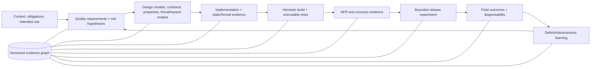

# Appendix A — Enterprise Control Architecture and Reference Pipelines

## A.1 Closed-loop quality control system



The control loop has three authorities that must remain distinct: engineering mechanisms produce evidence; policy evaluates evidence against versioned decision rules; an accountable role accepts residual risk. Automation may perform a decision whose authority has already been delegated by policy, but a test runner, scanner, model judge, dashboard, or deployment controller is never its own risk owner.

## A.2 Cross-track dependency matrix

| Producer | Downstream consumer | Required interface | Failure when disconnected |
|---|---|---|---|
| Quality/risk model (Ch. 1, 17) | Every assurance track | Requirement/risk ID, population, threshold, uncertainty, owner | Activity volume substitutes for a decision claim |
| Behavioral models (Ch. 2–3) | Contracts, test generation, runtime verification | State/transition/property identity and coverage semantics | Generated tests lack a traceable oracle |
| Static/formal verification (Ch. 4) | Developer feedback, CI, security | Finding identity, rule/version, proof assumptions, code/config scope | “No findings” is presented as defect absence |
| Test-data governance (Ch. 18) | Static verification (Ch. 4) | Fixture sensitivity labels, synthetic/masked provenance, allowed flows, retention | Taint/secret rules cannot distinguish permitted synthetic fixtures from leaked production data |
| Test-data governance (Ch. 18) | Contracts/PBT (Ch. 5), CI (Ch. 6), AI evaluation (Ch. 15–16) | Schema/lineage, representativeness, constraint preservation, access purpose | Privacy-safe data are statistically useless, or realistic data are unlawfully exposed |
| Hermetic build identity (Ch. 6) | All dynamic evidence | Source, dependency, toolchain, image, config, fixture and environment digests | Results cannot be reproduced or attached to the shipped artifact |
| Suite-trust service (Ch. 7) | Release gate and economics | Selection basis, flake posterior, retry history, shard/attempt IDs | Red builds are ignored or green retries hide defects |
| Observability contract (Ch. 13) | Performance/resilience, canary, incident metrics | Semantic schema, context propagation, sampling/loss, release/cohort identity | Field comparison and causal diagnosis are invalid |
| Data integrity controls (Ch. 12) | Rollback, shadowing, audit | Reconciliation invariants, migration phase, state snapshot, idempotency | Binary rollback is claimed while data remain irreversibly changed |
| Production experiment (Ch. 14) | Regression models, metrics/economics | Stable assignment, control/treatment, missingness, effect interval, decision | Traffic becomes exposure without learning |
| AI/agent assurance (Ch. 15–16) | Governance and operating model | Versioned configuration, estimand, risk suite, trajectory/side effects, human authority | Benchmark score silently grants autonomy |
| Defect/risk/economic ledger (Ch. 17) | Portfolio planning and test impact | Root cause, escape boundary, exposure, consequence, evidence provenance | Metrics are gamed and assurance investment cannot be evaluated |

## A.3 Vendor-neutral reference pipeline

```yaml
quality_pipeline: 2026.1
identity:
  bind: [source_commit, dependency_lock, toolchain, build_image, artifact_digest]
context:
  require: [intended_use, risk_register, quality_requirements, obligations]
stages:
  - name: precommit
    controls: [format, type_effect, secret_scan, focused_unit_property]
    evidence_ttl: 30d
  - name: pull_request
    controls: [review, static_dataflow, contract, impacted_tests, mutation_sample]
    require_independent_oracle_for: [critical_business_rule, security_control]
  - name: hermetic_ci
    network: deny_by_default
    environment: ephemeral
    controls: [full_unit, integration, schema_migration, fixture_policy, suite_trust]
  - name: qualification
    controls: [performance, resilience_recovery, security_dynamic, accessibility, data_reconciliation]
    production_shaped_data: governed
  - name: release
    strategy: progressive
    require: [artifact_attestation, compatibility, rollback_rehearsal, evidence_completeness]
    verdicts: [pass, hold, fail]
  - name: operate
    controls: [synthetic, runtime_invariants, field_quality, incident_learning]
decision:
  fail_closed_on: [critical_invariant, unauthorized_side_effect, evidence_tamper]
  pause_on: [missing_data, cohort_imbalance, uncertain_rollback, inconclusive_statistics]
  exceptions: {owner_required: true, expiry_required: true, compensating_control_required: true}
evidence:
  append_only: true
  minimum: [claim_id, risk_id, artifact, environment, method, oracle, raw_result, uncertainty, limitations, disposition]
```

This is a reference information architecture, not a universal gate order. A medical device, payment rail, game, internal tool, and public information site require different independence, retention, evidence, and exposure policy. Tailoring is itself a controlled decision with rationale.

## A.4 Release decision packet

The minimum packet contains: decision scope and artifact; intended/prohibited use; applicable obligations; quality/risk claims; evidence coverage and gaps; open defects/exceptions; uncertainty and data completeness; migration and rollback state; canary/shadow plan; accountable approvers; compensating controls and expiry; field thresholds; and immutable evidence links. The packet records why release is acceptable, not merely which jobs ran.

# Appendix B — Formula and Statistical-Method Reference

| Concept | Expression | Preconditions and interpretation |
|---|---|---|
| Expected risk/loss | \(E[L]=\sum_i p_iC_i\) | Scenarios and dependencies are defined; ordinal scores are not probabilities |
| Value of information | \(E[\max_a EU(a\mid E)]-\max_a EU(a)-Cost(E)\) | Evidence can change a choice; model and sensitivity are explicit |
| Equivalence coverage | \(C_{EP}=\lvert P_{hit}\rvert/\lvert P_{required}\rvert\) | Partitions are justified and infeasible regions recorded |
| State-transition coverage | \(C_T=\lvert T_{executed}\rvert/\lvert T_{required}\rvert\) | Model/version and feasible paths are explicit |
| t-way interaction universe | \(\sum_{I,|I|=t}\prod_{i\in I}v_i\) | Unconstrained parameter domains; constraints reduce feasible tuples |
| Mutation score | \(K/(M-E)\) | Equivalent/invalid mutants \(E\) are handled and killing oracle is meaningful |
| Property-test miss probability | \((1-p)^n\) | IID draws with failure-region probability \(p\); biased generators invalidate claim |
| APFD | \(1-\frac{\sum_iTF_i}{nm}+\frac{1}{2n}\) | Known fault set and first-detection positions; historical estimate, not future guarantee |
| Utilization | \(\rho=\lambda/(c\mu)\) | Stationary arrival/service assumptions; tail behavior and bottlenecks still measured |
| Little's law | \(L=\lambda W\) | Stable conserved system over matching boundary/window |
| Exponential reliability | \(R(t)=e^{-\lambda t}\) | Constant independent failure rate—often only a local approximation |
| Availability | \(uptime/(uptime+downtime)\) | Service boundary, exclusions, and clock semantics declared |
| Recovery point | \(RPO=t_{failure}-t_{newest\ recoverable}\) | Restore is also semantically reconciled, not merely readable |
| Reconciliation discrepancy | \(\Delta_k=T_k-S_k\) | Key/field/currency/time semantics and tolerances fixed before migration |
| Canary effect | \(E[Y\mid candidate]-E[Y\mid control]\) | Stable comparable cohorts, complete outcomes, predeclared window/metric |
| Benchmark-conditional mean | \(n^{-1}\sum_iE_r[Y_{ir}\mid i,\theta]\) | Repeats cluster within items; claim is bound to benchmark/configuration |
| Strict agent consistency | \(n^{-1}\sum_i\mathbf1(all\ k\ runs\ pass)\) | Reports reliability across repeats; do not infer independence |
| Defect density | \(D/Size\) | Defect unit, size measure, snapshot, domain, and observation window fixed |
| DRE | \(D_{pre}/(D_{pre}+D_{post})\) | Root-cause deduplication and post-release window fixed; latent defects unknown |
| Cost of Quality | \(P+A+IF+EF\) | Allocation rules prevent double counting and modeled loss is labeled |

### B.1 Method-selection rules

- Use an interval and denominator with every estimated proportion; prefer Wilson or exact intervals for small/simple binomial samples.
- Preserve item, user, session, service, or time clustering in bootstrap or hierarchical analysis; repeats are rarely independent evidence.
- Use non-inferiority/equivalence bounds when the question is “not unacceptably worse,” not a null-difference test.
- Use sequential or anytime-valid methods for continuously observed canaries; repeated fixed-sample peeking inflates false detection.
- Control familywise or false-discovery risk when many metrics or slices can trigger a decision; separate preregistered gates from exploration.
- Report effect magnitude and uncertainty. Statistical significance neither establishes practical importance nor repairs construct bias.
- Treat control limits as process-behavior estimates and specifications as acceptability limits. One cannot replace the other.
- Use causal language only with a defensible comparison design and assumptions; prediction, correlation, and feature importance are not intervention effects.
